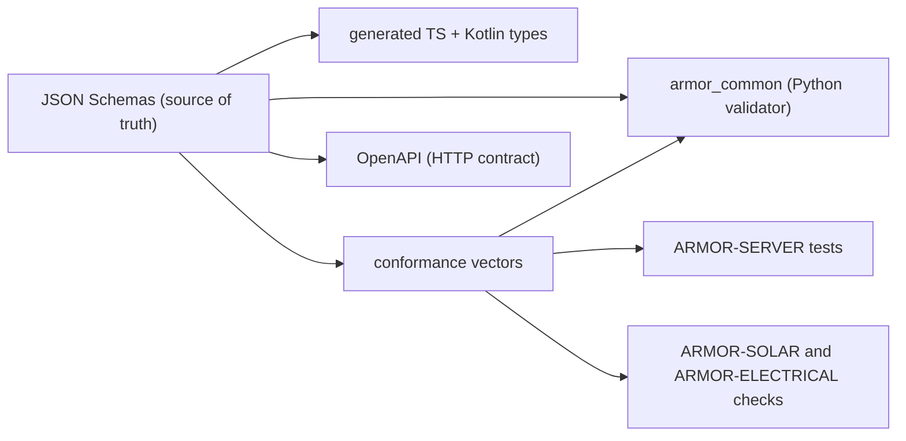

<p align="center">
  
</p>

# 🧾 ARMOR-COMMON

<p align="center">
  🇺🇸 <b>English</b> |
  <a href="README_spa.md">🇪🇸 Español</a> |
  <a href="README_fra.md">🇫🇷 Français</a> |
  <a href="README_ita.md">🇮🇹 Italiano</a> |
  <a href="README_deu.md">🇩🇪 Deutsch</a> |
  <a href="README_zho.md">🇨🇳 简体中文</a> |
  <a href="README_jpn.md">🇯🇵 日本語</a> |
  <a href="README_por.md">🇵🇹 Português</a>
</p>

### Message contracts, validation, the firmware base that the nodes share and the shared project launcher

<p align="center">
  
  
  
  
  
  
</p>

---

**Honesty check - what runs today:** The schemas (telemetry, health, command, node information, solar inverter and battery, electrical, alarm with its command and result, and network), the Python validator, the 685 conformance vectors, the generated TypeScript and Kotlin types, the OpenAPI file of the server (136 paths), the firmware base shared by the five nodes and the shared project launcher are real and tested (89 tests). The Kotlin file is generated but **not yet consumed** by ARMOR-ANDROID-CONTROL (which keeps its own parsing), and the `set_thresholds` command carries a single `sensitivity` field because the real radar parameters are not defined until firmware exists.

---

## 📋 At a glance

| | |
|---|---|
| Version | `0.7.3` |
| Maturity | Established |
| Tests | 89 (`python -m unittest discover -s tests`) and 685 conformance vectors |
| Stack | Python 3.11+ / JSON Schema / OpenAPI |
| On real hardware | Only the radar node has run on a board: its messages are the ones the CM5 server, Studio and the Android app speak every day; the messages of the other nodes are checked against stand-ins |

## 🎯 Overview

**ARMOR-COMMON** owns what every A.R.M.O.R. message means. Radar nodes, solar gateway nodes and the simulator produce these messages; the server, the visual AI and the voice service consume them. If two projects disagree about a field, this repository decides.

* **One source of truth:** JSON Schemas in `src/armor_common/schemas/` for telemetry, health, command, node information, the two solar messages (inverter, battery with cells and capacities), the electrical messages (readings, command, result), the alarm messages (state, command, result) and the network message. Unknown fields and impossible combinations are refused.
* **A validator that cannot skip a rule:** it interprets the schema directly and refuses a schema that uses a keyword it does not implement.
* **Conformance vectors:** 685 accepted and rejected payloads run by every implementation (Python here, TypeScript in ARMOR-SERVER, the checks of the firmware repositories), so drift fails a build.
* **Generated clients:** TypeScript and Kotlin types come from the schemas (`tools/generate_types.py --check` keeps them current).
* **HTTP contract:** `openapi/armor-server.yaml` describes every server route (163 paths, 215 operations), its access rule, and a named schema for every request body, answer and error, and a test checks that the routes the server registers are exactly the ones it describes (method and path).
* **Firmware base:** `firmware_base/` keeps each file the five nodes share (network, settings and users, web panel server and login, HTTPS certificate, log, Bluetooth with PIN pairing, signed-update check; relays and Zigbee for the nodes that have them) once; `tools/sync_firmware_base.py` writes it into every node and checks that no copy drifted ([the guide](docs/FIRMWARE_BASE.md), [signed firmware](docs/SIGNED_FIRMWARE.md)).
* **Shared launcher:** `tools/armor_project_tool.py` gives every repository of the family the same `build`, `build-test` and `run` workflow, and `tools/armor_ci_validate.py` the same CI checks.
* **Optional TLS link to the broker in the shared node base:** `firmware_base` carries the `mqtt.tls` switch and the `mqtt.ca_pem` text (one PEM certificate, at most 2 KB, validated), the connection that trusts that authority only and checks the broker's name, and the host tests shared by the five nodes; off by default.
* **Node health and arming profiles:** the `node_health` message (the same report from a radar, a solar, an electrical, an alarm or a wall-panel node) and the `arm_profile` (a named way of arming: which zones guard, the delays, the siren and how loudly the server tells people, carried inside the arm command) have their schemas, conformance vectors, generated TypeScript and Kotlin types, OpenAPI routes and the shared firmware code that builds the report.
* **Connection and system events of the history:** the schemas `connection_event`, `system_event` and `connection_client` (what the server's history says about the clients that connect and about the system itself, with a fixed vocabulary and no field where a secret could go), their conformance vectors, the generated TypeScript and Kotlin types and the OpenAPI route that lists the clients.

## 🧩 Role in A.R.M.O.R.

ARMOR-COMMON is what keeps the family speaking the same language. Every message between a node and [ARMOR-SERVER](https://github.com/JuanenRac/ARMOR-SERVER) is defined here once, with the vectors that every implementation must pass; the server's HTTP contract lives here too; and the firmware that the five nodes share ([ARMOR-RADAR](https://github.com/JuanenRac/ARMOR-RADAR), [ARMOR-SOLAR](https://github.com/JuanenRac/ARMOR-SOLAR), [ARMOR-ELECTRICAL](https://github.com/JuanenRac/ARMOR-ELECTRICAL), [ARMOR-ALARM](https://github.com/JuanenRac/ARMOR-ALARM), [ARMOR-HMI](https://github.com/JuanenRac/ARMOR-HMI)) is kept once and copied into them by a tool. It holds no secret and runs nothing in production.

## 🔄 Architecture



## 📂 Repository Structure

```text
ARMOR-COMMON/
├── src/armor_common/   contracts, schema (validator), envelope, schemas/*.json (the node messages, the alarm, electrical and network ones, the relay, zone-feed, alert and orders ones)
├── conformance/        accepted and rejected payloads shared by every implementation
├── firmware_base/      the firmware that the five nodes share, once (synced into each by tools/sync_firmware_base.py)
├── generated/          TypeScript and Kotlin types (generated, do not edit)
├── openapi/            armor-server.yaml
├── tools/              armor_project_tool.py, generate_types.py, make_conformance.py, sync_firmware_base.py, release_firmware.py, firmware_sign.mjs
├── tests/              unit tests and conformance runner
└── docs/               contracts guide, the shared firmware base
```

## 🛠️ Development Environment

**Requirements:** Python 3.11+

```powershell
python -m pip install -e .
python -m unittest discover -s tests      # 89 tests, 685 conformance vectors
python tools/generate_types.py --check    # generated types are current
python tools/make_conformance.py          # regenerate the vectors after editing the case list (--check: they are current)
python tools/sync_firmware_base.py check  # the firmware the node projects share has not drifted (see docs/FIRMWARE_BASE.md)
```

Broker topics: `armor/node/{node_id}/telemetry | health | command | info`, `armor/solar/{node_id}/{device}/state`, `armor/electrical/{node_id}/state | command | result`, `armor/alarm/{node_id}/state | command | result` and `armor/network/{node_id}/state`. See the [contracts guide](docs/CONTRACTS.md). The shared launcher creates an ignored `.env` on the first ARMOR-SERVER run with random secrets and a random administrator password; nothing is printed or committed.

## 🔗 Related Projects

**A.R.M.O.R.** (Autonomous Radar & Multimodal Observation Range) is a perimeter-security system made of independent repositories. Each one has its own version, its own tests and its own README; this is the family:

* **ARMOR-COMMON** (this repository) - Message contracts, validators, conformance vectors and generated types
* **[ARMOR-RADAR](https://github.com/JuanenRac/ARMOR-RADAR)** - Field-node firmware for ESP32-S3 with three radars and its own web panel
* **[ARMOR-SOLAR](https://github.com/JuanenRac/ARMOR-SOLAR)** - Solar inverter and battery protocols and the messages of a gateway node
* **[ARMOR-ELECTRICAL](https://github.com/JuanenRac/ARMOR-ELECTRICAL)** - Electrical node: meters, the message of the network's readings and the rules for switching
* **[ARMOR-ALARM](https://github.com/JuanenRac/ARMOR-ALARM)** - Alarm node and panel: zones, arming, delays, siren and PIN, with the server or without it
* **[ARMOR-HMI](https://github.com/JuanenRac/ARMOR-HMI)** - Touch panel: the state of the system on a wall screen, arming and acknowledging, and the home of the voice assistant
* **[ARMOR-NETWORK](https://github.com/JuanenRac/ARMOR-NETWORK)** - The local network: its devices, the internet and what changes
* **[ARMOR-SERVER](https://github.com/JuanenRac/ARMOR-SERVER)** - Central coordinator: telemetry, alarms, devices, solar readings and cameras
* **[ARMOR-STUDIO](https://github.com/JuanenRac/ARMOR-STUDIO)** - Web console: cameras, radar, alarms, solar energy and the 2D/3D site designer
* **[ARMOR-ANDROID-CONTROL](https://github.com/JuanenRac/ARMOR-ANDROID-CONTROL)** - Android operator client with a live 2D/3D radar
* **[ARMOR-SERVER-AI](https://github.com/JuanenRac/ARMOR-SERVER-AI)** - Visual inference policy that explains its decisions and never actuates
* **[ARMOR-VISION](https://github.com/JuanenRac/ARMOR-VISION)** - Camera zones, masks and detection rules for the Jetson Orin NX
* **[ARMOR-VOICE-AI](https://github.com/JuanenRac/ARMOR-VOICE-AI)** - Offline voice intents with a confirmation that cannot be forged
* **[ARMOR-HARDWARE](https://github.com/JuanenRac/ARMOR-HARDWARE)** - Enclosures, electronics and the bench acceptance matrix
* **[ARMOR-DEVOPS](https://github.com/JuanenRac/ARMOR-DEVOPS)** - Deployment, the CM5 test bench, backup and TLS
* **[ARMOR-SIMULATOR](https://github.com/JuanenRac/ARMOR-SIMULATOR)** - Offline telemetry simulator with repeatable faults
* **[ARMOR-UPDATER](https://github.com/JuanenRac/ARMOR-UPDATER)** - Detects, installs and updates the ecosystem's own repositories
* **[ARMOR-DOCS](https://github.com/JuanenRac/ARMOR-DOCS)** - Architecture, security baseline and the capability matrix

## 📚 Documentation & Community

Where to read more:

* [Capability matrix: what is proven and what is not](https://github.com/JuanenRac/ARMOR-DOCS/blob/main/docs/CAPABILITY_MATRIX.md)
* [Project catalogue: versions and how the repositories depend on each other](https://github.com/JuanenRac/ARMOR-DOCS/blob/main/docs/PROJECT_CATALOG.md)
* [Changelog of this repository](CHANGELOG.md)
* [License (GPL-3.0-or-later)](LICENSE)
* Questions, ideas and reports: electrohobby3d@gmail.com

## 👤 AUTHOR

**JuanenRac (Electro Hobby 3D)** · electrohobby3d@gmail.com

## 📜 LICENSE

GPL-3.0-or-later - see [LICENSE](LICENSE).
