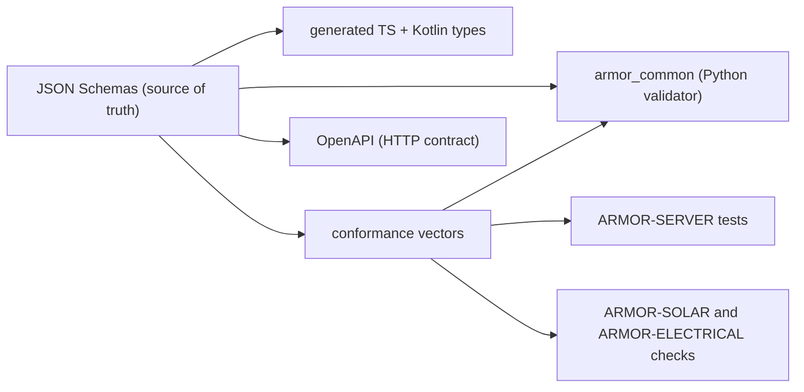

<p align="center">
  
</p>

# 🧾 ARMOR-COMMON

<p align="center">
  <a href="README.md">🇺🇸 English</a> |
  <a href="README_spa.md">🇪🇸 Español</a> |
  <a href="README_fra.md">🇫🇷 Français</a> |
  <a href="README_ita.md">🇮🇹 Italiano</a> |
  🇩🇪 <b>Deutsch</b> |
  <a href="README_zho.md">🇨🇳 简体中文</a> |
  <a href="README_jpn.md">🇯🇵 日本語</a> |
  <a href="README_por.md">🇵🇹 Português</a>
</p>

### Nachrichtenverträge, Validierung, die von den Knoten geteilte Firmware-Basis und der gemeinsame Projektstarter

<p align="center">
  
  
  
  
  
  
</p>

---

**Ehrlichkeitsprüfung - was heute läuft:** Die Schemas (Telemetrie, Zustand, Befehl, Knoteninformation, Solar-Wechselrichter und -Batterie, Elektro, Alarm mit Befehl und Ergebnis sowie Netzwerk), der Python-Validator, die 685 Konformitätsvektoren, die erzeugten TypeScript- und Kotlin-Typen, die OpenAPI-Datei des Servers (136 Pfade), die von den fünf Knoten geteilte Firmware-Basis und der gemeinsame Projektstarter sind real und getestet (89 Tests). Die Kotlin-Datei wird erzeugt, aber **noch nicht verwendet** von ARMOR-ANDROID-CONTROL (das sein eigenes Parsen behält), und der Befehl `set_thresholds` trägt nur ein Feld `sensitivity`, weil die echten Radarparameter erst definiert sind, wenn Firmware existiert.

---

## 📋 Auf einen Blick

| | |
|---|---|
| Version | `0.6.9` |
| Reifegrad | Etabliert |
| Tests | 89 (`python -m unittest discover -s tests`) and 685 conformance vectors |
| Technik | Python 3.11+ / JSON Schema / OpenAPI |
| Auf echter Hardware | Nur der Radarknoten hat auf einer Platine gelaufen: Seine Nachrichten sind die, die der CM5-Server, Studio und die Android-App täglich sprechen; die Nachrichten der anderen Knoten werden gegen Ersatz geprüft |

## 🎯 Überblick

**ARMOR-COMMON** besitzt die Bedeutung jeder A.R.M.O.R.-Nachricht. Radarknoten, Solar-Gateway-Knoten und der Simulator erzeugen diese Nachrichten; der Server, die visuelle KI und der Sprachdienst verbrauchen sie. Wenn zwei Projekte über ein Feld uneins sind, entscheidet dieses Repository.

* **Eine einzige Quelle der Wahrheit:** JSON-Schemas in `src/armor_common/schemas/` für Telemetrie, Zustand, Befehl, Knoteninformation, die beiden Solar-Nachrichten (Wechselrichter, Batterie mit Zellen und Kapazitäten), die Elektro-Nachrichten (Messwerte, Befehl, Ergebnis), die Alarmnachrichten (Zustand, Befehl, Ergebnis) und die Netzwerknachricht. Unbekannte Felder und unmögliche Kombinationen werden abgelehnt.
* **Ein Validator, der keine Regel überspringen kann:** er interpretiert das Schema direkt und lehnt ein Schema ab, das ein nicht implementiertes Schlüsselwort verwendet.
* **Konformitätsvektoren:** 685 akzeptierte und abgelehnte Nutzlasten, von jeder Implementierung ausgeführt (hier Python, TypeScript in ARMOR-SERVER, die Prüfungen der Firmware-Repositories), sodass eine Abweichung einen Build scheitern lässt.
* **Erzeugte Clients:** TypeScript- und Kotlin-Typen entstehen aus den Schemas (`tools/generate_types.py --check` hält sie aktuell).
* **HTTP-Vertrag:** `openapi/armor-server.yaml` beschreibt jede Route des Servers (163 Pfade, 215 Operationen), ihre Zugriffsregel und ein benanntes Schema für jeden Anfragekörper, jede Antwort und jeden Fehler, und ein Test prüft, dass die vom Server registrierten Routen genau die beschriebenen sind (Methode und Pfad).
* **Firmware-Basis:** `firmware_base/` hält jede von den fünf Knoten geteilte Datei einmal (Netzwerk, Einstellungen und Benutzer, Panel-Server und Login, HTTPS-Zertifikat, Log, Bluetooth mit PIN-Kopplung, Prüfung signierter Updates; Relais und Zigbee in den Knoten, die sie haben); `tools/sync_firmware_base.py` schreibt sie in jeden Knoten und prüft, dass keine Kopie abweicht ([die Anleitung](docs/FIRMWARE_BASE.md), [signierte Firmware](docs/SIGNED_FIRMWARE.md)).
* **Gemeinsamer Starter:** `tools/armor_project_tool.py` gibt jedem Repository der Familie denselben Ablauf `build`, `build-test` und `run`, und `tools/armor_ci_validate.py` dieselben CI-Prüfungen.
* **Optionale TLS-Verbindung zum Broker in der gemeinsamen Knotenbasis:** `firmware_base` enthält den Schalter `mqtt.tls` und den Text `mqtt.ca_pem` (ein PEM-Zertifikat, höchstens 2 KB, geprüft), die Verbindung, die nur dieser Stelle vertraut und den Namen des Brokers prüft, und die Host-Tests, die sich die fünf Knoten teilen; standardmäßig aus.
* **Zustand der Knoten und Scharfschaltprofile:** Die Nachricht `node_health` (derselbe Bericht von einem Radar-, Solar-, Elektro-, Alarm- oder Wandpanel-Knoten) und das `arm_profile` (eine benannte Art des Scharfschaltens: welche Zonen überwachen, die Verzögerungen, die Sirene und wie nachdrücklich der Server informiert, im Scharfschaltbefehl) haben ihre Schemas, Konformitätsvektoren, erzeugte TypeScript- und Kotlin-Typen, OpenAPI-Routen und den gemeinsamen Firmware-Code, der den Bericht baut.
* **Verbindungs- und Systemereignisse des Verlaufs:** die Schemas `connection_event`, `system_event` und `connection_client` (was der Verlauf des Servers über die sich verbindenden Clients und über das System selbst sagt, mit festem Vokabular und ohne Feld, in dem ein Geheimnis stehen könnte), ihre Konformitätsvektoren, die erzeugten TypeScript- und Kotlin-Typen und die OpenAPI-Route, die die Clients auflistet.

## 🧩 Rolle in A.R.M.O.R.

ARMOR-COMMON sorgt dafür, dass die Familie dieselbe Sprache spricht. Jede Nachricht zwischen einem Knoten und [ARMOR-SERVER](https://github.com/JuanenRac/ARMOR-SERVER) ist hier einmal definiert, mit den Vektoren, die jede Implementierung bestehen muss; hier lebt auch der HTTP-Vertrag des Servers; und die Firmware, die die fünf Knoten teilen ([ARMOR-RADAR](https://github.com/JuanenRac/ARMOR-RADAR), [ARMOR-SOLAR](https://github.com/JuanenRac/ARMOR-SOLAR), [ARMOR-ELECTRICAL](https://github.com/JuanenRac/ARMOR-ELECTRICAL), [ARMOR-ALARM](https://github.com/JuanenRac/ARMOR-ALARM), [ARMOR-HMI](https://github.com/JuanenRac/ARMOR-HMI)), wird einmal gehalten und von einem Werkzeug in sie kopiert. Es enthält kein Geheimnis und führt nichts in Produktion aus.

## 🔄 Architektur



## 📂 Struktur des Repositorys

```text
ARMOR-COMMON/
├── src/armor_common/   contracts, schema (validator), envelope, schemas/*.json (the node messages, the alarm, electrical and network ones, the relay, zone-feed, alert and orders ones)
├── conformance/        accepted and rejected payloads shared by every implementation
├── firmware_base/      the firmware that the five nodes share, once (synced into each by tools/sync_firmware_base.py)
├── generated/          TypeScript and Kotlin types (generated, do not edit)
├── openapi/            armor-server.yaml
├── tools/              armor_project_tool.py, generate_types.py, make_conformance.py, sync_firmware_base.py, release_firmware.py, firmware_sign.mjs
├── tests/              unit tests and conformance runner
└── docs/               contracts guide, the shared firmware base
```

## 🛠️ Entwicklungsumgebung

**Voraussetzungen:** Python 3.11+

```powershell
python -m pip install -e .
python -m unittest discover -s tests      # 89 tests, 685 conformance vectors
python tools/generate_types.py --check    # generated types are current
python tools/make_conformance.py          # regenerate the vectors after editing the case list (--check: they are current)
python tools/sync_firmware_base.py check  # the firmware the node projects share has not drifted (see docs/FIRMWARE_BASE.md)
```

Broker-Themen: `armor/node/{node_id}/telemetry | health | command | info`, `armor/solar/{node_id}/{device}/state`, `armor/electrical/{node_id}/state | command | result`, `armor/alarm/{node_id}/state | command | result` und `armor/network/{node_id}/state`. Siehe den [Vertragsleitfaden](docs/CONTRACTS.md). Der gemeinsame Starter legt beim ersten Start von ARMOR-SERVER eine ignorierte `.env` mit zufälligen Geheimnissen und einem zufälligen Administratorpasswort an; nichts wird ausgegeben oder eingecheckt.

## 🔗 Verwandte Projekte

**A.R.M.O.R.** (Autonomous Radar & Multimodal Observation Range) ist ein Perimeter-Sicherheitssystem aus unabhängigen Repositorys. Jedes hat eine eigene Version, eigene Tests und ein eigenes README; hier ist die Familie:

* **ARMOR-COMMON** (dieses Repository) - Nachrichtenverträge, Validierer, Konformitätsvektoren und generierte Typen
* **[ARMOR-RADAR](https://github.com/JuanenRac/ARMOR-RADAR)** - Feldknoten-Firmware für ESP32-S3 mit drei Radaren und eigenem Web-Panel
* **[ARMOR-SOLAR](https://github.com/JuanenRac/ARMOR-SOLAR)** - Protokolle für Solar-Wechselrichter und -Batterien und die Nachrichten eines Gateway-Knotens
* **[ARMOR-ELECTRICAL](https://github.com/JuanenRac/ARMOR-ELECTRICAL)** - Elektroknoten: Zähler, die Nachricht der Netzmesswerte und die Regeln fürs Schalten
* **[ARMOR-ALARM](https://github.com/JuanenRac/ARMOR-ALARM)** - Alarmknoten und Alarmzentrale: Zonen, Scharfschalten, Verzögerungen, Sirene und PIN, mit dem Server oder ohne ihn
* **[ARMOR-HMI](https://github.com/JuanenRac/ARMOR-HMI)** - Touch-Panel: der Systemzustand auf einem Wandbildschirm, Scharf- und Quittieren sowie das Zuhause des Sprachassistenten
* **[ARMOR-NETWORK](https://github.com/JuanenRac/ARMOR-NETWORK)** - Das lokale Netzwerk: seine Geräte, das Internet und was sich ändert
* **[ARMOR-SERVER](https://github.com/JuanenRac/ARMOR-SERVER)** - Zentraler Koordinator: Telemetrie, Alarme, Geräte, Solarmesswerte und Kameras
* **[ARMOR-STUDIO](https://github.com/JuanenRac/ARMOR-STUDIO)** - Web-Konsole: Kameras, Radar, Alarme, Solarenergie und 2D/3D-Standortdesigner
* **[ARMOR-ANDROID-CONTROL](https://github.com/JuanenRac/ARMOR-ANDROID-CONTROL)** - Android-Bedienclient mit Live-Radar in 2D/3D
* **[ARMOR-SERVER-AI](https://github.com/JuanenRac/ARMOR-SERVER-AI)** - Visuelle Inferenzrichtlinie, die ihre Entscheidungen erklärt und nie handelt
* **[ARMOR-VISION](https://github.com/JuanenRac/ARMOR-VISION)** - Kamerazonen, Masken und Erkennungsregeln für den Jetson Orin NX
* **[ARMOR-VOICE-AI](https://github.com/JuanenRac/ARMOR-VOICE-AI)** - Offline-Sprachabsichten mit einer nicht fälschbaren Bestätigung
* **[ARMOR-HARDWARE](https://github.com/JuanenRac/ARMOR-HARDWARE)** - Gehäuse, Elektronik und die Abnahmematrix am Prüfstand
* **[ARMOR-DEVOPS](https://github.com/JuanenRac/ARMOR-DEVOPS)** - Bereitstellung, CM5-Prüfstand, Backup und TLS
* **[ARMOR-SIMULATOR](https://github.com/JuanenRac/ARMOR-SIMULATOR)** - Offline-Telemetriesimulator mit wiederholbaren Fehlern
* **[ARMOR-UPDATER](https://github.com/JuanenRac/ARMOR-UPDATER)** - Erkennt, installiert und aktualisiert die eigenen Repositories des Ökosystems
* **[ARMOR-DOCS](https://github.com/JuanenRac/ARMOR-DOCS)** - Architektur, Sicherheitsgrundlage und die Fähigkeitsmatrix

## 📚 Dokumentation und Community

Hier gibt es mehr zu lesen:

* [Fähigkeitsmatrix: was belegt ist und was nicht](https://github.com/JuanenRac/ARMOR-DOCS/blob/main/docs/CAPABILITY_MATRIX.md)
* [Projektkatalog: Versionen und wie die Repositorys voneinander abhängen](https://github.com/JuanenRac/ARMOR-DOCS/blob/main/docs/PROJECT_CATALOG.md)
* [Änderungsverlauf dieses Repositorys](CHANGELOG.md)
* [Lizenz (GPL-3.0-or-later)](LICENSE)
* Fragen, Ideen und Meldungen: electrohobby3d@gmail.com

## 👤 AUTOR

**JuanenRac (Electro Hobby 3D)** · electrohobby3d@gmail.com

## 📜 LIZENZ

GPL-3.0-or-later - siehe [LICENSE](LICENSE).
