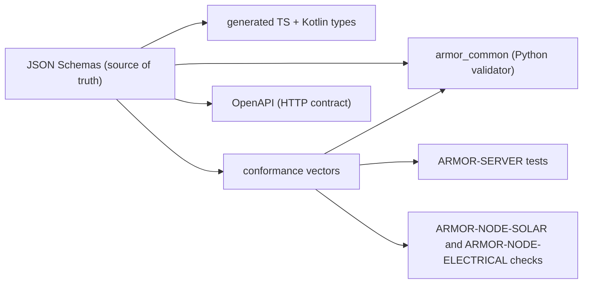

<p align="center">
  
</p>

# 🧾 ARMOR-COMMON

<p align="center">
  <a href="README.md">🇺🇸 English</a> |
  <a href="README_spa.md">🇪🇸 Español</a> |
  🇫🇷 <b>Français</b> |
  <a href="README_ita.md">🇮🇹 Italiano</a> |
  <a href="README_deu.md">🇩🇪 Deutsch</a> |
  <a href="README_zho.md">🇨🇳 简体中文</a> |
  <a href="README_jpn.md">🇯🇵 日本語</a> |
  <a href="README_por.md">🇵🇹 Português</a>
</p>

### Contrats de messages, validation, la base firmware que partagent les nœuds et le lanceur de projet partagé

<p align="center">
  
  
  
  
  
  
</p>

---

**Vérification d'honnêteté - ce qui fonctionne aujourd'hui:** Les schémas (télémétrie, santé, commande, information du nœud, onduleur et batterie solaires, électrique, alarme avec sa commande et son résultat, et réseau), le validateur Python, les 1222 vecteurs de conformité, les types TypeScript et Kotlin générés, le fichier OpenAPI du serveur (136 chemins), la base firmware partagée par les cinq nœuds et le lanceur de projet partagé sont réels et testés (156 tests). Le fichier Kotlin est généré mais **pas encore consommé** par ARMOR-ANDROID-CONTROL (qui garde sa propre lecture), et la commande `set_thresholds` porte un seul champ `sensitivity` car les vrais paramètres du radar ne sont définis que lorsque le firmware existe.

---

## 📋 En un coup d'œil

| | |
|---|---|
| Version | `0.7.5` |
| Maturité | Établi |
| Tests | 156 (`python -m unittest discover -s tests`) et 1222 vecteurs de conformité |
| Technologie | Python 3.11+ / JSON Schema / OpenAPI |
| Sur matériel réel | Seul le nœud radar a tourné sur une carte : ses messages sont ceux que parlent chaque jour le serveur CM5, Studio et l'application Android ; les messages des autres nœuds sont vérifiés contre des substituts |

## 🎯 Présentation

**ARMOR-COMMON** possède le sens de chaque message d'A.R.M.O.R. Les nœuds radar, les nœuds passerelles solaires et le simulateur produisent ces messages ; le serveur, l'IA visuelle et le service vocal les consomment. Si deux projets divergent sur un champ, ce dépôt tranche.

* **Une seule source de vérité :** schémas JSON dans `src/armor_common/schemas/` pour la télémétrie, la santé, la commande, l'information du nœud, les deux messages solaires (onduleur, batterie avec cellules et capacités), les messages électriques (mesures, commande, résultat), les messages d'alarme (état, commande, résultat) et le message réseau. Les champs inconnus et les combinaisons impossibles sont refusés.
* **Un validateur qui ne peut sauter aucune règle :** il interprète le schéma directement et refuse un schéma qui utilise un mot-clé qu'il n'implémente pas.
* **Vecteurs de conformité :** 1222 charges acceptées et refusées exécutées par chaque implémentation (Python ici, TypeScript dans ARMOR-SERVER, les vérifications des dépôts firmware), si bien qu'une dérive fait échouer une compilation.
* **Clients générés :** les types TypeScript et Kotlin viennent des schémas (`tools/generate_types.py --check` les tient à jour).
* **Contrat HTTP :** `openapi/armor-server.yaml` décrit chaque route du serveur (163 chemins, 215 opérations), sa règle d'accès et un schéma nommé pour chaque corps de requête, réponse et erreur, et un test vérifie que les routes enregistrées par le serveur sont exactement celles qu'il décrit (méthode et chemin).
* **Base firmware :** `firmware_base/` garde une seule fois chaque fichier que partagent les cinq nœuds (réseau, réglages et utilisateurs, serveur du panneau web et connexion, certificat HTTPS, journal, Bluetooth avec appairage par PIN, contrôle des mises à jour signées ; relais et Zigbee pour les nœuds qui en ont) ; `tools/sync_firmware_base.py` l'écrit dans chaque nœud et vérifie qu'aucune copie n'a dérivé ([le guide](docs/FIRMWARE_BASE.md), [firmware signé](docs/SIGNED_FIRMWARE.md)).
* **Lanceur partagé :** `tools/armor_project_tool.py` donne à chaque dépôt de la famille le même flux `build`, `build-test` et `run`, et `tools/armor_ci_validate.py` les mêmes contrôles de CI.
* **Liaison TLS facultative avec le broker dans la base commune des nœuds :** `firmware_base` porte l'interrupteur `mqtt.tls` et le texte `mqtt.ca_pem` (un certificat PEM, 2 Ko au plus, validé), la connexion qui ne fait confiance qu'à cette autorité et vérifie le nom du broker, et les tests sur ordinateur communs aux cinq nœuds ; désactivée par défaut.
* **Santé des nœuds et profils d'armement :** le message `node_health` (le même rapport d'un nœud radar, solaire, électrique, d'alarme ou de panneau mural) et le `arm_profile` (une manière nommée d'armer : quelles zones surveillent, les temporisations, la sirène et l'insistance du serveur, dans la commande d'armer) ont leurs schémas, vecteurs de conformité, types TypeScript et Kotlin générés, routes OpenAPI et le code de micrologiciel partagé qui construit le rapport.
* **Événements de connexion et de système de l'historique :** les schémas `connection_event`, `system_event` et `connection_client` (ce que l'historique du serveur dit des clients qui se connectent et du système lui-même, avec un vocabulaire fixe et aucun champ où un secret pourrait aller), leurs vecteurs de conformité, les types TypeScript et Kotlin générés et la route OpenAPI qui liste les clients.
* **Diagnostic et qualité des mesures dans le contrat :** le rapport de démarrage non propre, le vidage mémoire, le contrôle de sécurité des réglages, le paquet de diagnostic, les événements du radar et les messages du jeton de diagnostic en lecture seule ont leurs schémas, vecteurs de conformité et types générés ; un canal de compteur peut porter l'âge de sa mesure et son compteur d'erreurs, et un message d'onduleur peut nommer les valeurs que le nœud a retenues à une limite.

## 🧩 Rôle dans A.R.M.O.R.

ARMOR-COMMON est ce qui garde la famille dans la même langue. Chaque message entre un nœud et [ARMOR-SERVER](https://github.com/JuanenRac/ARMOR-SERVER) est défini ici une fois, avec les vecteurs que toute implémentation doit passer ; le contrat HTTP du serveur vit aussi ici ; et le firmware que partagent les cinq nœuds ([ARMOR-NODE-RADAR](https://github.com/JuanenRac/ARMOR-NODE-RADAR), [ARMOR-NODE-SOLAR](https://github.com/JuanenRac/ARMOR-NODE-SOLAR), [ARMOR-NODE-ELECTRICAL](https://github.com/JuanenRac/ARMOR-NODE-ELECTRICAL), [ARMOR-NODE-ALARM](https://github.com/JuanenRac/ARMOR-NODE-ALARM), [ARMOR-NODE-HMI](https://github.com/JuanenRac/ARMOR-NODE-HMI)) est gardé une fois et copié en eux par un outil. Il ne contient aucun secret et n'exécute rien en production.

## 🔄 Architecture



## 📂 Structure du dépôt

```text
ARMOR-COMMON/
├── src/armor_common/   contracts, schema (validator), envelope, schemas/*.json (the node messages, the alarm, electrical and network ones, the relay, zone-feed, alert and orders ones)
├── conformance/        accepted and rejected payloads shared by every implementation
├── firmware_base/      the firmware that the five nodes share, once (synced into each by tools/sync_firmware_base.py)
├── generated/          TypeScript and Kotlin types (generated, do not edit)
├── openapi/            armor-server.yaml
├── tools/              armor_project_tool.py, generate_types.py, make_conformance.py, sync_firmware_base.py, release_firmware.py, firmware_sign.mjs
├── tests/              unit tests and conformance runner
└── docs/               contracts guide, the shared firmware base
```

## 🛠️ Environnement de développement

**Prérequis:** Python 3.11+

```powershell
python -m pip install -e .
python -m unittest discover -s tests      # 156 tests, 1222 conformance vectors
python tools/generate_types.py --check    # generated types are current
python tools/make_conformance.py          # regenerate the vectors after editing the case list (--check: they are current)
python tools/sync_firmware_base.py check  # the firmware the node projects share has not drifted (see docs/FIRMWARE_BASE.md)
```

Sujets du broker : `armor/node/{node_id}/telemetry | health | command | info`, `armor/solar/{node_id}/{device}/state`, `armor/electrical/{node_id}/state | command | result`, `armor/alarm/{node_id}/state | command | result` et `armor/network/{node_id}/state`. Voir le [guide des contrats](docs/CONTRACTS.md). Le lanceur partagé crée un `.env` ignoré au premier lancement d'ARMOR-SERVER avec des secrets aléatoires et un mot de passe administrateur aléatoire ; rien n'est affiché ni versionné.

## 🔗 Projets liés

**A.R.M.O.R.** (Autonomous Radar & Multimodal Observation Range) est un système de sécurité périmétrique composé de dépôts indépendants. Chacun a sa propre version, ses propres tests et son propre README ; voici la famille :

* **ARMOR-COMMON** (ce dépôt) - Contrats de messages, validateurs, vecteurs de conformité et types générés
* **[ARMOR-NODE-RADAR](https://github.com/JuanenRac/ARMOR-NODE-RADAR)** - Firmware du nœud de terrain pour ESP32-S3 avec trois radars et son propre panneau web
* **[ARMOR-NODE-SOLAR](https://github.com/JuanenRac/ARMOR-NODE-SOLAR)** - Protocoles des onduleurs et batteries solaires et messages d'un nœud passerelle
* **[ARMOR-NODE-ELECTRICAL](https://github.com/JuanenRac/ARMOR-NODE-ELECTRICAL)** - Nœud électrique : compteurs, le message des mesures du réseau et les règles de commutation
* **[ARMOR-NODE-ALARM](https://github.com/JuanenRac/ARMOR-NODE-ALARM)** - Nœud et centrale d'alarme : zones, armement, temporisations, sirène et PIN, avec ou sans le serveur
* **[ARMOR-NODE-HMI](https://github.com/JuanenRac/ARMOR-NODE-HMI)** - Panneau tactile : l'état du système sur un écran mural, armer et acquitter, et la maison de l'assistant vocal
* **[ARMOR-NETWORK](https://github.com/JuanenRac/ARMOR-NETWORK)** - Le réseau local : ses appareils, internet et ce qui change
* **[ARMOR-SERVER](https://github.com/JuanenRac/ARMOR-SERVER)** - Coordinateur central : télémétrie, alarmes, appareils, relevés solaires et caméras
* **[ARMOR-STUDIO](https://github.com/JuanenRac/ARMOR-STUDIO)** - Console web : caméras, radar, alarmes, énergie solaire et concepteur de site 2D/3D
* **[ARMOR-ANDROID-CONTROL](https://github.com/JuanenRac/ARMOR-ANDROID-CONTROL)** - Client Android de l'opérateur avec radar 2D/3D en direct
* **[ARMOR-SERVER-AI](https://github.com/JuanenRac/ARMOR-SERVER-AI)** - Politique d'inférence visuelle qui explique ses décisions et n'agit jamais
* **[ARMOR-VISION](https://github.com/JuanenRac/ARMOR-VISION)** - Zones de caméra, masques et règles de détection pour la Jetson Orin NX
* **[ARMOR-VOICE-AI](https://github.com/JuanenRac/ARMOR-VOICE-AI)** - Intentions vocales hors ligne avec une confirmation impossible à falsifier
* **[ARMOR-HARDWARE](https://github.com/JuanenRac/ARMOR-HARDWARE)** - Boîtiers, électronique et matrice d'acceptation sur banc
* **[ARMOR-DEVOPS](https://github.com/JuanenRac/ARMOR-DEVOPS)** - Déploiement, banc d'essai CM5, sauvegarde et TLS
* **[ARMOR-SIMULATOR](https://github.com/JuanenRac/ARMOR-SIMULATOR)** - Simulateur de télémétrie hors ligne avec des pannes reproductibles
* **[ARMOR-UPDATER](https://github.com/JuanenRac/ARMOR-UPDATER)** - Détecte, installe et met à jour les propres dépôts de l'écosystème
* **[ARMOR-DOCS](https://github.com/JuanenRac/ARMOR-DOCS)** - Architecture, base de sécurité et matrice des capacités

## 📚 Documentation et communauté

Pour en savoir plus :

* [Matrice des capacités : ce qui est prouvé et ce qui ne l'est pas](https://github.com/JuanenRac/ARMOR-DOCS/blob/main/docs/CAPABILITY_MATRIX.md)
* [Catalogue des projets : versions et dépendances entre les dépôts](https://github.com/JuanenRac/ARMOR-DOCS/blob/main/docs/PROJECT_CATALOG.md)
* [Historique des modifications de ce dépôt](CHANGELOG.md)
* [Licence (GPL-3.0-or-later)](LICENSE)
* Questions, idées et rapports : electrohobby3d@gmail.com

## 👤 AUTEUR

**JuanenRac (Electro Hobby 3D)** · electrohobby3d@gmail.com

## 📜 LICENCE

GPL-3.0-or-later - voir [LICENSE](LICENSE).
