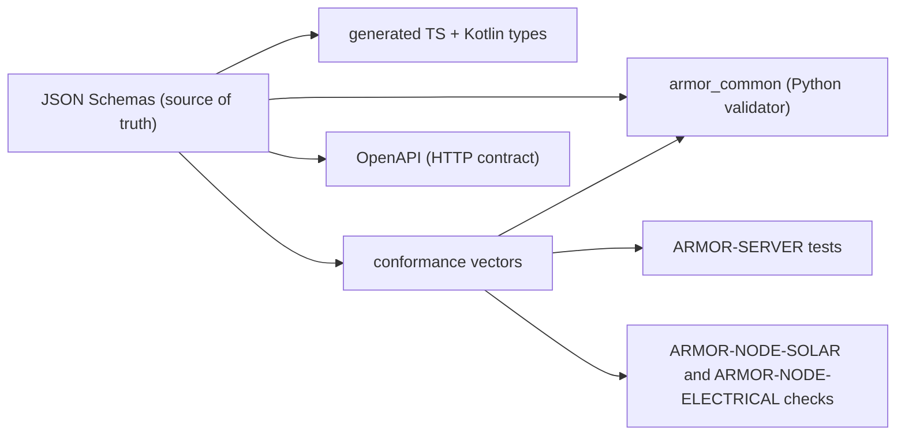

<p align="center">
  
</p>

# 🧾 ARMOR-COMMON

<p align="center">
  <a href="README.md">🇺🇸 English</a> |
  <a href="README_spa.md">🇪🇸 Español</a> |
  🇫🇷 <b>Français</b> |
  <a href="README_ita.md">🇮🇹 Italiano</a> |
  <a href="README_deu.md">🇩🇪 Deutsch</a> |
  <a href="README_zho.md">🇨🇳 简体中文</a> |
  <a href="README_jpn.md">🇯🇵 日本語</a> |
  <a href="README_por.md">🇵🇹 Português</a>
</p>

### Contrats de messages, validation, la base firmware que partagent les nœuds et le lanceur de projet partagé

<p align="center">
  
  
  
  
  
  
  
</p>

---

**Vérification d'honnêteté - ce qui fonctionne aujourd'hui :** Les schémas (télémétrie, santé, commande, information du nœud, onduleur et batterie solaires, électrique, alarme avec sa commande et son résultat, et réseau), le validateur Python, les 1270 vecteurs de conformité, les types TypeScript et Kotlin générés, le fichier OpenAPI du serveur (195 chemins), la base firmware partagée par les cinq nœuds et le lanceur de projet partagé sont réels et testés (237 tests). Le fichier Kotlin est généré mais **pas encore consommé** par ARMOR-ANDROID-CONTROL (qui garde sa propre lecture), et la commande `set_thresholds` porte un seul champ `sensitivity` car les vrais paramètres du radar ne sont définis que lorsque le firmware existe.

---

## 📋 En un coup d'œil

| | |
|---|---|
| Version | `0.7.9` |
| Maturité | Établi |
| Rôle | Contrats partagés, validateur et base de firmware de la famille |
| Technologie | Python 3.11+, JSON Schema, OpenAPI ; base de firmware C++ (ESP-IDF) |
| Tests | 237 (`python -m unittest discover -s tests`), 1270 vecteurs de conformité |
| Contrat | 35 JSON Schema, 196 chemins HTTP (255 opérations) |
| Fonctionne sur | Tout ordinateur (bibliothèque et outils) ; la base de firmware tourne dans les cinq nœuds |
| Sur matériel réel | Seul le nœud radar a exécuté le firmware partagé sur une carte ; les quatre autres non |
| Licence | GPL-3.0-or-later |

**Aller à :** [Présentation](#-présentation) · [Architecture](#-architecture) · [Fonctionnalités](#-fonctionnalités) · [Sécurité](#-sécurité-et-protection) · [Interfaces](#-interfaces) · [Configuration](#-configuration) · [Démarrage rapide](#-démarrage-rapide) · [Tests](#-tests) · [Dépannage](#-dépannage) · [Structure](#-structure-du-dépôt) · [Liés](#-projets-liés)

## 🚦 État du projet

Chaque ligne est une partie de ce dépôt et le feu dit où elle en est aujourd'hui. Elle est écrite d'après ce que le dépôt peut montrer (tests, compilations, exécutions), pas d'après ce qui est prévu.

🟢 Fait et vérifié · 🟡 Fonctionne, avec des limites connues · 🟠 À moitié fait ou pas encore vérifié · 🔴 Pas fait ou ne fonctionne pas

| Domaine | État | Ce que cela veut dire ici |
|---|---|---|
| Logiciel | 🟢 | Les schémas, le validateur Python, les types TypeScript et Kotlin générés, le fichier OpenAPI du serveur et la base de firmware partagée par les cinq nœuds sont en place. |
| Tests | 🟢 | 237 tests et 1270 vecteurs de conformité réussissent ; les analyseurs JSON, Bluetooth et Improv du firmware sont aussi soumis à du fuzzing avec libFuzzer. |
| Protocoles et données | 🟡 | Seuls les messages du nœud radar sont utilisés chaque jour avec une vraie carte et le serveur ; ceux des autres nœuds sont vérifiés par rapport à des simulations. |
| Intégration | 🟡 | On vérifie que la base de firmware est identique dans chaque nœud ; les types Kotlin sont générés mais l'application Android ne les utilise pas encore, elle garde son propre analyseur. |
| Matériel | 🟠 | Seul le nœud radar a exécuté ce firmware partagé sur une carte ; les quatre autres nœuds ne l'ont pas fait. |
| Sécurité | 🟡 | La vérification de la signature du firmware et la dérivation du PIN Bluetooth sont testées sur l'hôte ; il n'y a pas eu de revue indépendante. |
| Documentation | 🟢 | Huit langues, le fichier OpenAPI, le guide de conformité et le journal des modifications sont à jour. |

## 🎯 Présentation

**ARMOR-COMMON** possède le sens de chaque message d'A.R.M.O.R. Les nœuds radar, les nœuds passerelles solaires et le simulateur produisent ces messages ; le serveur, l'IA visuelle et le service vocal les consomment. Si deux projets divergent sur un champ, ce dépôt tranche.

* **Une seule source de vérité :** schémas JSON dans `src/armor_common/schemas/` pour la télémétrie, la santé, la commande, l'information du nœud, les deux messages solaires (onduleur, batterie avec cellules et capacités), les messages électriques (mesures, commande, résultat), les messages d'alarme (état, commande, résultat) et le message réseau. Les champs inconnus et les combinaisons impossibles sont refusés.
* **Un validateur qui ne peut sauter aucune règle :** il interprète le schéma directement et refuse un schéma qui utilise un mot-clé qu'il n'implémente pas.
* **Vecteurs de conformité :** 1270 charges acceptées et refusées exécutées par chaque implémentation (Python ici, TypeScript dans ARMOR-SERVER, les vérifications des dépôts firmware), si bien qu'une dérive fait échouer une compilation.
* **Clients générés :** les types TypeScript et Kotlin viennent des schémas (`tools/generate_types.py --check` les tient à jour).
* **Contrat HTTP :** `openapi/armor-server.yaml` décrit chaque route du serveur (195 chemins, 253 opérations), sa règle d'accès et un schéma nommé pour chaque corps de requête, réponse et erreur, et un test vérifie que les routes enregistrées par le serveur sont exactement celles qu'il décrit (méthode et chemin).
* **Base firmware :** `firmware_base/` garde une seule fois chaque fichier que partagent les cinq nœuds (réseau, réglages et utilisateurs, serveur du panneau web et connexion, certificat HTTPS, journal, Bluetooth avec appairage par PIN, contrôle des mises à jour signées ; relais et Zigbee pour les nœuds qui en ont) ; `tools/sync_firmware_base.py` l'écrit dans chaque nœud et vérifie qu'aucune copie n'a dérivé ([le guide](docs/FIRMWARE_BASE.md), [firmware signé](docs/SIGNED_FIRMWARE.md)).
* **Lanceur partagé :** `tools/armor_project_tool.py` donne à chaque dépôt de la famille le même flux `build`, `build-test` et `run`, et `tools/armor_ci_validate.py` les mêmes contrôles de CI.
* **Liaison TLS facultative avec le broker dans la base commune des nœuds :** `firmware_base` porte l'interrupteur `mqtt.tls` et le texte `mqtt.ca_pem` (un certificat PEM, 2 Ko au plus, validé), la connexion qui ne fait confiance qu'à cette autorité et vérifie le nom du broker, et les tests sur ordinateur communs aux cinq nœuds ; désactivée par défaut.
* **Santé des nœuds et profils d'armement :** le message `node_health` (le même rapport d'un nœud radar, solaire, électrique, d'alarme ou de panneau mural) et le `arm_profile` (une manière nommée d'armer : quelles zones surveillent, les temporisations, la sirène et l'insistance du serveur, dans la commande d'armer) ont leurs schémas, vecteurs de conformité, types TypeScript et Kotlin générés, routes OpenAPI et le code de micrologiciel partagé qui construit le rapport.
* **Modes d'armement :** le schéma `arming_modes` (absent, à la maison et nuit : ce que chacun défend, les temporisations de sortie et d'entrée et un calendrier facultatif), ses 42 vecteurs de conformité, le validateur de règles, les types TypeScript et Kotlin générés et les routes OpenAPI `GET` et `PUT /api/v1/alarm/modes`, les modes de `POST /api/v1/mode` et les quatre réglages qui activent le tout (désactivé par défaut).
* **Événements de connexion et de système de l'historique :** les schémas `connection_event`, `system_event` et `connection_client` (ce que l'historique du serveur dit des clients qui se connectent et du système lui-même, avec un vocabulaire fixe et aucun champ où un secret pourrait aller), leurs vecteurs de conformité, les types TypeScript et Kotlin générés et la route OpenAPI qui liste les clients.
* **Diagnostic et qualité des mesures dans le contrat :** le rapport de démarrage non propre, le vidage mémoire, le contrôle de sécurité des réglages, le paquet de diagnostic, les événements du radar et les messages du jeton de diagnostic en lecture seule ont leurs schémas, vecteurs de conformité et types générés ; un canal de compteur peut porter l'âge de sa mesure et son compteur d'erreurs, et un message d'onduleur peut nommer les valeurs que le nœud a retenues à une limite.

## 🧩 Rôle dans A.R.M.O.R.

ARMOR-COMMON est ce qui garde la famille dans la même langue. Chaque message entre un nœud et [ARMOR-SERVER](https://github.com/JuanenRac/ARMOR-SERVER) est défini ici une fois, avec les vecteurs que toute implémentation doit passer ; le contrat HTTP du serveur vit aussi ici ; et le firmware que partagent les cinq nœuds ([ARMOR-NODE-RADAR](https://github.com/JuanenRac/ARMOR-NODE-RADAR), [ARMOR-NODE-SOLAR](https://github.com/JuanenRac/ARMOR-NODE-SOLAR), [ARMOR-NODE-ELECTRICAL](https://github.com/JuanenRac/ARMOR-NODE-ELECTRICAL), [ARMOR-NODE-ALARM](https://github.com/JuanenRac/ARMOR-NODE-ALARM), [ARMOR-NODE-HMI](https://github.com/JuanenRac/ARMOR-NODE-HMI)) est gardé une fois et copié en eux par un outil. Il ne contient aucun secret et n'exécute rien en production.

| Il parle à | Comment | Pour quoi faire |
|---|---|---|
| ARMOR-SERVER | exécute les vecteurs ; implémente chaque route OpenAPI | vecteurs, OpenAPI |
| ARMOR-STUDIO | garde une copie des types générés ; un test échoue en cas de dérive | TypeScript généré |
| ARMOR-ANDROID-CONTROL | a son propre analyse ; les types Kotlin sont générés, non utilisés | Kotlin généré |
| ARMOR-NODE-RADAR, SOLAR, ELECTRICAL, ALARM, HMI | reçoivent firmware_base via `tools/sync_firmware_base.py` | firmware copié |
| ARMOR-DOCS, ARMOR-DEVOPS, ARMOR-UPDATER | lisent `registry/repositories.json`, la liste unique des dépôts | le registre |

## 🏛️ Architecture

<p align="center">
  
</p>

<details>
<summary>Version texte du diagramme (Mermaid)</summary>



</details>

## ✨ Fonctionnalités

### Ajouter ou modifier un message

1. Modifier le schéma dans `src/armor_common/schemas/` (et `docs/CONTRACTS.md` si le sens change).
2. Ajouter les cas à la liste et lancer `python tools/make_conformance.py`.
3. Lancer `python tools/generate_types.py` et `python tools/generate_rest_types.py` pour renouveler les types TypeScript et Kotlin.
4. Mettre à jour `openapi/armor-server.yaml` si une route est concernée ; `tests/test_openapi.py` le compare aux routes du serveur.
5. Le serveur et les nœuds exécutent alors les mêmes vecteurs : un désaccord fait échouer le build.

### La base de firmware

`firmware_base/` garde une seule fois chaque fichier que partagent les cinq nœuds : réseau, réglages et utilisateurs, le serveur du panneau web et sa connexion, le certificat HTTPS, le journal, le Bluetooth avec appairage par PIN, la vérification d'une mise à jour signée, le rapport de santé du nœud, le garde qui redémarre un nœud en difficulté, les ordres typés du serveur et, pour les nœuds qui en ont, relais et Zigbee. `tools/sync_firmware_base.py` l'écrit dans chaque nœud et vérifie qu'aucune copie n'a dérivé (voir [docs/FIRMWARE_BASE.md](docs/FIRMWARE_BASE.md) et [docs/SIGNED_FIRMWARE.md](docs/SIGNED_FIRMWARE.md)). Ses décisions qui n'ont pas besoin de matériel vivent dans `core/` et sont testées sur un ordinateur ; `main/` lit les vraies valeurs.

## 🔒 Sécurité et protection

| Menace | Défense |
|---|---|
| Un champ inconnu ou une combinaison impossible | `additionalProperties: false` ; le validateur interprète le schéma et refuse d'en charger un qui utilise un mot-clé non géré |
| Une télémétrie sans plafond qui épuise un nœud | Au plus 15 pistes (5 par capteur, 3 capteurs) et lux de 0 à 200 000 |
| Une commande hors liste | Liste fermée : `calibrate`, `set_thresholds` (sensibilité 1 à 10), `restart` ; l'abonné rejette le reste avant le matériel |
| Un topic qui ne correspond pas à l'identifiant de nœud du corps | Le consommateur rejette l'écart |
| Un faux firmware sur GitHub | L'image doit correspondre à son `.sha256` et porter une signature Ed25519 de ce hash, vérifiée avec la clé publique de `firmware_base/core/fw_trust.hpp` ; sinon rien ne change |
| La clé privée de publication fuit | Elle vit hors de tout dépôt, CI et publication (PKCS#8, mode 0600) ; `release_firmware.py` refuse de publier si la clé n'est pas celle que le firmware reconnaît |
| Mots de passe de nœud et PIN Bluetooth | Mots de passe : PBKDF2-HMAC-SHA256, 10 000 tours. PIN : dérivé de la MAC et du secret de flotte (`CONFIG_ARMOR_FLEET_SECRET`, vide dans le firmware public) |
| Analyseurs exposés (JSON, trames Bluetooth, Improv) | Fuzzing avec libFuzzer, AddressSanitizer et UndefinedBehaviorSanitizer (`fuzz/run_fuzz.sh`, Linux avec clang) |
| La copie d'un nœud dérive de la copie partagée | `tools/sync_firmware_base.py check` échoue si les cinq nœuds ne sont pas identiques |

**Ce qu'il ne couvre pas.** Un firmware envoyé à la main par un administrateur n'est pas vérifié. Un nœud dont le firmware précède cette vérification installe la première version signée sur son seul hash. La clé protège les versions, pas les cartes : avec un accès physique, n'importe qui peut flasher n'importe quoi. Si la clé est perdue, le programme de mise à jour GitHub reste bloqué jusqu'au remplacement de la clé publique par un envoi manuel ou par câble. La vérification de la signature et le PIN sont testés sur l'hôte ; il n'y a pas eu de revue indépendante. Plus dans [docs/SIGNED_FIRMWARE.md](docs/SIGNED_FIRMWARE.md).

## 🔌 Interfaces

### Topics du broker

| Topic | Ce qu'il porte |
|---|---|
| `armor/node/{node_id}/telemetry`  `health`  `command`  `info` | un nœud radar : pistes, santé, commandes et informations |
| `armor/solar/{node_id}/{device}/state` | un onduleur ou une batterie d'un nœud solaire |
| `armor/electrical/{node_id}/state`  `command`  `result` | le nœud électrique : mesures, commande, résultat |
| `armor/alarm/{node_id}/state`  `command`  `result` | le nœud d'alarme (aussi `zigbee` et `policy` du serveur) |
| `armor/network/{node_id}/state` | ce qu'un nœud voit sur le réseau |
| `armor/health/{node_id}` | le rapport de santé de tout nœud et son testament |
| `armor/control/{node_id}/command`  `result`  `maintenance`  and `armor/control/all/command` | ordres typés vers un nœud ou tous, leur résultat et le signal de maintenance prévue |
| `armor/device/{node_id}/{relay}/set`  `state`  `availability` | un relais d'un nœud |
| `armor/radar/{node_id}/events`  and  `armor/server/alert` | événements radar ; alertes que le serveur envoie aux panneaux |

### Schémas, vecteurs et OpenAPI

* **35 JSON Schema** dans `src/armor_common/schemas/` : télémétrie, santé, commande, informations du nœud, santé du nœud, contrôle du nœud (commande et résultat), maintenance du nœud, onduleur et batterie solaires (avec leurs commandes et résultats), électrique (avec commande et résultat), alarme (état, commande, résultat, politique et zones), réseau (avec ses ordres), événements de connexion et système, événements radar, alerte du serveur, profil d'armement, modes d'armement, état d'appareil, jetons de diagnostic et le tour de parole.
* **1270 vecteurs de conformité** dans `conformance/` (35 fichiers, un par message), exécutés par ce dépôt, par ARMOR-SERVER et par les vérifications des dépôts de firmware.
* **OpenAPI** `openapi/armor-server.yaml` : 196 chemins et 255 opérations, chacun avec sa règle d'accès et un schéma nommé pour chaque corps, réponse et erreur. Un test vérifie que les routes enregistrées par le serveur sont exactement celles décrites. Le tour de parole voyage en octets (voir [docs/CONTRACTS.md](docs/CONTRACTS.md)).

### Outils en ligne de commande

| Outil | Ce qu'il fait |
|---|---|
| `tools/armor_project_tool.py` | le flux partagé `build`, `build-test` et `run` |
| `tools/generate_types.py [--check]`  `generate_rest_types.py [--check]` | types TypeScript et Kotlin, et ceux du contrat HTTP |
| `tools/make_conformance.py [--check]` | écrit les vecteurs de conformité depuis la liste de cas |
| `tools/sync_firmware_base.py` (`check`, `sync`, `import`) | écrit `firmware_base` dans les cinq nœuds, ou vérifie qu'ils n'ont pas dérivé |
| `tools/release_firmware.py`  `tools/firmware_sign.mjs` | signe et publie une version de firmware |
| `tools/voice_cases.py` | les cas vocaux partagés avec ARMOR-VOICE-AI |
| `tools/make_architecture.py`  `tools/make_structure.py`  `tools/universal_readme_check.py` | les images et la vérification de la mise en page des README |

## ⚙️ Configuration

### Options de compilation du firmware (Kconfig)

| Réglage | Par défaut | Ce qu'il fait |
|---|---|---|
| `CONFIG_ARMOR_NODE_ID` | "" | le nom du nœud sur le broker |
| `CONFIG_ARMOR_SETUP_CODE` | "" | le code qui ouvre la configuration |
| `CONFIG_ARMOR_FLEET_SECRET` | "" | secret de flotte pour le PIN Bluetooth ; vide dans le firmware public |
| `CONFIG_ARMOR_BLE_SETUP_MINUTES` | 10 (1 to 120) | combien de temps la configuration Bluetooth reste ouverte |
| `CONFIG_ARMOR_ETH_SPI_HOST` | 1 (1 to 2) | hôte SPI de la puce Ethernet |
| `CONFIG_ARMOR_ETH_MOSI` `MISO` `SCLK` `CS` `INT` `RST` | 11, 12, 13, 14, 10, 9 | broches de la carte Ethernet (profil `s3-eth`) |
| `CONFIG_ARMOR_ETH_SPI_MHZ` | 20 (1 to 40) | horloge SPI de la puce Ethernet |
| `CONFIG_ARMOR_MQTT_URI` `USERNAME` `PASSWORD` | "" | adresse et identifiants initiaux du broker |
| `CONFIG_ARMOR_BOOT_FACTORY_RESET` | y | autorise la réinitialisation d'usine au démarrage |
| `CONFIG_ARMOR_NTP_SERVER` | pool.ntp.org | serveur de temps |
| `CONFIG_ARMOR_HEARTBEAT_S` | 10 (2 to 300) | secondes entre les battements |
| `CONFIG_ARMOR_BOARD_S3_WIFI`  `CONFIG_ARMOR_BOARD_S3_ETH` | S3_WIFI | le profil de carte de l'image (`tools/build_node.sh NODE BOARD`) |

La liaison TLS du nœud avec le broker est un réglage du nœud (pas du build) : `mqtt.tls` (désactivé par défaut) et `mqtt.ca_pem` (un certificat PEM, 2 Ko au plus, validé) ; la connexion ne fait confiance qu'à cette autorité et vérifie le nom du broker. La bibliothèque Python n'a pas de variables d'environnement propres ; le lanceur partagé crée un `.env` ignoré au premier lancement d'ARMOR-SERVER, avec des secrets aléatoires et un mot de passe administrateur aléatoire, sans rien afficher ni versionner.

## 🚀 Démarrage rapide

**Prérequis :** Python 3.11+ (aucun autre paquet). Pour vérifier la base de firmware, les dépôts des cinq nœuds doivent se trouver à côté de celui-ci.

```powershell
python -m pip install -e .                   # installe la bibliothèque
python -m unittest discover -s tests         # 237 tests, 1270 vecteurs
python tools/generate_types.py --check       # les types générés sont à jour
python tools/generate_rest_types.py --check  # les types du contrat HTTP sont à jour
python tools/make_conformance.py             # régénère les vecteurs après modification de la liste de cas (--check : à jour)
python tools/sync_firmware_base.py check     # le firmware partagé n'a pas dérivé
```

## 🧪 Tests

```powershell
python -m unittest discover -s tests  # 237 tests
python -I tools/armor_ci_validate.py
```

| Fichier de tests | Tests | Ce qu'il couvre |
|---|---|---|
| `test_contracts.py` | 68 | chaque message, topic et découpeur, avec les vecteurs de conformité |
| `test_task_safety_check.py` | 23 | le balayage qui trouve les tâches indispensables d'un nœud |
| `test_universal_readme_check.py`, `test_readme_tools.py` | 36 | la vérification de mise en page et les images des README |
| `test_firmware_base.py` | 13 | la base de firmware partagée et sa synchronisation |
| `test_openapi.py` | 13 | le fichier OpenAPI face aux routes du serveur |
| `test_release_firmware.py` | 12 | la signature et la publication du firmware |
| `test_pretty_run.py`, `test_build_scripts.py` | 11 | le panneau en direct des scripts |
| `test_generated_types.py`, `test_repository_registry.py`, `test_voice_turn.py` | 21 | les types générés, la liste des dépôts et le tour de parole |
| `test_alarm_codes.py`, `test_collect_errors.py`, `test_project_manifest_doc.py`, `test_firmware_fuzz.py`, `test_fuzz_validator.py` | 17 | mots des codes d'alarme, collecte d'erreurs, guide du manifeste et banc de fuzzing |

Les tests hôte du firmware partagé sont dans `firmware_base/tests/` (C++, sans ESP-IDF) et s'exécutent dans les vérifications des dépôts des nœuds. `python tools/sync_firmware_base.py check` a besoin des dépôts des cinq nœuds à côté de celui-ci. GitHub Actions exécute la base A.R.M.O.R. à chaque push et pull request : la validation du manifeste, de la version, du journal des modifications et de la parité des README, puis le build et les tests propres au projet.

## 🏗️ Compilation et publication

C'est du Python pur et un ensemble d'outils : rien à compiler. La version se trouve dans `pyproject.toml`, dans `armor.project.json` et dans le badge du README (lu depuis le manifeste) ; chaque version a son entrée dans [CHANGELOG.md](CHANGELOG.md). Les versions sont publiées sur GitHub. L'outil de publication de firmware (`tools/release_firmware.py`) signe et publie les images des nœuds ; la clé dont il a besoin n'est jamais dans un dépôt.

## 🩺 Dépannage

| Vous voyez | Parce que | Faites |
|---|---|---|
| `FIRMWARE_BASE=FAIL ... copies drifted` | un nœud a modifié à la main un fichier partagé | faites le changement dans `firmware_base/` et lancez `sync` ; ou `import` pour reprendre les fichiers des nœuds tels quels |
| `ARMOR-NODE-HMI: main/secret_vault.cpp is missing` | les dépôts des nœuds ne sont pas à côté d'ARMOR-COMMON | clonez-les côte à côte |
| `generated types are out of date` | un schéma ou le fichier OpenAPI a changé | lancez `generate_types.py` et `generate_rest_types.py` sans `--check` |
| `TASK_SAFETY=FAIL no task found: the scan is broken` | le balayage des sources des nœuds n'a rien trouvé | vérifiez que les dépôts des nœuds sont à côté de celui-ci |
| `no_signature`, `bad_signature`, `checksum_mismatch`, `wrong_firmware` | le nœud a refusé une version : signature, hash ou carte absents ou faux | publiez avec `tools/release_firmware.py` et la clé que le firmware reconnaît |

## 📂 Structure du dépôt

<p align="center">
  
</p>

<details>
<summary>Version texte de l'arborescence</summary>

```text
ARMOR-COMMON/
├── src/armor_common/
│   ├── contracts.py               topics et validateurs
│   ├── schema.py                  l'interpréteur de schémas
│   ├── envelope.py                l'enveloppe commune
│   ├── voice.py                   le contrat vocal
│   ├── schemas/                   35 JSON Schema
│   ├── alarm_codes.json           mots de chaque alarme
│   └── battery_ops.json           opérations de batterie
├── firmware_base/                 le firmware que les cinq nœuds partagent, une seule fois
├── conformance/                   1270 messages valides et refusés
├── generated/                     types TypeScript et Kotlin (générés, ne pas modifier)
├── openapi/                       armor-server.yaml, contrat HTTP
├── registry/                      repositories.json, liste de la famille
├── fuzz/                          cibles libFuzzer
├── scripts/                       lanceur armor-project
├── tools/                         générateurs, synchronisation et publication du firmware, lanceur, vérifications CI
├── tests/                         237 tests
├── docs/                          contrats, firmware, fuzzing
├── images/                        bannière, icône et images du README
├── .github/                       workflow CI, avis au tableau de bord, modèles d'issues et de pull requests
├── armor.project.json             manifeste : version, rôle, maturité
├── pyproject.toml                 métadonnées du paquet, entrées
├── CHANGELOG.md                   ce qui a changé à chaque version
├── run.sh run.bat                 démarrer, flux partagé
├── build.sh build.bat             construire et tester, flux partagé
├── build-test.sh build-test.bat   construire, tester, empaqueter
├── test.sh test.bat               seulement les tests, jamais la version
└── SECURITY.md SUPPORT.md CONTRIBUTING.md CODE_OF_CONDUCT.md LICENSE
```

</details>

## 🗺️ Feuille de route et limites connues

**Limites connues aujourd'hui**

* Les types Kotlin sont générés mais **pas encore utilisés** par ARMOR-ANDROID-CONTROL, qui garde sa propre analyse.
* La commande `set_thresholds` n'a qu'un champ `sensitivity` : les vrais paramètres du radar ne sont définis qu'une fois le firmware existant.
* Seul le nœud radar a exécuté le firmware partagé sur une carte ; les quatre autres non.
* Pas de revue de sécurité indépendante.

**Prochainement**

* Que l'application Android utilise les types Kotlin générés.
* Définir les vrais paramètres radar de `set_thresholds`.
* Exécuter le firmware partagé sur les cartes des quatre autres nœuds.

## 🌍 Langues

Le README et les textes existent en anglais, espagnol, français, italien, allemand, chinois, japonais et portugais européen.

## 🔗 Projets liés

**A.R.M.O.R.** (Autonomous Radar & Multimodal Observation Range) est un système de sécurité périmétrique composé de dépôts indépendants. Chacun a sa propre version, ses propres tests et son propre README ; voici la famille :

* **ARMOR-COMMON** (ce dépôt) - Contrats de messages, validateurs, vecteurs de conformité et types générés
* **[ARMOR-NODE-RADAR](https://github.com/JuanenRac/ARMOR-NODE-RADAR)** - Firmware du nœud de terrain pour ESP32-S3 avec trois radars et son propre panneau web
* **[ARMOR-NODE-SOLAR](https://github.com/JuanenRac/ARMOR-NODE-SOLAR)** - Protocoles des onduleurs et batteries solaires et messages d'un nœud passerelle
* **[ARMOR-NODE-ELECTRICAL](https://github.com/JuanenRac/ARMOR-NODE-ELECTRICAL)** - Nœud électrique : compteurs, le message des mesures du réseau et les règles de commutation
* **[ARMOR-NODE-ALARM](https://github.com/JuanenRac/ARMOR-NODE-ALARM)** - Nœud et centrale d'alarme : zones, armement, temporisations, sirène et PIN, avec ou sans le serveur
* **[ARMOR-NODE-HMI](https://github.com/JuanenRac/ARMOR-NODE-HMI)** - Panneau tactile : l'état du système sur un écran mural, armer et acquitter, et la maison de l'assistant vocal
* **[ARMOR-NETWORK](https://github.com/JuanenRac/ARMOR-NETWORK)** - Le réseau local : ses appareils, internet et ce qui change
* **[ARMOR-SERVER](https://github.com/JuanenRac/ARMOR-SERVER)** - Coordinateur central : télémétrie, alarmes, appareils, relevés solaires et caméras
* **[ARMOR-STUDIO](https://github.com/JuanenRac/ARMOR-STUDIO)** - Console web : caméras, radar, alarmes, énergie solaire et concepteur de site 2D/3D
* **[ARMOR-ANDROID-CONTROL](https://github.com/JuanenRac/ARMOR-ANDROID-CONTROL)** - Client Android de l'opérateur avec radar 2D/3D en direct
* **[ARMOR-IOS-CONTROL](https://github.com/JuanenRac/ARMOR-IOS-CONTROL)** - Client opérateur iPhone
* **[ARMOR-SERVER-AI](https://github.com/JuanenRac/ARMOR-SERVER-AI)** - Politique d'inférence visuelle qui explique ses décisions et n'agit jamais
* **[ARMOR-VISION](https://github.com/JuanenRac/ARMOR-VISION)** - Zones de caméra, masques et règles de détection pour la Jetson Orin NX
* **[ARMOR-VOICE-AI](https://github.com/JuanenRac/ARMOR-VOICE-AI)** - Intentions vocales hors ligne avec une confirmation impossible à falsifier
* **[ARMOR-HARDWARE](https://github.com/JuanenRac/ARMOR-HARDWARE)** - Boîtiers, électronique et matrice d'acceptation sur banc
* **[ARMOR-DEVOPS](https://github.com/JuanenRac/ARMOR-DEVOPS)** - Déploiement, banc d'essai CM5, sauvegarde et TLS
* **[ARMOR-SIMULATOR](https://github.com/JuanenRac/ARMOR-SIMULATOR)** - Simulateur de télémétrie hors ligne avec des pannes reproductibles
* **[ARMOR-UPDATER](https://github.com/JuanenRac/ARMOR-UPDATER)** - Détecte, installe et met à jour les propres dépôts de l'écosystème
* **[ARMOR-DOCS](https://github.com/JuanenRac/ARMOR-DOCS)** - Architecture, base de sécurité et matrice des capacités

## 📚 Documentation

* [Contrats](docs/CONTRACTS.md) : chaque message, topic et la façon de changer un contrat
* [Base de firmware](docs/FIRMWARE_BASE.md) : ce que partagent les cinq nœuds et comment c'est synchronisé
* [Firmware signé](docs/SIGNED_FIRMWARE.md) : la signature des versions et ce qu'elle ne couvre pas
* [Fuzzing](docs/FUZZING.md) : les trois cibles d'analyse et comment les lancer
* [Manifeste du projet](docs/PROJECT_MANIFEST.md) : le `armor.project.json` de chaque dépôt
* [Les images des README](docs/README_PICTURES.md) : comment Architecture et Structure du dépôt sont dessinées
* [Matrice des capacités : ce qui est prouvé et ce qui ne l'est pas](https://github.com/JuanenRac/ARMOR-DOCS/blob/main/docs/CAPABILITY_MATRIX.md)
* [Catalogue des projets : versions et dépendances entre les dépôts](https://github.com/JuanenRac/ARMOR-DOCS/blob/main/docs/PROJECT_CATALOG.md)
* [Historique des modifications de ce dépôt](CHANGELOG.md)

## 🤝 Contribuer et communauté

* Avant une pull request, exécutez `python -I tools/armor_ci_validate.py` et les tests : les deux doivent réussir. Voir [CONTRIBUTING.md](CONTRIBUTING.md) et le [code de conduite](CODE_OF_CONDUCT.md).
* Le README existe en huit langues et est généré à partir des sources d'ARMOR-DOCS : une modification du texte se fait là-bas.
* Une modification d'un message entre composants commence dans ARMOR-COMMON.
* Ne décrivez pas comme fonctionnant sur une carte ce qui a seulement été compilé.
* Signalez une vulnérabilité en privé : [SECURITY.md](SECURITY.md). Questions, idées et rapports : electrohobby3d@gmail.com ([SUPPORT.md](SUPPORT.md)).

## 👤 AUTEUR

**JuanenRac (Electro Hobby 3D)** · electrohobby3d@gmail.com

## 📜 LICENCE

GPL-3.0-or-later - voir [LICENSE](LICENSE).
