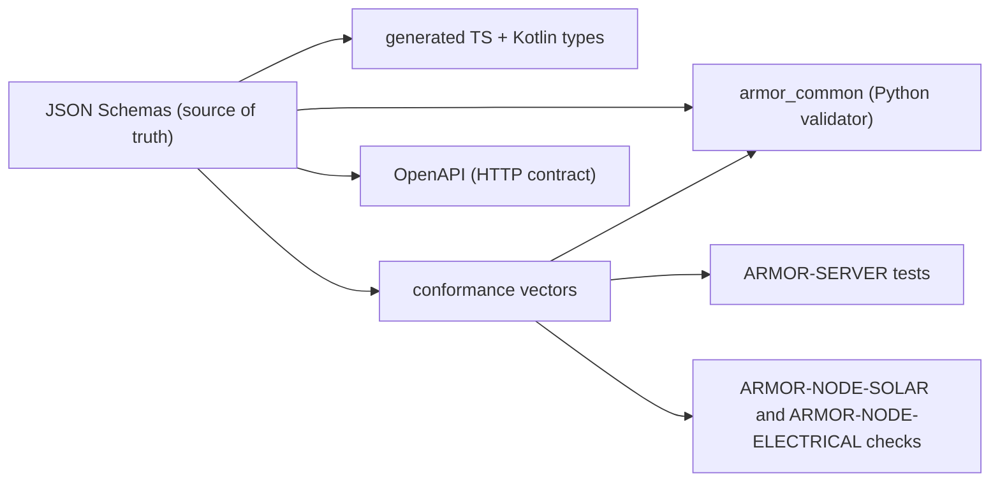

<p align="center">
  
</p>

# 🧾 ARMOR-COMMON

<p align="center">
  <a href="README.md">🇺🇸 English</a> |
  <a href="README_spa.md">🇪🇸 Español</a> |
  <a href="README_fra.md">🇫🇷 Français</a> |
  🇮🇹 <b>Italiano</b> |
  <a href="README_deu.md">🇩🇪 Deutsch</a> |
  <a href="README_zho.md">🇨🇳 简体中文</a> |
  <a href="README_jpn.md">🇯🇵 日本語</a> |
  <a href="README_por.md">🇵🇹 Português</a>
</p>

### Contratti dei messaggi, validazione, la base firmware condivisa dai nodi e il lanciatore di progetto condiviso

<p align="center">
  
  
  
  
  
  
</p>

---

**Controllo di onestà - cosa funziona oggi:** Gli schemi (telemetria, salute, comando, informazioni del nodo, inverter e batteria solari, elettrico, allarme con il suo comando e risultato, e rete), il validatore Python, i 1222 vettori di conformità, i tipi TypeScript e Kotlin generati, il file OpenAPI del server (136 percorsi), la base firmware condivisa dai cinque nodi e il lanciatore di progetto condiviso sono reali e provati (157 test). Il file Kotlin è generato ma **non ancora consumato** da ARMOR-ANDROID-CONTROL (che mantiene una propria lettura), e il comando `set_thresholds` porta un solo campo `sensitivity` perché i veri parametri del radar non sono definiti finché non esiste il firmware.

---

## 📋 In breve

| | |
|---|---|
| Versione | `0.7.5` |
| Maturità | Consolidato |
| Test | 157 (`python -m unittest discover -s tests`) e 1222 vettori di conformità |
| Tecnologia | Python 3.11+ / JSON Schema / OpenAPI |
| Su hardware reale | Solo il nodo radar ha girato su una scheda: i suoi messaggi sono quelli che parlano ogni giorno il server CM5, Studio e l'app Android; i messaggi degli altri nodi sono controllati contro sostituti |

## 🎯 Panoramica

**ARMOR-COMMON** possiede il significato di ogni messaggio di A.R.M.O.R. I nodi radar, i nodi gateway solari e il simulatore producono questi messaggi; il server, l'IA visiva e il servizio vocale li consumano. Se due progetti non concordano su un campo, decide questo repository.

* **Un'unica fonte di verità:** schemi JSON in `src/armor_common/schemas/` per telemetria, salute, comando, informazioni del nodo, i due messaggi solari (inverter, batteria con celle e capacità), i messaggi elettrici (letture, comando, risultato), i messaggi di allarme (stato, comando, risultato) e il messaggio di rete. I campi sconosciuti e le combinazioni impossibili sono rifiutati.
* **Un validatore che non può saltare una regola:** interpreta direttamente lo schema e rifiuta uno schema che usa una parola chiave che non implementa.
* **Vettori di conformità:** 1222 carichi accettati e rifiutati eseguiti da ogni implementazione (Python qui, TypeScript in ARMOR-SERVER, i controlli dei repository firmware), così una deriva fa fallire una compilazione.
* **Client generati:** i tipi TypeScript e Kotlin vengono dagli schemi (`tools/generate_types.py --check` li mantiene aggiornati).
* **Contratto HTTP:** `openapi/armor-server.yaml` descrive ogni rotta del server (163 percorsi, 215 operazioni), la sua regola di accesso e uno schema con nome per ogni corpo di richiesta, risposta ed errore, e un test verifica che le rotte registrate dal server siano esattamente quelle che descrive (metodo e percorso).
* **Base firmware:** `firmware_base/` tiene una sola volta ogni file condiviso dai cinque nodi (rete, impostazioni e utenti, server del pannello web e accesso, certificato HTTPS, registro, Bluetooth con abbinamento a PIN, controllo degli aggiornamenti firmati; relè e Zigbee per i nodi che li hanno); `tools/sync_firmware_base.py` lo scrive in ogni nodo e controlla che nessuna copia sia derivata ([la guida](docs/FIRMWARE_BASE.md), [firmware firmato](docs/SIGNED_FIRMWARE.md)).
* **Lanciatore condiviso:** `tools/armor_project_tool.py` dà a ogni repository della famiglia lo stesso flusso `build`, `build-test` e `run`, e `tools/armor_ci_validate.py` gli stessi controlli di CI.
* **Collegamento TLS facoltativo con il broker nella base comune dei nodi:** `firmware_base` porta l'interruttore `mqtt.tls` e il testo `mqtt.ca_pem` (un certificato PEM, al massimo 2 KB, validato), la connessione che si fida solo di quell'autorità e verifica il nome del broker, e i test sul computer condivisi dai cinque nodi; disattivato per impostazione predefinita.
* **Salute dei nodi e profili di inserimento:** il messaggio `node_health` (lo stesso rapporto da un nodo radar, solare, elettrico, di allarme o a pannello da parete) e l'`arm_profile` (un modo con nome di inserire: quali zone sorvegliano, i ritardi, la sirena e con quanta insistenza il server avvisa, dentro il comando di inserimento) hanno schemi, vettori di conformità, tipi TypeScript e Kotlin generati, rotte OpenAPI e il codice firmware condiviso che costruisce il rapporto.
* **Eventi di connessione e di sistema della cronologia:** gli schemi `connection_event`, `system_event` e `connection_client` (ciò che la cronologia del server dice dei client che si collegano e del sistema stesso, con un vocabolario fisso e nessun campo dove possa andare un segreto), i loro vettori di conformità, i tipi TypeScript e Kotlin generati e la rotta OpenAPI che elenca i client.
* **Diagnostica e qualità delle letture nel contratto:** il rapporto di avvio non pulito, il core dump, il controllo di sicurezza delle impostazioni, il pacchetto di diagnostica, gli eventi del radar e i messaggi del token di diagnostica in sola lettura hanno i loro schemi, vettori di conformità e tipi generati; un canale del contatore può portare l'età della sua lettura e il suo contatore di errori, e un messaggio dell'inverter può nominare i valori che il nodo ha trattenuto a un limite.

## 🧩 Ruolo in A.R.M.O.R.

ARMOR-COMMON è ciò che tiene la famiglia nella stessa lingua. Ogni messaggio fra un nodo e [ARMOR-SERVER](https://github.com/JuanenRac/ARMOR-SERVER) è definito qui una volta, con i vettori che ogni implementazione deve superare; qui vive anche il contratto HTTP del server; e il firmware che i cinque nodi condividono ([ARMOR-NODE-RADAR](https://github.com/JuanenRac/ARMOR-NODE-RADAR), [ARMOR-NODE-SOLAR](https://github.com/JuanenRac/ARMOR-NODE-SOLAR), [ARMOR-NODE-ELECTRICAL](https://github.com/JuanenRac/ARMOR-NODE-ELECTRICAL), [ARMOR-NODE-ALARM](https://github.com/JuanenRac/ARMOR-NODE-ALARM), [ARMOR-NODE-HMI](https://github.com/JuanenRac/ARMOR-NODE-HMI)) è tenuto una volta e copiato in essi da uno strumento. Non contiene alcun segreto e non esegue nulla in produzione.

## 🔄 Architettura



## 📂 Struttura del repository

```text
ARMOR-COMMON/
├── src/armor_common/   contracts, schema (validator), envelope, schemas/*.json (the node messages, the alarm, electrical and network ones, the relay, zone-feed, alert and orders ones)
├── conformance/        accepted and rejected payloads shared by every implementation
├── firmware_base/      the firmware that the five nodes share, once (synced into each by tools/sync_firmware_base.py)
├── generated/          TypeScript and Kotlin types (generated, do not edit)
├── openapi/            armor-server.yaml
├── tools/              armor_project_tool.py, generate_types.py, make_conformance.py, sync_firmware_base.py, release_firmware.py, firmware_sign.mjs
├── tests/              unit tests and conformance runner
└── docs/               contracts guide, the shared firmware base
```

## 🛠️ Ambiente di sviluppo

**Requisiti:** Python 3.11+

```powershell
python -m pip install -e .
python -m unittest discover -s tests      # 157 tests, 1222 conformance vectors
python tools/generate_types.py --check    # generated types are current
python tools/make_conformance.py          # regenerate the vectors after editing the case list (--check: they are current)
python tools/sync_firmware_base.py check  # the firmware the node projects share has not drifted (see docs/FIRMWARE_BASE.md)
```

Topic del broker: `armor/node/{node_id}/telemetry | health | command | info`, `armor/solar/{node_id}/{device}/state`, `armor/electrical/{node_id}/state | command | result`, `armor/alarm/{node_id}/state | command | result` e `armor/network/{node_id}/state`. Vedi la [guida ai contratti](docs/CONTRACTS.md). Il lanciatore condiviso crea un `.env` ignorato al primo avvio di ARMOR-SERVER con segreti casuali e una password di amministratore casuale; nulla è stampato né committato.

## 🔗 Progetti correlati

**A.R.M.O.R.** (Autonomous Radar & Multimodal Observation Range) è un sistema di sicurezza perimetrale fatto di repository indipendenti. Ognuno ha la propria versione, i propri test e il proprio README; ecco la famiglia:

* **ARMOR-COMMON** (questo repository) - Contratti dei messaggi, validatori, vettori di conformità e tipi generati
* **[ARMOR-NODE-RADAR](https://github.com/JuanenRac/ARMOR-NODE-RADAR)** - Firmware del nodo di campo per ESP32-S3 con tre radar e un proprio pannello web
* **[ARMOR-NODE-SOLAR](https://github.com/JuanenRac/ARMOR-NODE-SOLAR)** - Protocolli di inverter e batterie solari e messaggi di un nodo gateway
* **[ARMOR-NODE-ELECTRICAL](https://github.com/JuanenRac/ARMOR-NODE-ELECTRICAL)** - Nodo elettrico: contatori, il messaggio delle letture della rete e le regole di manovra
* **[ARMOR-NODE-ALARM](https://github.com/JuanenRac/ARMOR-NODE-ALARM)** - Nodo e centrale d'allarme: zone, inserimento, ritardi, sirena e PIN, con il server o senza
* **[ARMOR-NODE-HMI](https://github.com/JuanenRac/ARMOR-NODE-HMI)** - Pannello touch: lo stato del sistema su uno schermo a parete, attivare e riconoscere gli allarmi, e la casa dell'assistente vocale
* **[ARMOR-NETWORK](https://github.com/JuanenRac/ARMOR-NETWORK)** - La rete locale: i suoi dispositivi, internet e ciò che cambia
* **[ARMOR-SERVER](https://github.com/JuanenRac/ARMOR-SERVER)** - Coordinatore centrale: telemetria, allarmi, dispositivi, letture solari e telecamere
* **[ARMOR-STUDIO](https://github.com/JuanenRac/ARMOR-STUDIO)** - Console web: telecamere, radar, allarmi, energia solare e progettista del sito 2D/3D
* **[ARMOR-ANDROID-CONTROL](https://github.com/JuanenRac/ARMOR-ANDROID-CONTROL)** - Client Android dell'operatore con radar 2D/3D in tempo reale
* **[ARMOR-IOS-CONTROL](https://github.com/JuanenRac/ARMOR-IOS-CONTROL)** - Client operatore per iPhone
* **[ARMOR-SERVER-AI](https://github.com/JuanenRac/ARMOR-SERVER-AI)** - Politica di inferenza visiva che spiega le sue decisioni e non agisce mai
* **[ARMOR-VISION](https://github.com/JuanenRac/ARMOR-VISION)** - Zone delle telecamere, maschere e regole di rilevamento per la Jetson Orin NX
* **[ARMOR-VOICE-AI](https://github.com/JuanenRac/ARMOR-VOICE-AI)** - Intenti vocali offline con una conferma impossibile da falsificare
* **[ARMOR-HARDWARE](https://github.com/JuanenRac/ARMOR-HARDWARE)** - Contenitori, elettronica e matrice di accettazione da banco
* **[ARMOR-DEVOPS](https://github.com/JuanenRac/ARMOR-DEVOPS)** - Distribuzione, banco di prova CM5, backup e TLS
* **[ARMOR-SIMULATOR](https://github.com/JuanenRac/ARMOR-SIMULATOR)** - Simulatore di telemetria offline con guasti ripetibili
* **[ARMOR-UPDATER](https://github.com/JuanenRac/ARMOR-UPDATER)** - Rileva, installa e aggiorna i repository stessi dell'ecosistema
* **[ARMOR-DOCS](https://github.com/JuanenRac/ARMOR-DOCS)** - Architettura, base di sicurezza e matrice delle capacità

## 📚 Documentazione e comunità

Dove leggere di più:

* [Matrice delle capacità: cosa è provato e cosa no](https://github.com/JuanenRac/ARMOR-DOCS/blob/main/docs/CAPABILITY_MATRIX.md)
* [Catalogo dei progetti: versioni e dipendenze tra i repository](https://github.com/JuanenRac/ARMOR-DOCS/blob/main/docs/PROJECT_CATALOG.md)
* [Cronologia delle modifiche di questo repository](CHANGELOG.md)
* [Licenza (GPL-3.0-or-later)](LICENSE)
* Domande, idee e segnalazioni: electrohobby3d@gmail.com

## 👤 AUTORE

**JuanenRac (Electro Hobby 3D)** · electrohobby3d@gmail.com

## 📜 LICENZA

GPL-3.0-or-later - vedi [LICENSE](LICENSE).
