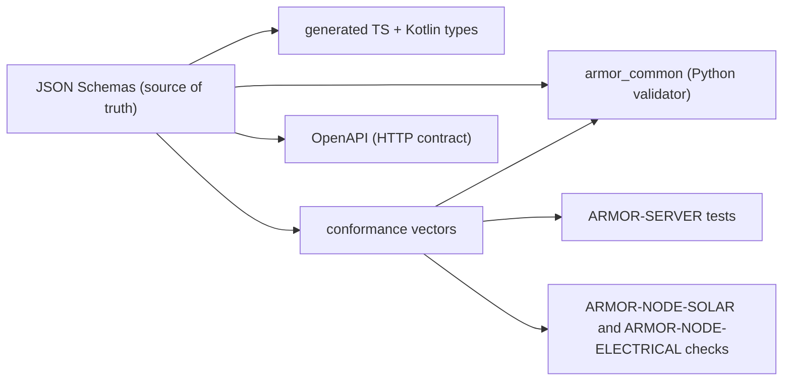

<p align="center">
  
</p>

# 🧾 ARMOR-COMMON

<p align="center">
  <a href="README.md">🇺🇸 English</a> |
  <a href="README_spa.md">🇪🇸 Español</a> |
  <a href="README_fra.md">🇫🇷 Français</a> |
  🇮🇹 <b>Italiano</b> |
  <a href="README_deu.md">🇩🇪 Deutsch</a> |
  <a href="README_zho.md">🇨🇳 简体中文</a> |
  <a href="README_jpn.md">🇯🇵 日本語</a> |
  <a href="README_por.md">🇵🇹 Português</a>
</p>

### Contratti dei messaggi, validazione, la base firmware condivisa dai nodi e il lanciatore di progetto condiviso

<p align="center">
  
  
  
  
  
  
  
</p>

---

**Controllo di onestà - cosa funziona oggi:** Gli schemi (telemetria, salute, comando, informazioni del nodo, inverter e batteria solari, elettrico, allarme con il suo comando e risultato, e rete), il validatore Python, i 1225 vettori di conformità, i tipi TypeScript e Kotlin generati, il file OpenAPI del server (191 percorsi), la base firmware condivisa dai cinque nodi e il lanciatore di progetto condiviso sono reali e provati (214 test). Il file Kotlin è generato ma **non ancora consumato** da ARMOR-ANDROID-CONTROL (che mantiene una propria lettura), e il comando `set_thresholds` porta un solo campo `sensitivity` perché i veri parametri del radar non sono definiti finché non esiste il firmware.

---

## 📋 In breve

| | |
|---|---|
| Versione | `0.7.8` |
| Maturità | Consolidato |
| Ruolo | Contratti condivisi, validatore e base firmware della famiglia |
| Tecnologia | Python 3.11+, JSON Schema, OpenAPI; base firmware in C++ (ESP-IDF) |
| Test | 214 (`python -m unittest discover -s tests`), 1225 vettori di conformità |
| Contratto | 34 JSON Schema, 191 percorsi HTTP (247 operazioni) |
| Gira su | Qualsiasi computer (libreria e strumenti); la base firmware gira dentro i cinque nodi |
| Su hardware reale | Solo il nodo radar ha eseguito il firmware condiviso su una scheda; gli altri quattro no |
| Licenza | GPL-3.0-or-later |

**Vai a:** [Panoramica](#-panoramica) · [Architettura](#-architettura) · [Funzionalità](#-funzionalità) · [Sicurezza](#-sicurezza-e-protezione) · [Interfacce](#-interfacce) · [Configurazione](#-configurazione) · [Avvio rapido](#-avvio-rapido) · [Test](#-test) · [Problemi](#-risoluzione-dei-problemi) · [Struttura](#-struttura-del-repository) · [Correlati](#-progetti-correlati)

## 🚦 Stato del progetto

Ogni riga è una parte di questo repository e il semaforo dice a che punto è oggi. È scritta in base a ciò che il repository può mostrare (test, compilazioni, esecuzioni), non a ciò che è previsto.

🟢 Fatto e verificato · 🟡 Funziona, con limiti noti · 🟠 Fatto a metà o non ancora verificato · 🔴 Non fatto o non funzionante

| Area | Stato | Cosa significa qui |
|---|---|---|
| Software | 🟢 | Gli schemi, il validatore Python, i tipi TypeScript e Kotlin generati, il file OpenAPI del server e la base firmware condivisa dai cinque nodi sono pronti. |
| Test | 🟢 | Superano 214 test e 1225 vettori di conformità; i parser JSON, Bluetooth e Improv del firmware sono sottoposti anche a fuzzing con libFuzzer. |
| Protocolli e dati | 🟡 | Solo i messaggi del nodo radar sono usati ogni giorno con una scheda reale e il server; quelli degli altri nodi sono verificati contro simulazioni. |
| Integrazione | 🟡 | Si verifica che la base firmware sia identica in ogni nodo; i tipi Kotlin sono generati ma l'app Android non li usa ancora, perché mantiene il proprio parsing. |
| Hardware | 🟠 | Solo il nodo radar ha eseguito questo firmware condiviso su una scheda; gli altri quattro nodi no. |
| Sicurezza | 🟡 | Il controllo della firma del firmware e la derivazione del PIN Bluetooth sono testati sull'host; non c'è stata una revisione indipendente. |
| Documentazione | 🟢 | Otto lingue, il file OpenAPI, la guida di conformità e il registro delle modifiche sono aggiornati. |

## 🎯 Panoramica

**ARMOR-COMMON** possiede il significato di ogni messaggio di A.R.M.O.R. I nodi radar, i nodi gateway solari e il simulatore producono questi messaggi; il server, l'IA visiva e il servizio vocale li consumano. Se due progetti non concordano su un campo, decide questo repository.

* **Un'unica fonte di verità:** schemi JSON in `src/armor_common/schemas/` per telemetria, salute, comando, informazioni del nodo, i due messaggi solari (inverter, batteria con celle e capacità), i messaggi elettrici (letture, comando, risultato), i messaggi di allarme (stato, comando, risultato) e il messaggio di rete. I campi sconosciuti e le combinazioni impossibili sono rifiutati.
* **Un validatore che non può saltare una regola:** interpreta direttamente lo schema e rifiuta uno schema che usa una parola chiave che non implementa.
* **Vettori di conformità:** 1225 carichi accettati e rifiutati eseguiti da ogni implementazione (Python qui, TypeScript in ARMOR-SERVER, i controlli dei repository firmware), così una deriva fa fallire una compilazione.
* **Client generati:** i tipi TypeScript e Kotlin vengono dagli schemi (`tools/generate_types.py --check` li mantiene aggiornati).
* **Contratto HTTP:** `openapi/armor-server.yaml` descrive ogni rotta del server (191 percorsi, 247 operazioni), la sua regola di accesso e uno schema con nome per ogni corpo di richiesta, risposta ed errore, e un test verifica che le rotte registrate dal server siano esattamente quelle che descrive (metodo e percorso).
* **Base firmware:** `firmware_base/` tiene una sola volta ogni file condiviso dai cinque nodi (rete, impostazioni e utenti, server del pannello web e accesso, certificato HTTPS, registro, Bluetooth con abbinamento a PIN, controllo degli aggiornamenti firmati; relè e Zigbee per i nodi che li hanno); `tools/sync_firmware_base.py` lo scrive in ogni nodo e controlla che nessuna copia sia derivata ([la guida](docs/FIRMWARE_BASE.md), [firmware firmato](docs/SIGNED_FIRMWARE.md)).
* **Lanciatore condiviso:** `tools/armor_project_tool.py` dà a ogni repository della famiglia lo stesso flusso `build`, `build-test` e `run`, e `tools/armor_ci_validate.py` gli stessi controlli di CI.
* **Collegamento TLS facoltativo con il broker nella base comune dei nodi:** `firmware_base` porta l'interruttore `mqtt.tls` e il testo `mqtt.ca_pem` (un certificato PEM, al massimo 2 KB, validato), la connessione che si fida solo di quell'autorità e verifica il nome del broker, e i test sul computer condivisi dai cinque nodi; disattivato per impostazione predefinita.
* **Salute dei nodi e profili di inserimento:** il messaggio `node_health` (lo stesso rapporto da un nodo radar, solare, elettrico, di allarme o a pannello da parete) e l'`arm_profile` (un modo con nome di inserire: quali zone sorvegliano, i ritardi, la sirena e con quanta insistenza il server avvisa, dentro il comando di inserimento) hanno schemi, vettori di conformità, tipi TypeScript e Kotlin generati, rotte OpenAPI e il codice firmware condiviso che costruisce il rapporto.
* **Eventi di connessione e di sistema della cronologia:** gli schemi `connection_event`, `system_event` e `connection_client` (ciò che la cronologia del server dice dei client che si collegano e del sistema stesso, con un vocabolario fisso e nessun campo dove possa andare un segreto), i loro vettori di conformità, i tipi TypeScript e Kotlin generati e la rotta OpenAPI che elenca i client.
* **Diagnostica e qualità delle letture nel contratto:** il rapporto di avvio non pulito, il core dump, il controllo di sicurezza delle impostazioni, il pacchetto di diagnostica, gli eventi del radar e i messaggi del token di diagnostica in sola lettura hanno i loro schemi, vettori di conformità e tipi generati; un canale del contatore può portare l'età della sua lettura e il suo contatore di errori, e un messaggio dell'inverter può nominare i valori che il nodo ha trattenuto a un limite.

## 🧩 Ruolo in A.R.M.O.R.

ARMOR-COMMON è ciò che tiene la famiglia nella stessa lingua. Ogni messaggio fra un nodo e [ARMOR-SERVER](https://github.com/JuanenRac/ARMOR-SERVER) è definito qui una volta, con i vettori che ogni implementazione deve superare; qui vive anche il contratto HTTP del server; e il firmware che i cinque nodi condividono ([ARMOR-NODE-RADAR](https://github.com/JuanenRac/ARMOR-NODE-RADAR), [ARMOR-NODE-SOLAR](https://github.com/JuanenRac/ARMOR-NODE-SOLAR), [ARMOR-NODE-ELECTRICAL](https://github.com/JuanenRac/ARMOR-NODE-ELECTRICAL), [ARMOR-NODE-ALARM](https://github.com/JuanenRac/ARMOR-NODE-ALARM), [ARMOR-NODE-HMI](https://github.com/JuanenRac/ARMOR-NODE-HMI)) è tenuto una volta e copiato in essi da uno strumento. Non contiene alcun segreto e non esegue nulla in produzione.

| Parla con | Come | A che scopo |
|---|---|---|
| ARMOR-SERVER | esegue i vettori; implementa ogni rotta OpenAPI | vettori, OpenAPI |
| ARMOR-STUDIO | tiene una copia dei tipi generati; un test fallisce se divergono | TypeScript generato |
| ARMOR-ANDROID-CONTROL | ha un parsing proprio; i tipi Kotlin sono generati ma non usati | Kotlin generato |
| ARMOR-NODE-RADAR, SOLAR, ELECTRICAL, ALARM, HMI | ricevono firmware_base con `tools/sync_firmware_base.py` | firmware copiato |
| ARMOR-DOCS, ARMOR-DEVOPS, ARMOR-UPDATER | leggono `registry/repositories.json`, l'unico elenco dei repository | il registro |

## 🏛️ Architettura

<p align="center">
  
</p>

<details>
<summary>Versione testuale del diagramma (Mermaid)</summary>



</details>

## ✨ Funzionalità

### Aggiungere o cambiare un messaggio

1. Modifica lo schema in `src/armor_common/schemas/` (e `docs/CONTRACTS.md` se cambia il significato).
2. Aggiungi i casi all'elenco ed esegui `python tools/make_conformance.py`.
3. Esegui `python tools/generate_types.py` e `python tools/generate_rest_types.py` per rinnovare i tipi TypeScript e Kotlin.
4. Aggiorna `openapi/armor-server.yaml` se è coinvolta una rotta; `tests/test_openapi.py` lo confronta con le rotte del server.
5. Server e nodi eseguono poi gli stessi vettori, quindi un disaccordo fa fallire la compilazione.

### La base firmware

`firmware_base/` conserva una sola volta ogni file che i cinque nodi condividono: rete, impostazioni e utenti, il server del pannello web e il suo accesso, il certificato HTTPS, il registro, il Bluetooth con abbinamento a PIN, il controllo di un aggiornamento firmato, il rapporto di salute del nodo, la guardia che riavvia un nodo in difficoltà, gli ordini tipizzati del server e, per i nodi che li hanno, relè e Zigbee. `tools/sync_firmware_base.py` la scrive in ogni nodo e verifica che nessuna copia sia divergente (vedi [docs/FIRMWARE_BASE.md](docs/FIRMWARE_BASE.md) e [docs/SIGNED_FIRMWARE.md](docs/SIGNED_FIRMWARE.md)). Le decisioni che non richiedono hardware stanno in `core/` e si provano su un computer; `main/` legge i valori reali.

## 🔒 Sicurezza e protezione

| Minaccia | Difesa |
|---|---|
| Un campo sconosciuto o una combinazione impossibile | `additionalProperties: false`; il validatore interpreta lo schema e rifiuta di caricarne uno con una parola chiave non implementata |
| Telemetria senza tetto che esaurisce un nodo | Al massimo 15 tracce (5 per ciascuno di 3 sensori) e lux da 0 a 200 000 |
| Un comando fuori elenco | Elenco chiuso: `calibrate`, `set_thresholds` (sensibilità da 1 a 10), `restart`; il sottoscrittore rifiuta il resto prima dell'hardware |
| Un topic che non corrisponde all'id del nodo nel corpo | Il consumatore rifiuta la discrepanza |
| Un firmware falso su GitHub | L'immagine deve corrispondere al suo `.sha256` e portare una firma Ed25519 di quell'hash, verificata con la chiave pubblica di `firmware_base/core/fw_trust.hpp`; senza, non cambia nulla |
| La chiave privata di rilascio trapela | Vive fuori da ogni repository, CI e rilascio (PKCS#8, modo 0600); `release_firmware.py` rifiuta di pubblicare se la chiave non è quella di cui il firmware si fida |
| Password dei nodi e PIN Bluetooth | Password: PBKDF2-HMAC-SHA256, 10 000 giri. PIN: derivato da MAC e segreto di flotta (`CONFIG_ARMOR_FLEET_SECRET`, vuoto nel firmware pubblico) |
| Parser esposti (JSON, frame Bluetooth, Improv) | Fuzzing con libFuzzer, AddressSanitizer e UndefinedBehaviorSanitizer (`fuzz/run_fuzz.sh`, Linux con clang) |
| La copia di un nodo diverge da quella condivisa | `tools/sync_firmware_base.py check` fallisce se i cinque nodi non sono identici |

**Cosa non copre.** Un firmware caricato a mano da un amministratore non viene verificato. Un nodo con un firmware precedente a questo controllo installa la prima versione firmata solo in base all'hash. La chiave protegge i rilasci, non le schede: con accesso fisico chiunque può scrivere qualsiasi cosa. Se la chiave si perde, l'aggiornatore GitHub resta bloccato finché la chiave pubblica non viene sostituita con un caricamento manuale o via cavo. Il controllo della firma e il PIN sono provati sull'host; non c'è stata una revisione indipendente. Altro in [docs/SIGNED_FIRMWARE.md](docs/SIGNED_FIRMWARE.md).

## 🔌 Interfacce

### Topic del broker

| Topic | Cosa porta |
|---|---|
| `armor/node/{node_id}/telemetry`  `health`  `command`  `info` | un nodo radar: tracce, stato, comandi e informazioni |
| `armor/solar/{node_id}/{device}/state` | un inverter o una batteria di un nodo solare |
| `armor/electrical/{node_id}/state`  `command`  `result` | il nodo elettrico: letture, comando, risultato |
| `armor/alarm/{node_id}/state`  `command`  `result` | il nodo allarme (anche `zigbee` e `policy` dal server) |
| `armor/network/{node_id}/state` | ciò che un nodo vede in rete |
| `armor/health/{node_id}` | il rapporto di salute di ogni nodo e il suo testamento |
| `armor/control/{node_id}/command`  `result`  `maintenance`  and `armor/control/all/command` | ordini tipizzati a un nodo o a tutti, il loro risultato e il segnale di manutenzione programmata |
| `armor/device/{node_id}/{relay}/set`  `state`  `availability` | un relè di un nodo |
| `armor/radar/{node_id}/events`  and  `armor/server/alert` | eventi del radar; avvisi che il server invia ai pannelli |

### Schemi, vettori e OpenAPI

* **34 JSON Schema** in `src/armor_common/schemas/`: telemetria, salute, comando, informazioni del nodo, salute del nodo, controllo del nodo (comando e risultato), manutenzione del nodo, inverter e batteria solari (con comandi e risultati), elettrico (con comando e risultato), allarme (stato, comando, risultato, politica e zone), rete (con i suoi ordini), eventi di connessione e di sistema, eventi radar, avviso del server, profilo di armamento, stato del dispositivo, token di diagnostica e il turno vocale.
* **1225 vettori di conformità** in `conformance/` (34 file, uno per messaggio), eseguiti da questo repository, da ARMOR-SERVER e dai controlli dei repository firmware.
* **OpenAPI** `openapi/armor-server.yaml`: 191 percorsi e 247 operazioni, ciascuno con la sua regola di accesso e uno schema con nome per ogni corpo, risposta ed errore. Un test verifica che le rotte registrate dal server siano esattamente quelle descritte. Il turno vocale viaggia come byte (vedi [docs/CONTRACTS.md](docs/CONTRACTS.md)).

### Strumenti da riga di comando

| Strumento | Cosa fa |
|---|---|
| `tools/armor_project_tool.py` | il flusso condiviso `build`, `build-test` e `run` |
| `tools/generate_types.py [--check]`  `generate_rest_types.py [--check]` | tipi TypeScript e Kotlin, e quelli del contratto HTTP |
| `tools/make_conformance.py [--check]` | scrive i vettori di conformità dall'elenco dei casi |
| `tools/sync_firmware_base.py` (`check`, `sync`, `import`) | scrive `firmware_base` nei cinque nodi, o verifica che non siano divergenti |
| `tools/release_firmware.py`  `tools/firmware_sign.mjs` | firma e pubblica una versione del firmware |
| `tools/voice_cases.py` | i casi vocali condivisi con ARMOR-VOICE-AI |
| `tools/make_architecture.py`  `tools/make_structure.py`  `tools/universal_readme_check.py` | le immagini e il controllo del formato dei README |

## ⚙️ Configurazione

### Opzioni di compilazione del firmware (Kconfig)

| Impostazione | Predefinito | Cosa fa |
|---|---|---|
| `CONFIG_ARMOR_NODE_ID` | "" | il nome del nodo sul broker |
| `CONFIG_ARMOR_SETUP_CODE` | "" | il codice che apre la configurazione |
| `CONFIG_ARMOR_FLEET_SECRET` | "" | segreto di flotta per il PIN Bluetooth; vuoto nel firmware pubblico |
| `CONFIG_ARMOR_BLE_SETUP_MINUTES` | 10 (1 to 120) | quanto resta aperta la configurazione Bluetooth |
| `CONFIG_ARMOR_ETH_SPI_HOST` | 1 (1 to 2) | host SPI del chip Ethernet |
| `CONFIG_ARMOR_ETH_MOSI` `MISO` `SCLK` `CS` `INT` `RST` | 11, 12, 13, 14, 10, 9 | pin della scheda Ethernet (profilo `s3-eth`) |
| `CONFIG_ARMOR_ETH_SPI_MHZ` | 20 (1 to 40) | clock SPI del chip Ethernet |
| `CONFIG_ARMOR_MQTT_URI` `USERNAME` `PASSWORD` | "" | indirizzo e credenziali iniziali del broker |
| `CONFIG_ARMOR_BOOT_FACTORY_RESET` | y | consente il ripristino di fabbrica all'avvio |
| `CONFIG_ARMOR_NTP_SERVER` | pool.ntp.org | server dell'ora |
| `CONFIG_ARMOR_HEARTBEAT_S` | 10 (2 to 300) | secondi tra i battiti |
| `CONFIG_ARMOR_BOARD_S3_WIFI`  `CONFIG_ARMOR_BOARD_S3_ETH` | S3_WIFI | il profilo di scheda dell'immagine (`tools/build_node.sh NODE BOARD`) |

Il collegamento TLS del nodo con il broker è un'impostazione del nodo (non della compilazione): `mqtt.tls` (spento di default) e `mqtt.ca_pem` (un certificato PEM, al massimo 2 KB, validato); la connessione si fida solo di quell'autorità e verifica il nome del broker. La libreria Python non ha variabili d'ambiente proprie; l'avviatore condiviso crea un `.env` ignorato alla prima esecuzione di ARMOR-SERVER con segreti casuali e una password di amministratore casuale, senza stampare né versionare nulla.

## 🚀 Avvio rapido

**Requisiti:** Python 3.11+ (nessun altro pacchetto). Per verificare la base firmware i repository dei cinque nodi devono stare accanto a questo.

```powershell
python -m pip install -e .                   # installa la libreria
python -m unittest discover -s tests         # 214 test, 1225 vettori
python tools/generate_types.py --check       # i tipi generati sono aggiornati
python tools/generate_rest_types.py --check  # i tipi del contratto HTTP sono aggiornati
python tools/make_conformance.py             # rigenera i vettori dopo aver modificato l'elenco dei casi (--check: aggiornati)
python tools/sync_firmware_base.py check     # il firmware condiviso non è divergente
```

## 🧪 Test

```powershell
python -m unittest discover -s tests  # 214 test
python -I tools/armor_ci_validate.py
```

| File di test | Test | Cosa copre |
|---|---|---|
| `test_contracts.py` | 68 | ogni messaggio, topic e separatore, con i vettori di conformità |
| `test_task_safety_check.py` | 23 | la scansione che trova i task indispensabili di un nodo |
| `test_universal_readme_check.py`, `test_readme_tools.py` | 36 | il controllo del formato e le immagini dei README |
| `test_firmware_base.py` | 13 | la base firmware condivisa e la sua sincronia |
| `test_openapi.py` | 13 | il file OpenAPI rispetto alle rotte del server |
| `test_release_firmware.py` | 12 | la firma e la pubblicazione del firmware |
| `test_pretty_run.py`, `test_build_scripts.py` | 11 | il pannello dal vivo degli script |
| `test_generated_types.py`, `test_repository_registry.py`, `test_voice_turn.py` | 21 | i tipi generati, l'elenco dei repository e il turno vocale |
| `test_alarm_codes.py`, `test_collect_errors.py`, `test_project_manifest_doc.py`, `test_firmware_fuzz.py`, `test_fuzz_validator.py` | 17 | parole dei codici di allarme, raccolta errori, guida al manifesto e banco di fuzzing |

I test host del firmware condiviso sono in `firmware_base/tests/` (C++, senza ESP-IDF) e girano nei controlli dei repository dei nodi. `python tools/sync_firmware_base.py check` richiede i repository dei cinque nodi accanto a questo. GitHub Actions esegue la base A.R.M.O.R. a ogni push e pull request: la validazione di manifesto, versione, registro delle modifiche e parità dei README, poi la compilazione e i test del progetto.

## 🏗️ Compilazione e rilascio

È Python puro e un insieme di strumenti: nulla da compilare. La versione risiede in `pyproject.toml`, in `armor.project.json` e nel badge del README (letto dal manifesto); ogni versione ha la sua voce in [CHANGELOG.md](CHANGELOG.md). Le versioni sono pubblicate su GitHub. Lo strumento di rilascio del firmware (`tools/release_firmware.py`) firma e pubblica le immagini dei nodi; la chiave che richiede non sta mai in un repository.

## 🩺 Risoluzione dei problemi

| Vedi | Perché | Fai |
|---|---|---|
| `FIRMWARE_BASE=FAIL ... copies drifted` | un nodo ha modificato a mano un file condiviso | fai la modifica in `firmware_base/` ed esegui `sync`; oppure `import` per prendere i file dei nodi così come sono |
| `ARMOR-NODE-HMI: main/secret_vault.cpp is missing` | i repository dei nodi non sono accanto ad ARMOR-COMMON | clonali affiancati |
| `generated types are out of date` | è cambiato uno schema o il file OpenAPI | esegui `generate_types.py` e `generate_rest_types.py` senza `--check` |
| `TASK_SAFETY=FAIL no task found: the scan is broken` | la scansione dei sorgenti dei nodi non ha trovato nulla | verifica che i repository dei nodi siano accanto a questo |
| `no_signature`, `bad_signature`, `checksum_mismatch`, `wrong_firmware` | il nodo ha rifiutato una versione: firma, hash o scheda mancanti o errati | pubblica con `tools/release_firmware.py` e la chiave di cui il firmware si fida |

## 📂 Struttura del repository

<p align="center">
  
</p>

<details>
<summary>Versione testuale dell'albero</summary>

```text
ARMOR-COMMON/
├── src/armor_common/
│   ├── contracts.py               topic e validatori
│   ├── schema.py                  l'interprete di schemi
│   ├── envelope.py                la busta comune
│   ├── voice.py                   il contratto vocale
│   ├── schemas/                   34 JSON Schema
│   ├── alarm_codes.json           parole di ogni allarme
│   └── battery_ops.json           operazioni batteria
├── firmware_base/                 il firmware che i cinque nodi condividono, una volta sola
├── conformance/                   1225 messaggi validi e rifiutati
├── generated/                     tipi TypeScript e Kotlin (generati, non modificare)
├── openapi/                       armor-server.yaml, contratto HTTP
├── registry/                      repositories.json, elenco famiglia
├── fuzz/                          target libFuzzer
├── scripts/                       avviatore armor-project
├── tools/                         generatori, sincronia e rilascio del firmware, avviatore, controlli CI
├── tests/                         214 test
├── docs/                          contratti, firmware, fuzzing
├── images/                        banner, icona e immagini del README
├── .github/                       workflow CI, avviso alla dashboard, modelli per issue e pull request
├── armor.project.json             manifesto: versione, ruolo, maturità
├── pyproject.toml                 metadati del pacchetto, ingressi
├── CHANGELOG.md                   cosa è cambiato in ogni versione
├── run.sh run.bat                 avvio, flusso condiviso
├── build.sh build.bat             compila e prova, flusso condiviso
├── build-test.sh build-test.bat   compila, prova e impacchetta
├── test.sh test.bat               solo i test, mai la versione
└── SECURITY.md SUPPORT.md CONTRIBUTING.md CODE_OF_CONDUCT.md LICENSE
```

</details>

## 🗺️ Roadmap e limiti noti

**Limiti noti oggi**

* I tipi Kotlin sono generati ma **non ancora usati** da ARMOR-ANDROID-CONTROL, che mantiene il proprio parsing.
* Il comando `set_thresholds` ha un solo campo `sensitivity`: i veri parametri del radar non sono definiti finché non esiste il firmware.
* Solo il nodo radar ha eseguito il firmware condiviso su una scheda; gli altri quattro no.
* Nessuna revisione di sicurezza indipendente.

**Prossimi passi**

* Far usare all'app Android i tipi Kotlin generati.
* Definire i veri parametri radar di `set_thresholds`.
* Eseguire il firmware condiviso sulle schede degli altri quattro nodi.

## 🌍 Lingue

Il README e i testi esistono in inglese, spagnolo, francese, italiano, tedesco, cinese, giapponese e portoghese europeo.

## 🔗 Progetti correlati

**A.R.M.O.R.** (Autonomous Radar & Multimodal Observation Range) è un sistema di sicurezza perimetrale fatto di repository indipendenti. Ognuno ha la propria versione, i propri test e il proprio README; ecco la famiglia:

* **ARMOR-COMMON** (questo repository) - Contratti dei messaggi, validatori, vettori di conformità e tipi generati
* **[ARMOR-NODE-RADAR](https://github.com/JuanenRac/ARMOR-NODE-RADAR)** - Firmware del nodo di campo per ESP32-S3 con tre radar e un proprio pannello web
* **[ARMOR-NODE-SOLAR](https://github.com/JuanenRac/ARMOR-NODE-SOLAR)** - Protocolli di inverter e batterie solari e messaggi di un nodo gateway
* **[ARMOR-NODE-ELECTRICAL](https://github.com/JuanenRac/ARMOR-NODE-ELECTRICAL)** - Nodo elettrico: contatori, il messaggio delle letture della rete e le regole di manovra
* **[ARMOR-NODE-ALARM](https://github.com/JuanenRac/ARMOR-NODE-ALARM)** - Nodo e centrale d'allarme: zone, inserimento, ritardi, sirena e PIN, con il server o senza
* **[ARMOR-NODE-HMI](https://github.com/JuanenRac/ARMOR-NODE-HMI)** - Pannello touch: lo stato del sistema su uno schermo a parete, attivare e riconoscere gli allarmi, e la casa dell'assistente vocale
* **[ARMOR-NETWORK](https://github.com/JuanenRac/ARMOR-NETWORK)** - La rete locale: i suoi dispositivi, internet e ciò che cambia
* **[ARMOR-SERVER](https://github.com/JuanenRac/ARMOR-SERVER)** - Coordinatore centrale: telemetria, allarmi, dispositivi, letture solari e telecamere
* **[ARMOR-STUDIO](https://github.com/JuanenRac/ARMOR-STUDIO)** - Console web: telecamere, radar, allarmi, energia solare e progettista del sito 2D/3D
* **[ARMOR-ANDROID-CONTROL](https://github.com/JuanenRac/ARMOR-ANDROID-CONTROL)** - Client Android dell'operatore con radar 2D/3D in tempo reale
* **[ARMOR-IOS-CONTROL](https://github.com/JuanenRac/ARMOR-IOS-CONTROL)** - Client operatore per iPhone
* **[ARMOR-SERVER-AI](https://github.com/JuanenRac/ARMOR-SERVER-AI)** - Politica di inferenza visiva che spiega le sue decisioni e non agisce mai
* **[ARMOR-VISION](https://github.com/JuanenRac/ARMOR-VISION)** - Zone delle telecamere, maschere e regole di rilevamento per la Jetson Orin NX
* **[ARMOR-VOICE-AI](https://github.com/JuanenRac/ARMOR-VOICE-AI)** - Intenti vocali offline con una conferma impossibile da falsificare
* **[ARMOR-HARDWARE](https://github.com/JuanenRac/ARMOR-HARDWARE)** - Contenitori, elettronica e matrice di accettazione da banco
* **[ARMOR-DEVOPS](https://github.com/JuanenRac/ARMOR-DEVOPS)** - Distribuzione, banco di prova CM5, backup e TLS
* **[ARMOR-SIMULATOR](https://github.com/JuanenRac/ARMOR-SIMULATOR)** - Simulatore di telemetria offline con guasti ripetibili
* **[ARMOR-UPDATER](https://github.com/JuanenRac/ARMOR-UPDATER)** - Rileva, installa e aggiorna i repository stessi dell'ecosistema
* **[ARMOR-DOCS](https://github.com/JuanenRac/ARMOR-DOCS)** - Architettura, base di sicurezza e matrice delle capacità

## 📚 Documentazione

* [Contratti](docs/CONTRACTS.md): ogni messaggio, topic e come cambiare un contratto
* [Base firmware](docs/FIRMWARE_BASE.md): cosa condividono i cinque nodi e come si sincronizza
* [Firmware firmato](docs/SIGNED_FIRMWARE.md): la firma dei rilasci e cosa non copre
* [Fuzzing](docs/FUZZING.md): i tre target dei parser e come eseguirli
* [Manifesto del progetto](docs/PROJECT_MANIFEST.md): il `armor.project.json` di ogni repository
* [Le immagini dei README](docs/README_PICTURES.md): come si disegnano Architettura e Struttura del repository
* [Matrice delle capacità: cosa è provato e cosa no](https://github.com/JuanenRac/ARMOR-DOCS/blob/main/docs/CAPABILITY_MATRIX.md)
* [Catalogo dei progetti: versioni e dipendenze tra i repository](https://github.com/JuanenRac/ARMOR-DOCS/blob/main/docs/PROJECT_CATALOG.md)
* [Cronologia delle modifiche di questo repository](CHANGELOG.md)

## 🤝 Contribuire e comunità

* Prima di una pull request esegui `python -I tools/armor_ci_validate.py` e i test: devono passare entrambi. Vedi [CONTRIBUTING.md](CONTRIBUTING.md) e il [codice di condotta](CODE_OF_CONDUCT.md).
* Il README esiste in otto lingue ed è generato dalle sorgenti in ARMOR-DOCS: una modifica al testo si fa lì.
* Una modifica a un messaggio tra componenti parte da ARMOR-COMMON.
* Non descrivere come funzionante su una scheda ciò che è stato solo compilato.
* Segnala una vulnerabilità in privato: [SECURITY.md](SECURITY.md). Domande, idee e segnalazioni: electrohobby3d@gmail.com ([SUPPORT.md](SUPPORT.md)).

## 👤 AUTORE

**JuanenRac (Electro Hobby 3D)** · electrohobby3d@gmail.com

## 📜 LICENZA

GPL-3.0-or-later - vedi [LICENSE](LICENSE).
