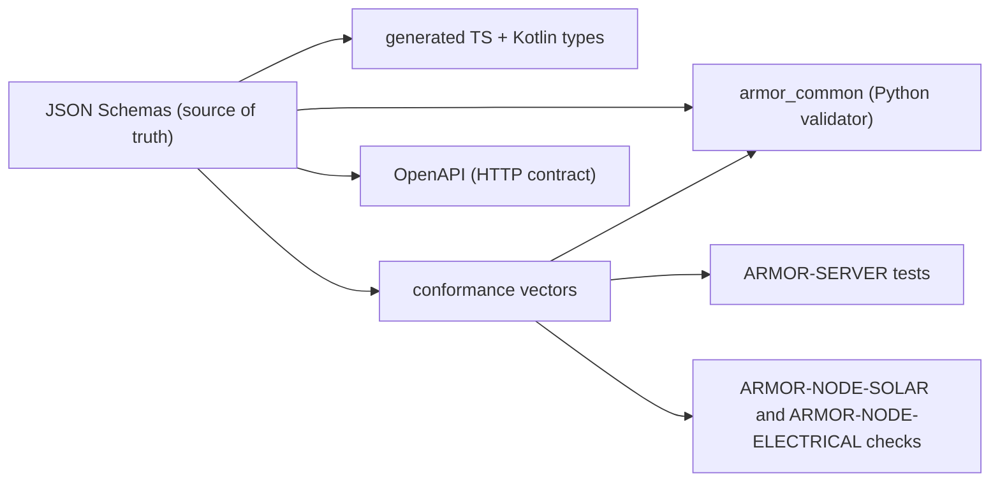

<p align="center">
  
</p>

# 🧾 ARMOR-COMMON

<p align="center">
  <a href="README.md">🇺🇸 English</a> |
  <a href="README_spa.md">🇪🇸 Español</a> |
  <a href="README_fra.md">🇫🇷 Français</a> |
  <a href="README_ita.md">🇮🇹 Italiano</a> |
  <a href="README_deu.md">🇩🇪 Deutsch</a> |
  <a href="README_zho.md">🇨🇳 简体中文</a> |
  🇯🇵 <b>日本語</b> |
  <a href="README_por.md">🇵🇹 Português</a>
</p>

### メッセージのコントラクト、検証、ノードが共有するファームウェア基盤、共通のプロジェクトランチャー

<p align="center">
  
  
  
  
  
  
</p>

---

**正直さのチェック - 今日動いているもの:** スキーマ（テレメトリ、状態、コマンド、ノード情報、ソーラーのインバーターとバッテリー、電気、コマンドと結果を含む警報、ネットワーク）、Python の検証器、1225 個の適合ベクトル、生成された TypeScript と Kotlin の型、サーバーの OpenAPI ファイル（190 パス）、5 つのノードが共有するファームウェア基盤、共通のプロジェクトランチャーは実在し、テストされています（170 件）。Kotlin ファイルは生成されますが ARMOR-ANDROID-CONTROL では**まだ使われていません**（独自の解析を保持）。`set_thresholds` コマンドは `sensitivity` フィールド 1 つだけを持ちます。実際のレーダーパラメーターはファームウェアができるまで定義できないためです。

---

## 📋 ひと目で

| | |
|---|---|
| バージョン | `0.7.6` |
| 成熟度 | 確立 |
| テスト | 170 (`python -m unittest discover -s tests`) と 1225 件の適合ベクトル |
| 技術 | Python 3.11+ / JSON Schema / OpenAPI |
| 実機での確認 | 基板上で動いたのはレーダーノードだけです。そのメッセージは CM5 サーバー、Studio、Android アプリが毎日話しているもので、他のノードのメッセージは代替に対して検査されます |

## 🚦 プロジェクトの状況

各行はこのリポジトリの一部分で、信号は今日どこまで進んでいるかを示します。計画ではなく、リポジトリが示せるもの（テスト、ビルド、実行）に基づいて書かれています。

🟢 完了・検証済み · 🟡 動作する（既知の制限あり） · 🟠 一部のみ、または未検証 · 🔴 未実装または動作しない

| 領域 | 状態 | ここでの意味 |
|---|---|---|
| ソフトウェア | 🟢 | スキーマ、Python の検証ツール、生成された TypeScript と Kotlin の型、サーバーの OpenAPI ファイル、5 つのノードが共有するファームウェアの基盤が揃っています。 |
| テスト | 🟢 | 170 件のテストと 1225 件の適合ベクターが通ります。ファームウェアの JSON、Bluetooth、Improv のパーサーは libFuzzer でファジングも行っています。 |
| プロトコルとデータ | 🟡 | 毎日、実機のボードとサーバーで使われているのはレーダーノードのメッセージだけです。他のノードのメッセージは模擬に対して検証しています。 |
| 連携 | 🟡 | ファームウェアの基盤が全ノードで同一であることを確認しています。Kotlin の型は生成済みですが、Android アプリは独自の解析を使っていて、まだ使っていません。 |
| ハードウェア | 🟠 | この共有ファームウェアをボード上で動かしたのはレーダーノードだけで、他の 4 つのノードはまだです。 |
| セキュリティ | 🟡 | ファームウェア署名の確認と Bluetooth の PIN の導出はホストでテスト済みです。独立したレビューはまだありません。 |
| ドキュメント | 🟢 | 8 言語、OpenAPI ファイル、適合ガイド、変更履歴は最新です。 |

## 🎯 概要

**ARMOR-COMMON** は A.R.M.O.R. のすべてのメッセージの意味を所有します。レーダーノード、太陽光ゲートウェイノード、シミュレーターがこれらのメッセージを作り、サーバー、視覚 AI、音声サービスが使います。2 つのプロジェクトがフィールドについて食い違ったら、このリポジトリが決めます。

* **唯一の信頼できる情報源：**`src/armor_common/schemas/` の JSON Schema。テレメトリ、状態、コマンド、ノード情報、2 つのソーラーメッセージ（インバーター、セルと容量を含むバッテリー）、電気メッセージ（測定値、コマンド、結果）、警報メッセージ（状態、コマンド、結果）、ネットワークメッセージ。未知のフィールドや不可能な組み合わせは拒否されます。
* **ルールを飛ばせない検証器：**スキーマを直接解釈し、実装していないキーワードを使うスキーマを拒否します。
* **適合ベクトル：**受理と拒否の 1225 個のペイロードをすべての実装（ここでは Python、ARMOR-SERVER では TypeScript、ファームウェアリポジトリの検査）が実行するため、ずれがあればビルドが失敗します。
* **生成されるクライアント：**TypeScript と Kotlin の型はスキーマから作られます（`tools/generate_types.py --check` で最新に保ちます）。
* **HTTP コントラクト：**`openapi/armor-server.yaml` はサーバーのすべてのルート（190 パス、245 操作）、そのアクセスルール、そして各リクエスト本文・応答・エラーの名前付きスキーマを記述し、サーバーが登録するルートが記述と完全に一致すること（メソッドとパス）をテストが確認します。
* **ファームウェア基盤：**`firmware_base/` は 5 つのノードが共有する各ファイル（ネットワーク、設定とユーザー、Web パネルのサーバーとログイン、HTTPS 証明書、ログ、PIN ペアリング付き Bluetooth、署名付きアップデートの検査、リレーと Zigbee は備えるノードのみ）を 1 か所に保持し、`tools/sync_firmware_base.py` が各ノードに書き込んでコピーのずれがないか検査します（[ガイド](docs/FIRMWARE_BASE.md)、[署名付きファームウェア](docs/SIGNED_FIRMWARE.md)）。
* **共通ランチャー：**`tools/armor_project_tool.py` はファミリーの全リポジトリに同じ `build`、`build-test`、`run` の流れを、`tools/armor_ci_validate.py` に同じ CI 検査を提供します。
* **共有ノードベースの任意の TLS ブローカー接続:** `firmware_base` は `mqtt.tls` スイッチと `mqtt.ca_pem` テキスト(PEM 証明書 1 つ、最大 2 KB、検証済み)、その認証局だけを信頼してブローカーの名前を確認する接続、5 つのノードで共有するホストテストを含みます。初期状態ではオフです。
* **ノードの状態と警戒プロファイル:** `node_health` メッセージ（レーダー、太陽光、電気、警報、壁パネルのどのノードも同じ報告）と `arm_profile`（警戒コマンドに入る名前付きの警戒方法：警戒するゾーン、遅延、サイレン、サーバーの通知の強さ）に、スキーマ、適合ベクター、生成された TypeScript と Kotlin の型、OpenAPI のルート、報告を作る共有ファームウェアコードがあります。
* **履歴の接続イベントとシステムイベント:** スキーマ `connection_event`・`system_event`・`connection_client`（接続するクライアントとシステム自体について、サーバーの履歴が何を伝えるか。語彙は固定で、秘密が入る欄はありません）、その適合ベクトル、生成された TypeScript と Kotlin の型、クライアントを一覧する OpenAPI のルート。
* **契約に含まれる診断と測定品質：** 正常でない起動のレポート、コアダンプ、設定の安全チェック、診断パッケージ、レーダーイベント、読み取り専用診断トークンのメッセージに、それぞれスキーマ、適合ベクトル、生成された型があります。メーターチャンネルは測定値の経過時間とエラー数を持て、インバーターのメッセージはノードが上限に留めた値を名指しできます。

## 🧩 A.R.M.O.R. での役割

ARMOR-COMMON はファミリーに同じ言葉を話させるものです。ノードと [ARMOR-SERVER](https://github.com/JuanenRac/ARMOR-SERVER) の間のすべてのメッセージはここで 1 度だけ定義され、すべての実装が通らなければならないベクトルが付きます。サーバーの HTTP コントラクトもここにあり、5 つのノード（[ARMOR-NODE-RADAR](https://github.com/JuanenRac/ARMOR-NODE-RADAR)、[ARMOR-NODE-SOLAR](https://github.com/JuanenRac/ARMOR-NODE-SOLAR)、[ARMOR-NODE-ELECTRICAL](https://github.com/JuanenRac/ARMOR-NODE-ELECTRICAL)、[ARMOR-NODE-ALARM](https://github.com/JuanenRac/ARMOR-NODE-ALARM)、[ARMOR-NODE-HMI](https://github.com/JuanenRac/ARMOR-NODE-HMI)）が共有するファームウェアは 1 か所に保持され、ツールで各ノードにコピーされます。秘密は持たず、本番では何も実行しません。

## 🔄 アーキテクチャ



## 📂 リポジトリの構成

```text
ARMOR-COMMON/
├── src/armor_common/   contracts, schema (validator), envelope, schemas/*.json (the node messages, the alarm, electrical and network ones, the relay, zone-feed, alert and orders ones)
├── conformance/        accepted and rejected payloads shared by every implementation
├── firmware_base/      the firmware that the five nodes share, once (synced into each by tools/sync_firmware_base.py)
├── generated/          TypeScript and Kotlin types (generated, do not edit)
├── openapi/            armor-server.yaml
├── registry/           repositories.json: the one list of the repositories of the family (kind, group, technologies, place on the map, who feeds whom) that the documentation, deployment and update tools read
├── tools/              armor_project_tool.py, generate_types.py, generate_rest_types.py, make_conformance.py, sync_firmware_base.py, release_firmware.py, firmware_sign.mjs
├── tests/              unit tests and conformance runner
└── docs/               contracts guide, the shared firmware base
```

## 🛠️ 開発環境

**必要なもの:** Python 3.11+

```powershell
python -m pip install -e .
python -m unittest discover -s tests      # 170 tests, 1225 conformance vectors
python tools/generate_types.py --check    # generated types are current
python tools/generate_rest_types.py --check    # the types of the HTTP contract are current
python tools/make_conformance.py          # regenerate the vectors after editing the case list (--check: they are current)
python tools/sync_firmware_base.py check  # the firmware the node projects share has not drifted (see docs/FIRMWARE_BASE.md)
```

ブローカーのトピック：`armor/node/{node_id}/telemetry | health | command | info`、`armor/solar/{node_id}/{device}/state`、`armor/electrical/{node_id}/state | command | result`、`armor/alarm/{node_id}/state | command | result`、`armor/network/{node_id}/state`。[コントラクトガイド](docs/CONTRACTS.md)を参照してください。共通ランチャーは ARMOR-SERVER の初回実行時に、ランダムな秘密とランダムな管理者パスワードを持つ無視対象の `.env` を作成し、何も表示もコミットもしません。

## 🔗 関連プロジェクト

**A.R.M.O.R.**（Autonomous Radar & Multimodal Observation Range）は、独立したリポジトリで構成される周辺警備システムです。それぞれに独自のバージョン、テスト、README があります。ファミリーは次のとおりです：

* **ARMOR-COMMON** (このリポジトリ) - メッセージ契約、検証器、適合性ベクトル、生成された型
* **[ARMOR-NODE-RADAR](https://github.com/JuanenRac/ARMOR-NODE-RADAR)** - ESP32-S3 用フィールドノードのファームウェア。レーダー 3 基と独自の Web パネル付き
* **[ARMOR-NODE-SOLAR](https://github.com/JuanenRac/ARMOR-NODE-SOLAR)** - 太陽光インバーターとバッテリーのプロトコル、およびゲートウェイノードのメッセージ
* **[ARMOR-NODE-ELECTRICAL](https://github.com/JuanenRac/ARMOR-NODE-ELECTRICAL)** - 電気ノード：電力量計、電力網の計測メッセージ、開閉のルール
* **[ARMOR-NODE-ALARM](https://github.com/JuanenRac/ARMOR-NODE-ALARM)** - 警報ノードと警報盤：警戒区域、警戒セット、遅延、サイレン、PIN。サーバーがあってもなくても
* **[ARMOR-NODE-HMI](https://github.com/JuanenRac/ARMOR-NODE-HMI)** - タッチパネル：壁面ディスプレイでのシステム状態表示、警戒・確認操作、音声アシスタントの拠点
* **[ARMOR-NETWORK](https://github.com/JuanenRac/ARMOR-NETWORK)** - ローカルネットワーク：機器、インターネット、そして変化
* **[ARMOR-SERVER](https://github.com/JuanenRac/ARMOR-SERVER)** - 中央コーディネーター：テレメトリ、アラーム、デバイス、太陽光の測定値、カメラ
* **[ARMOR-STUDIO](https://github.com/JuanenRac/ARMOR-STUDIO)** - Web コンソール：カメラ、レーダー、アラーム、太陽光発電、2D/3D サイト設計
* **[ARMOR-ANDROID-CONTROL](https://github.com/JuanenRac/ARMOR-ANDROID-CONTROL)** - リアルタイム 2D/3D レーダー付きの Android オペレータークライアント
* **[ARMOR-IOS-CONTROL](https://github.com/JuanenRac/ARMOR-IOS-CONTROL)** - iPhone オペレータークライアント
* **[ARMOR-SERVER-AI](https://github.com/JuanenRac/ARMOR-SERVER-AI)** - 判断を説明し、決して動作しない視覚推論ポリシー
* **[ARMOR-VISION](https://github.com/JuanenRac/ARMOR-VISION)** - Jetson Orin NX 向けのカメラのゾーン、マスク、検知ルール
* **[ARMOR-VOICE-AI](https://github.com/JuanenRac/ARMOR-VOICE-AI)** - 偽造できない確認を備えたオフライン音声インテント
* **[ARMOR-HARDWARE](https://github.com/JuanenRac/ARMOR-HARDWARE)** - 筐体、電子部品、ベンチ受け入れマトリクス
* **[ARMOR-DEVOPS](https://github.com/JuanenRac/ARMOR-DEVOPS)** - デプロイ、CM5 テストベンチ、バックアップ、TLS
* **[ARMOR-SIMULATOR](https://github.com/JuanenRac/ARMOR-SIMULATOR)** - 再現可能な故障を備えたオフラインのテレメトリシミュレーター
* **[ARMOR-UPDATER](https://github.com/JuanenRac/ARMOR-UPDATER)** - エコシステム自身のリポジトリを検出し、インストールし、更新する
* **[ARMOR-DOCS](https://github.com/JuanenRac/ARMOR-DOCS)** - アーキテクチャ、セキュリティ基準、機能マトリクス

## 📚 ドキュメントとコミュニティ

詳しくは：

* [機能マトリクス：実証済みのものとそうでないもの](https://github.com/JuanenRac/ARMOR-DOCS/blob/main/docs/CAPABILITY_MATRIX.md)
* [プロジェクト一覧：バージョンとリポジトリ間の依存関係](https://github.com/JuanenRac/ARMOR-DOCS/blob/main/docs/PROJECT_CATALOG.md)
* [このリポジトリの変更履歴](CHANGELOG.md)
* [ライセンス（GPL-3.0-or-later）](LICENSE)
* 質問・提案・報告：electrohobby3d@gmail.com

## 👤 作者

**JuanenRac (Electro Hobby 3D)** · electrohobby3d@gmail.com

## 📜 ライセンス

GPL-3.0-or-later - [LICENSE](LICENSE) を参照。
