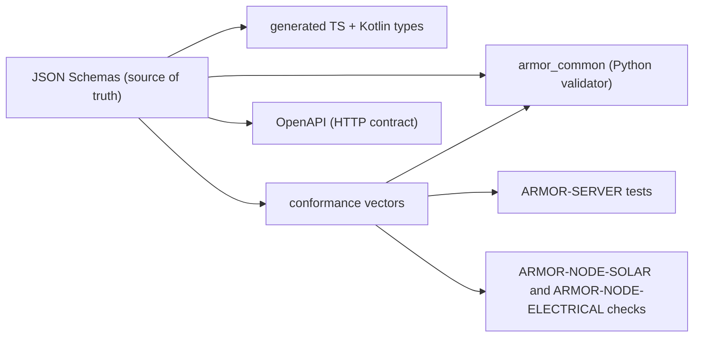

<p align="center">
  
</p>

# 🧾 ARMOR-COMMON

<p align="center">
  <a href="README.md">🇺🇸 English</a> |
  <a href="README_spa.md">🇪🇸 Español</a> |
  <a href="README_fra.md">🇫🇷 Français</a> |
  <a href="README_ita.md">🇮🇹 Italiano</a> |
  <a href="README_deu.md">🇩🇪 Deutsch</a> |
  <a href="README_zho.md">🇨🇳 简体中文</a> |
  🇯🇵 <b>日本語</b> |
  <a href="README_por.md">🇵🇹 Português</a>
</p>

### メッセージのコントラクト、検証、ノードが共有するファームウェア基盤、共通のプロジェクトランチャー

<p align="center">
  
  
  
  
  
  
  
</p>

---

**正直さのチェック - 今日動いているもの:** スキーマ（テレメトリ、状態、コマンド、ノード情報、ソーラーのインバーターとバッテリー、電気、コマンドと結果を含む警報、ネットワーク）、Python の検証器、1225 個の適合ベクトル、生成された TypeScript と Kotlin の型、サーバーの OpenAPI ファイル（191 パス）、5 つのノードが共有するファームウェア基盤、共通のプロジェクトランチャーは実在し、テストされています（235 件）。Kotlin ファイルは生成されますが ARMOR-ANDROID-CONTROL では**まだ使われていません**（独自の解析を保持）。`set_thresholds` コマンドは `sensitivity` フィールド 1 つだけを持ちます。実際のレーダーパラメーターはファームウェアができるまで定義できないためです。

---

## 📋 ひと目で

| | |
|---|---|
| バージョン | `0.7.8` |
| 成熟度 | 確立 |
| 役割 | ファミリー共通の契約、検証器、ファームウェア基盤 |
| 技術 | Python 3.11+、JSON Schema、OpenAPI、C++ のファームウェア基盤（ESP-IDF） |
| テスト | 235 件（`python -m unittest discover -s tests`）、適合ベクター 1225 件 |
| 契約 | JSON Schema 34 個、HTTP パス 191 本（247 操作） |
| 動作環境 | 任意のコンピューター（ライブラリとツール）。ファームウェア基盤は 5 つのノード内で動作 |
| 実機での確認 | 共通ファームウェアを実機で動かしたのはレーダーノードのみで、他の 4 つは未実施 |
| ライセンス | GPL-3.0-or-later |

**移動先：** [概要](#-概要) · [アーキテクチャ](#-アーキテクチャ) · [機能](#-機能) · [セキュリティ](#-セキュリティと安全) · [インターフェース](#-インターフェース) · [設定](#-設定) · [クイックスタート](#-クイックスタート) · [テスト](#-テスト) · [トラブルシューティング](#-トラブルシューティング) · [構成](#-リポジトリの構成) · [関連](#-関連プロジェクト)

## 🚦 プロジェクトの状況

各行はこのリポジトリの一部分で、信号は今日どこまで進んでいるかを示します。計画ではなく、リポジトリが示せるもの（テスト、ビルド、実行）に基づいて書かれています。

🟢 完了・検証済み · 🟡 動作する（既知の制限あり） · 🟠 一部のみ、または未検証 · 🔴 未実装または動作しない

| 領域 | 状態 | ここでの意味 |
|---|---|---|
| ソフトウェア | 🟢 | スキーマ、Python の検証ツール、生成された TypeScript と Kotlin の型、サーバーの OpenAPI ファイル、5 つのノードが共有するファームウェアの基盤が揃っています。 |
| テスト | 🟢 | 235 件のテストと 1225 件の適合ベクターが通ります。ファームウェアの JSON、Bluetooth、Improv のパーサーは libFuzzer でファジングも行っています。 |
| プロトコルとデータ | 🟡 | 毎日、実機のボードとサーバーで使われているのはレーダーノードのメッセージだけです。他のノードのメッセージは模擬に対して検証しています。 |
| 連携 | 🟡 | ファームウェアの基盤が全ノードで同一であることを確認しています。Kotlin の型は生成済みですが、Android アプリは独自の解析を使っていて、まだ使っていません。 |
| ハードウェア | 🟠 | この共有ファームウェアをボード上で動かしたのはレーダーノードだけで、他の 4 つのノードはまだです。 |
| セキュリティ | 🟡 | ファームウェア署名の確認と Bluetooth の PIN の導出はホストでテスト済みです。独立したレビューはまだありません。 |
| ドキュメント | 🟢 | 8 言語、OpenAPI ファイル、適合ガイド、変更履歴は最新です。 |

## 🎯 概要

**ARMOR-COMMON** は A.R.M.O.R. のすべてのメッセージの意味を所有します。レーダーノード、太陽光ゲートウェイノード、シミュレーターがこれらのメッセージを作り、サーバー、視覚 AI、音声サービスが使います。2 つのプロジェクトがフィールドについて食い違ったら、このリポジトリが決めます。

* **唯一の信頼できる情報源：**`src/armor_common/schemas/` の JSON Schema。テレメトリ、状態、コマンド、ノード情報、2 つのソーラーメッセージ（インバーター、セルと容量を含むバッテリー）、電気メッセージ（測定値、コマンド、結果）、警報メッセージ（状態、コマンド、結果）、ネットワークメッセージ。未知のフィールドや不可能な組み合わせは拒否されます。
* **ルールを飛ばせない検証器：**スキーマを直接解釈し、実装していないキーワードを使うスキーマを拒否します。
* **適合ベクトル：**受理と拒否の 1225 個のペイロードをすべての実装（ここでは Python、ARMOR-SERVER では TypeScript、ファームウェアリポジトリの検査）が実行するため、ずれがあればビルドが失敗します。
* **生成されるクライアント：**TypeScript と Kotlin の型はスキーマから作られます（`tools/generate_types.py --check` で最新に保ちます）。
* **HTTP コントラクト：**`openapi/armor-server.yaml` はサーバーのすべてのルート（191 パス、247 操作）、そのアクセスルール、そして各リクエスト本文・応答・エラーの名前付きスキーマを記述し、サーバーが登録するルートが記述と完全に一致すること（メソッドとパス）をテストが確認します。
* **ファームウェア基盤：**`firmware_base/` は 5 つのノードが共有する各ファイル（ネットワーク、設定とユーザー、Web パネルのサーバーとログイン、HTTPS 証明書、ログ、PIN ペアリング付き Bluetooth、署名付きアップデートの検査、リレーと Zigbee は備えるノードのみ）を 1 か所に保持し、`tools/sync_firmware_base.py` が各ノードに書き込んでコピーのずれがないか検査します（[ガイド](docs/FIRMWARE_BASE.md)、[署名付きファームウェア](docs/SIGNED_FIRMWARE.md)）。
* **共通ランチャー：**`tools/armor_project_tool.py` はファミリーの全リポジトリに同じ `build`、`build-test`、`run` の流れを、`tools/armor_ci_validate.py` に同じ CI 検査を提供します。
* **共有ノードベースの任意の TLS ブローカー接続:** `firmware_base` は `mqtt.tls` スイッチと `mqtt.ca_pem` テキスト(PEM 証明書 1 つ、最大 2 KB、検証済み)、その認証局だけを信頼してブローカーの名前を確認する接続、5 つのノードで共有するホストテストを含みます。初期状態ではオフです。
* **ノードの状態と警戒プロファイル:** `node_health` メッセージ（レーダー、太陽光、電気、警報、壁パネルのどのノードも同じ報告）と `arm_profile`（警戒コマンドに入る名前付きの警戒方法：警戒するゾーン、遅延、サイレン、サーバーの通知の強さ）に、スキーマ、適合ベクター、生成された TypeScript と Kotlin の型、OpenAPI のルート、報告を作る共有ファームウェアコードがあります。
* **履歴の接続イベントとシステムイベント:** スキーマ `connection_event`・`system_event`・`connection_client`（接続するクライアントとシステム自体について、サーバーの履歴が何を伝えるか。語彙は固定で、秘密が入る欄はありません）、その適合ベクトル、生成された TypeScript と Kotlin の型、クライアントを一覧する OpenAPI のルート。
* **契約に含まれる診断と測定品質：** 正常でない起動のレポート、コアダンプ、設定の安全チェック、診断パッケージ、レーダーイベント、読み取り専用診断トークンのメッセージに、それぞれスキーマ、適合ベクトル、生成された型があります。メーターチャンネルは測定値の経過時間とエラー数を持て、インバーターのメッセージはノードが上限に留めた値を名指しできます。

## 🧩 A.R.M.O.R. での役割

ARMOR-COMMON はファミリーに同じ言葉を話させるものです。ノードと [ARMOR-SERVER](https://github.com/JuanenRac/ARMOR-SERVER) の間のすべてのメッセージはここで 1 度だけ定義され、すべての実装が通らなければならないベクトルが付きます。サーバーの HTTP コントラクトもここにあり、5 つのノード（[ARMOR-NODE-RADAR](https://github.com/JuanenRac/ARMOR-NODE-RADAR)、[ARMOR-NODE-SOLAR](https://github.com/JuanenRac/ARMOR-NODE-SOLAR)、[ARMOR-NODE-ELECTRICAL](https://github.com/JuanenRac/ARMOR-NODE-ELECTRICAL)、[ARMOR-NODE-ALARM](https://github.com/JuanenRac/ARMOR-NODE-ALARM)、[ARMOR-NODE-HMI](https://github.com/JuanenRac/ARMOR-NODE-HMI)）が共有するファームウェアは 1 か所に保持され、ツールで各ノードにコピーされます。秘密は持たず、本番では何も実行しません。

| 連携先 | 方法 | 目的 |
|---|---|---|
| ARMOR-SERVER | ベクターを実行し、OpenAPI の全ルートを実装 | ベクター、OpenAPI |
| ARMOR-STUDIO | 生成された型のコピーを保持し、ずれるとテストが失敗 | 生成された TypeScript |
| ARMOR-ANDROID-CONTROL | 独自の解析を持ち、Kotlin の型は生成のみで未使用 | 生成された Kotlin |
| ARMOR-NODE-RADAR, SOLAR, ELECTRICAL, ALARM, HMI | `tools/sync_firmware_base.py` で firmware_base を受け取る | コピーされるファームウェア |
| ARMOR-DOCS, ARMOR-DEVOPS, ARMOR-UPDATER | リポジトリの唯一の一覧 `registry/repositories.json` を読む | レジストリ |

## 🏛️ アーキテクチャ

<p align="center">
  
</p>

<details>
<summary>図のテキスト版（Mermaid）</summary>



</details>

## ✨ 機能

### メッセージの追加と変更

1. `src/armor_common/schemas/` のスキーマを編集します（意味が変わるなら `docs/CONTRACTS.md` も）。
2. ケースを一覧に追加し、`python tools/make_conformance.py` を実行します。
3. `python tools/generate_types.py` と `python tools/generate_rest_types.py` を実行し、TypeScript と Kotlin の型を更新します。
4. ルートが関わる場合は `openapi/armor-server.yaml` を更新します。`tests/test_openapi.py` がサーバーのルートと照合します。
5. サーバーとノードは同じベクターを実行するので、食い違いはビルドの失敗になります。

### ファームウェア基盤

`firmware_base/` は、5 つのノードが共有するファイルを 1 か所だけに置きます：ネットワーク、設定とユーザー、Web パネルサーバーとログイン、HTTPS 証明書、ログ、PIN ペアリング付き Bluetooth、署名付き更新の検証、ノード健康レポート、不調のノードを再起動する監視、サーバーからの型付きオーダー、そして該当ノードのリレーと Zigbee。`tools/sync_firmware_base.py` が各ノードへ書き込み、ずれがないか確認します（[docs/FIRMWARE_BASE.md](docs/FIRMWARE_BASE.md) と [docs/SIGNED_FIRMWARE.md](docs/SIGNED_FIRMWARE.md) を参照）。ハードウェア不要の判定は `core/` にあり、コンピューターでテストされます。`main/` が実際の値を読みます。

## 🔒 セキュリティと安全

| 脅威 | 防御 |
|---|---|
| 未知のフィールドや不可能な組み合わせ | `additionalProperties: false`。検証器はスキーマを解釈し、未実装のキーワードを使うスキーマの読み込みを拒否 |
| 上限のないテレメトリでノードを枯渇させる | 最大 15 トラック（3 センサー × 5）、照度 0〜200 000 |
| リスト外のコマンド | 許可リスト：`calibrate`、`set_thresholds`（感度 1〜10）、`restart`。それ以外はハードウェアに届く前に購読側が拒否 |
| 本文のノード ID と一致しないトピック | 受信側は不一致を拒否 |
| GitHub 上の偽ファームウェア | イメージは `.sha256` と一致し、そのハッシュの Ed25519 署名が必要です（`firmware_base/core/fw_trust.hpp` の公開鍵で検証）。なければ何も変わりません |
| リリース用の秘密鍵の漏えい | どのリポジトリ・CI・リリースにも置かれません（PKCS#8、モード 0600）。`release_firmware.py` は鍵がファームウェアの信頼する鍵と違えば公開を拒否 |
| ノードのパスワードと Bluetooth の PIN | パスワード：PBKDF2-HMAC-SHA256、10 000 回。PIN：MAC とフリート秘密から導出（`CONFIG_ARMOR_FLEET_SECRET`、公開ファームウェアでは空） |
| 外部に露出するパーサ（JSON、Bluetooth フレーム、Improv） | libFuzzer、AddressSanitizer、UndefinedBehaviorSanitizer でファジング（`fuzz/run_fuzz.sh`、clang のある Linux） |
| ノードのコピーが共有版とずれる | 5 つのノードが同一でなければ `tools/sync_firmware_base.py check` が失敗 |

**対象外のこと。** 管理者が手動でアップロードしたファームウェアは検証されません。この検証より古いファームウェアのノードは、最初の署名付きリリースをハッシュだけでインストールします。鍵が守るのはリリースであって基板ではありません。物理的に触れれば誰でも何でも書き込めます。鍵を失うと、公開鍵を手動アップロードかケーブルで入れ替えるまで GitHub 更新は止まります。署名検証と PIN はホスト上でテスト済みで、第三者によるレビューはありません。詳細は [docs/SIGNED_FIRMWARE.md](docs/SIGNED_FIRMWARE.md)。

## 🔌 インターフェース

### ブローカーのトピック

| トピック | 内容 |
|---|---|
| `armor/node/{node_id}/telemetry`  `health`  `command`  `info` | レーダーノード：トラック、状態、コマンド、情報 |
| `armor/solar/{node_id}/{device}/state` | ソーラーノードのインバーターまたはバッテリー |
| `armor/electrical/{node_id}/state`  `command`  `result` | 電気ノード：測定値、コマンド、結果 |
| `armor/alarm/{node_id}/state`  `command`  `result` | アラームノード（サーバーからの `zigbee` と `policy` も） |
| `armor/network/{node_id}/state` | ノードがネットワークで見るもの |
| `armor/health/{node_id}` | 全ノードの健康レポートと遺言メッセージ |
| `armor/control/{node_id}/command`  `result`  `maintenance`  and `armor/control/all/command` | 1 ノードまたは全ノードへの型付きオーダー、その結果、計画メンテナンスの信号 |
| `armor/device/{node_id}/{relay}/set`  `state`  `availability` | ノードのリレー |
| `armor/radar/{node_id}/events`  and  `armor/server/alert` | レーダーイベントと、サーバーからパネルへの通知 |

### スキーマ、ベクター、OpenAPI

* **JSON Schema 34 個**（`src/armor_common/schemas/`）：テレメトリ、健康状態、コマンド、ノード情報、ノード健康、ノード制御（コマンドと結果）、ノードメンテナンス、ソーラーのインバーターとバッテリー（コマンドと結果を含む）、電気（コマンドと結果）、アラーム（状態、コマンド、結果、ポリシー、ゾーンフィード）、ネットワーク（オーダー）、接続・システムイベント、レーダーイベント、サーバー警報、警戒プロファイル、デバイス状態、診断トークン、音声ターン。
* **適合ベクター 1225 件**（`conformance/`、メッセージごとに 1 ファイル、計 34 ファイル）。このリポジトリ、ARMOR-SERVER、ファームウェアリポジトリの検査が実行します。
* **OpenAPI** `openapi/armor-server.yaml`：191 パス、247 操作。各操作にアクセス規則と、本文・応答・エラーごとの名前付きスキーマがあります。サーバーが登録するルートが記述と完全に一致することをテストが確認します。音声ターンはバイト列で送られます（[docs/CONTRACTS.md](docs/CONTRACTS.md) を参照）。

### コマンドラインツール

| ツール | 内容 |
|---|---|
| `tools/armor_project_tool.py` | 共通の `build`、`build-test`、`run` フロー |
| `tools/generate_types.py [--check]`  `generate_rest_types.py [--check]` | TypeScript と Kotlin の型、HTTP 契約の型 |
| `tools/make_conformance.py [--check]` | ケース一覧から適合ベクターを書き出す |
| `tools/sync_firmware_base.py` (`check`, `sync`, `import`) | `firmware_base` を 5 ノードへ書き込む、またはずれがないか確認 |
| `tools/release_firmware.py`  `tools/firmware_sign.mjs` | ファームウェアリリースの署名と公開 |
| `tools/voice_cases.py` | ARMOR-VOICE-AI と共有する音声ケース |
| `tools/make_architecture.py`  `tools/make_structure.py`  `tools/universal_readme_check.py` | README の図とレイアウトの検査 |

## ⚙️ 設定

### ファームウェアのビルドオプション（Kconfig）

| 設定 | 既定値 | 内容 |
|---|---|---|
| `CONFIG_ARMOR_NODE_ID` | "" | ブローカー上のノード名 |
| `CONFIG_ARMOR_SETUP_CODE` | "" | 設定を開くコード |
| `CONFIG_ARMOR_FLEET_SECRET` | "" | Bluetooth PIN 用のフリート秘密。公開ファームウェアでは空 |
| `CONFIG_ARMOR_BLE_SETUP_MINUTES` | 10 (1 to 120) | Bluetooth 設定を開いておく時間（分） |
| `CONFIG_ARMOR_ETH_SPI_HOST` | 1 (1 to 2) | Ethernet チップの SPI ホスト |
| `CONFIG_ARMOR_ETH_MOSI` `MISO` `SCLK` `CS` `INT` `RST` | 11, 12, 13, 14, 10, 9 | Ethernet 基板のピン（プロファイル `s3-eth`） |
| `CONFIG_ARMOR_ETH_SPI_MHZ` | 20 (1 to 40) | Ethernet チップの SPI クロック |
| `CONFIG_ARMOR_MQTT_URI` `USERNAME` `PASSWORD` | "" | 最初のブローカーのアドレスと認証情報 |
| `CONFIG_ARMOR_BOOT_FACTORY_RESET` | y | 起動時の初期化を許可 |
| `CONFIG_ARMOR_NTP_SERVER` | pool.ntp.org | 時刻サーバー |
| `CONFIG_ARMOR_HEARTBEAT_S` | 10 (2 to 300) | ハートビートの間隔（秒） |
| `CONFIG_ARMOR_BOARD_S3_WIFI`  `CONFIG_ARMOR_BOARD_S3_ETH` | S3_WIFI | イメージの基板プロファイル（`tools/build_node.sh NODE BOARD`） |

ノードとブローカーの TLS 接続はビルドではなくノードの設定です：`mqtt.tls`（既定はオフ）と `mqtt.ca_pem`（PEM 証明書 1 枚、最大 2 KB、検証あり）。接続はその認証局だけを信頼し、ブローカー名を確認します。Python ライブラリ自体の環境変数はありません。共通ランチャーは ARMOR-SERVER の初回実行時に、ランダムな秘密と管理者パスワードを入れた無視対象の `.env` を作り、何も表示せずコミットもしません。

## 🚀 クイックスタート

**要件：** Python 3.11+（他のパッケージは不要）。ファームウェア基盤を検査するには、5 つのノードのリポジトリをこのリポジトリの隣に置きます。

```powershell
python -m pip install -e .                   # ライブラリをインストール
python -m unittest discover -s tests         # 235 件のテスト、1225 ベクター
python tools/generate_types.py --check       # 生成された型は最新
python tools/generate_rest_types.py --check  # HTTP 契約の型は最新
python tools/make_conformance.py             # ケース一覧の編集後にベクターを再生成（--check：最新か確認）
python tools/sync_firmware_base.py check     # 共有ファームウェアにずれなし
```

## 🧪 テスト

```powershell
python -m unittest discover -s tests  # 235 件
python -I tools/armor_ci_validate.py
```

| テストファイル | テスト数 | 対象 |
|---|---|---|
| `test_contracts.py` | 68 | 全メッセージ、トピック、分解処理と適合ベクター |
| `test_task_safety_check.py` | 23 | ノードに不可欠なタスクを見つける走査 |
| `test_universal_readme_check.py`, `test_readme_tools.py` | 36 | README のレイアウト検査と図 |
| `test_firmware_base.py` | 13 | 共有ファームウェア基盤と同期 |
| `test_openapi.py` | 13 | OpenAPI とサーバーのルートの照合 |
| `test_release_firmware.py` | 12 | ファームウェアの署名と公開 |
| `test_pretty_run.py`, `test_build_scripts.py` | 11 | スクリプトのライブパネル |
| `test_generated_types.py`, `test_repository_registry.py`, `test_voice_turn.py` | 21 | 生成型、リポジトリ一覧、音声ターン |
| `test_alarm_codes.py`, `test_collect_errors.py`, `test_project_manifest_doc.py`, `test_firmware_fuzz.py`, `test_fuzz_validator.py` | 17 | アラームコードの文言、エラー収集、マニフェスト解説、ファズ環境 |

共有ファームウェアのホストテストは `firmware_base/tests/`（C++、ESP-IDF 不要）にあり、各ノードリポジトリの検査から実行されます。`python tools/sync_firmware_base.py check` には 5 つのノードのリポジトリがこのリポジトリの隣に必要です。GitHub Actions は push と pull request のたびに A.R.M.O.R. の基本検査（マニフェスト、バージョン、変更履歴、README の一致）と、プロジェクト自身のビルドとテストを実行します。

## 🏗️ ビルドとリリース

純粋な Python とツール群なので、コンパイルするものはありません。バージョンは `pyproject.toml`、`armor.project.json`、README のバッジ（マニフェストから読み取り）にあり、各バージョンには [CHANGELOG.md](CHANGELOG.md) にエントリーがあります。リリースは GitHub で公開されます。ファームウェアのリリースツール（`tools/release_firmware.py`）がノードのイメージに署名して公開します。必要な鍵はリポジトリに置かれません。

## 🩺 トラブルシューティング

| 表示 | 原因 | 対処 |
|---|---|---|
| `FIRMWARE_BASE=FAIL ... copies drifted` | ノードが共有ファイルを手で変更した | `firmware_base/` で変更して `sync` を実行。ノード側のファイルをそのまま採用するなら `import` |
| `ARMOR-NODE-HMI: main/secret_vault.cpp is missing` | ノードのリポジトリが ARMOR-COMMON の隣にない | 並べてクローンする |
| `generated types are out of date` | スキーマまたは OpenAPI が変更された | `--check` なしで `generate_types.py` と `generate_rest_types.py` を実行 |
| `TASK_SAFETY=FAIL no task found: the scan is broken` | ノードのソース走査で何も見つからない | ノードのリポジトリがここの隣にあるか確認 |
| `no_signature`, `bad_signature`, `checksum_mismatch`, `wrong_firmware` | ノードがリリースを拒否：署名、ハッシュ、基板の欠落または不一致 | `tools/release_firmware.py` とファームウェアが信頼するリリース鍵で公開 |

## 📂 リポジトリの構成

<p align="center">
  
</p>

<details>
<summary>ツリーのテキスト版</summary>

```text
ARMOR-COMMON/
├── src/armor_common/
│   ├── contracts.py               トピックと検証
│   ├── schema.py                  スキーマ解釈器
│   ├── envelope.py                共通エンベロープ
│   ├── voice.py                   音声の契約
│   ├── schemas/                   34 個の JSON Schema
│   ├── alarm_codes.json           アラームコードの文言
│   └── battery_ops.json           バッテリー操作
├── firmware_base/                 5 つのノードが共有するファームウェア（1 か所）
├── conformance/                   受理・拒否 1225 件
├── generated/                     TypeScript と Kotlin の型（生成物、編集不可）
├── openapi/                       armor-server.yaml（HTTP 契約）
├── registry/                      repositories.json（一覧）
├── fuzz/                          libFuzzer ターゲット
├── scripts/                       armor-project 起動
├── tools/                         ジェネレーター、ファームウェアの同期とリリース、ランチャー、CI 検査
├── tests/                         235 件のテスト
├── docs/                          契約・FW・ファジング
├── images/                        バナー、アイコン、README の画像
├── .github/                       CI ワークフロー、ダッシュボード通知、Issue と Pull Request のテンプレート
├── armor.project.json             マニフェスト：版・役割・成熟度
├── pyproject.toml                 パッケージ情報とエントリー
├── CHANGELOG.md                   各バージョンの変更点
├── run.sh run.bat                 起動（共通フロー）
├── build.sh build.bat             ビルドとテスト（共通フロー）
├── build-test.sh build-test.bat   ビルド、テスト、パッケージ化
├── test.sh test.bat               テストのみ（版は変えません）
└── SECURITY.md SUPPORT.md CONTRIBUTING.md CODE_OF_CONDUCT.md LICENSE
```

</details>

## 🗺️ ロードマップと既知の制限

**現時点の既知の制限**

* Kotlin の型は生成されますが、ARMOR-ANDROID-CONTROL は**まだ使っておらず**、独自の解析を持っています。
* `set_thresholds` コマンドのフィールドは `sensitivity` 1 つだけです。実際のレーダーパラメータはファームウェアができるまで定義されません。
* 共通ファームウェアを実機で動かしたのはレーダーノードのみで、他の 4 つは未実施です。
* 第三者によるセキュリティレビューはありません。

**今後**

* Android アプリで生成された Kotlin の型を使う。
* `set_thresholds` の実際のレーダーパラメータを定義する。
* 他の 4 ノードの基板で共通ファームウェアを動かす。

## 🌍 言語

README とテキストは、英語、スペイン語、フランス語、イタリア語、ドイツ語、中国語、日本語、ヨーロッパポルトガル語で提供されています。

## 🔗 関連プロジェクト

**A.R.M.O.R.**（Autonomous Radar & Multimodal Observation Range）は、独立したリポジトリで構成される境界セキュリティシステムです。各リポジトリは独自のバージョン、テスト、README を持ちます。ファミリーは次のとおりです：

* **ARMOR-COMMON**（このリポジトリ） - メッセージのコントラクト、バリデーター、適合ベクトル、生成された型
* **[ARMOR-NODE-RADAR](https://github.com/JuanenRac/ARMOR-NODE-RADAR)** - 3 つのレーダーと独自の Web パネルを備えた ESP32-S3 向けフィールドノードのファームウェア
* **[ARMOR-NODE-SOLAR](https://github.com/JuanenRac/ARMOR-NODE-SOLAR)** - ソーラーインバーターとバッテリーのプロトコル、ゲートウェイノードのメッセージ
* **[ARMOR-NODE-ELECTRICAL](https://github.com/JuanenRac/ARMOR-NODE-ELECTRICAL)** - 電気ノード：メーター、系統の読み取り値のメッセージ、切り替えのルール
* **[ARMOR-NODE-ALARM](https://github.com/JuanenRac/ARMOR-NODE-ALARM)** - 警報ノードとパネル：ゾーン、警戒、遅延、サイレン、PIN。サーバーありでもなしでも動作
* **[ARMOR-NODE-HMI](https://github.com/JuanenRac/ARMOR-NODE-HMI)** - タッチパネル：壁面画面でのシステムの状態、警戒と確認応答、そして音声アシスタントの置き場
* **[ARMOR-NETWORK](https://github.com/JuanenRac/ARMOR-NETWORK)** - ローカルネットワーク：そのデバイス、インターネット、そして変化
* **[ARMOR-SERVER](https://github.com/JuanenRac/ARMOR-SERVER)** - 中央コーディネーター：テレメトリ、警報、デバイス、ソーラーの読み取り値、カメラ
* **[ARMOR-STUDIO](https://github.com/JuanenRac/ARMOR-STUDIO)** - Web コンソール：カメラ、レーダー、警報、太陽光エネルギー、2D/3D のサイトデザイナー
* **[ARMOR-ANDROID-CONTROL](https://github.com/JuanenRac/ARMOR-ANDROID-CONTROL)** - ライブの 2D/3D レーダーを備えた Android オペレータークライアント
* **[ARMOR-IOS-CONTROL](https://github.com/JuanenRac/ARMOR-IOS-CONTROL)** - iPhone オペレータークライアント
* **[ARMOR-SERVER-AI](https://github.com/JuanenRac/ARMOR-SERVER-AI)** - 判断を説明し、決して作動させない視覚推論ポリシー
* **[ARMOR-VISION](https://github.com/JuanenRac/ARMOR-VISION)** - Jetson Orin NX 向けのカメラゾーン、マスク、検出ルール
* **[ARMOR-VOICE-AI](https://github.com/JuanenRac/ARMOR-VOICE-AI)** - 偽造できない確認つきのオフライン音声インテント
* **[ARMOR-HARDWARE](https://github.com/JuanenRac/ARMOR-HARDWARE)** - 筐体、電子回路、ベンチ受け入れマトリクス
* **[ARMOR-DEVOPS](https://github.com/JuanenRac/ARMOR-DEVOPS)** - デプロイ、CM5 テストベンチ、バックアップ、TLS
* **[ARMOR-SIMULATOR](https://github.com/JuanenRac/ARMOR-SIMULATOR)** - 再現可能な障害を持つオフラインのテレメトリシミュレーター
* **[ARMOR-UPDATER](https://github.com/JuanenRac/ARMOR-UPDATER)** - エコシステム自身のリポジトリを検出、インストール、更新
* **[ARMOR-DOCS](https://github.com/JuanenRac/ARMOR-DOCS)** - アーキテクチャ、セキュリティのベースライン、機能マトリクス

## 📚 ドキュメント

* [契約](docs/CONTRACTS.md)：全メッセージ、トピック、契約の変更方法
* [ファームウェア基盤](docs/FIRMWARE_BASE.md)：5 ノードの共有内容と同期の方法
* [署名付きファームウェア](docs/SIGNED_FIRMWARE.md)：リリース署名と対象外のこと
* [ファジング](docs/FUZZING.md)：3 つのパーサ対象と実行方法
* [プロジェクトマニフェスト](docs/PROJECT_MANIFEST.md)：各リポジトリの `armor.project.json`
* [README の図](docs/README_PICTURES.md)：アーキテクチャとリポジトリ構造の描き方
* [機能マトリクス：何が証明され、何が証明されていないか](https://github.com/JuanenRac/ARMOR-DOCS/blob/main/docs/CAPABILITY_MATRIX.md)
* [プロジェクトカタログ：バージョンと、リポジトリ同士の依存関係](https://github.com/JuanenRac/ARMOR-DOCS/blob/main/docs/PROJECT_CATALOG.md)
* [このリポジトリの変更履歴](CHANGELOG.md)

## 🤝 コントリビュートとコミュニティ

* Pull Request の前に `python -I tools/armor_ci_validate.py` とテストを実行してください。どちらも通る必要があります。[CONTRIBUTING.md](CONTRIBUTING.md) と[行動規範](CODE_OF_CONDUCT.md)を参照してください。
* README は 8 言語で提供され、ARMOR-DOCS のソースから生成されます。文面の変更はそちらで行います。
* コンポーネント間のメッセージの変更は ARMOR-COMMON から始めます。
* ビルドしただけのものを、ボード上で動いているかのように書かないでください。
* 脆弱性は非公開で報告してください：[SECURITY.md](SECURITY.md)。質問、アイデア、報告：electrohobby3d@gmail.com（[SUPPORT.md](SUPPORT.md)）。

## 👤 作者

**JuanenRac (Electro Hobby 3D)** · electrohobby3d@gmail.com

## 📜 ライセンス

GPL-3.0-or-later - [LICENSE](LICENSE) を参照してください。
