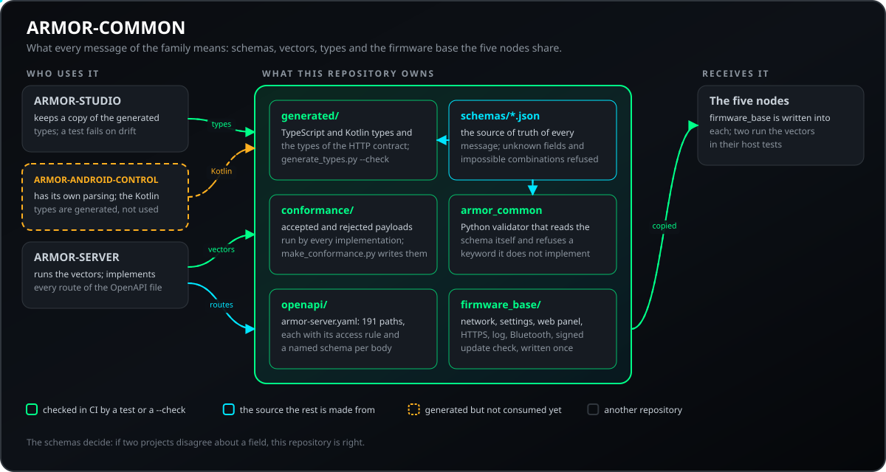
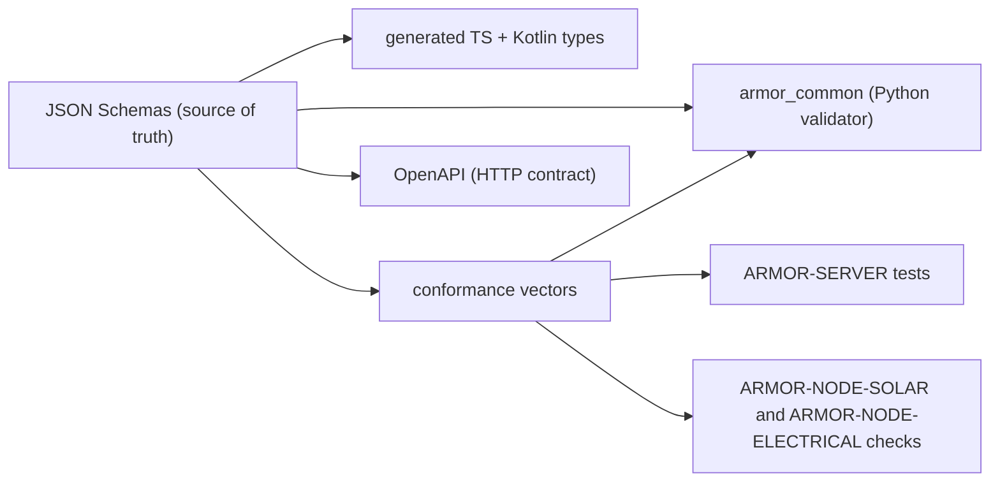
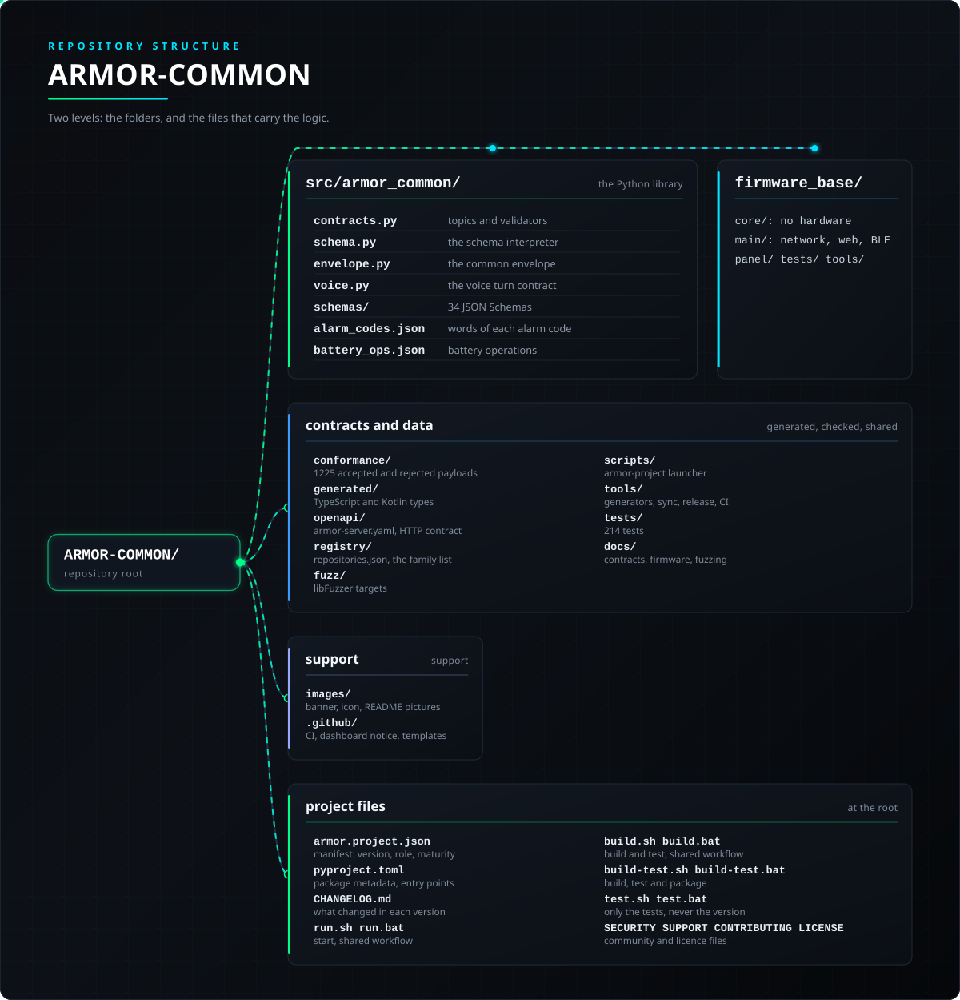

<p align="center">
  
</p>

# 🧾 ARMOR-COMMON

<p align="center">
  <a href="README.md">🇺🇸 English</a> |
  <a href="README_spa.md">🇪🇸 Español</a> |
  <a href="README_fra.md">🇫🇷 Français</a> |
  <a href="README_ita.md">🇮🇹 Italiano</a> |
  <a href="README_deu.md">🇩🇪 Deutsch</a> |
  <a href="README_zho.md">🇨🇳 简体中文</a> |
  <a href="README_jpn.md">🇯🇵 日本語</a> |
  🇵🇹 <b>Português</b>
</p>

### Contratos de mensagens, validação, a base de firmware que os nós partilham e o lançador de projetos partilhado

<p align="center">
  
  
  
  
  
  
  
</p>

---

**Verificação de honestidade - o que funciona hoje:** Os esquemas (telemetria, saúde, comando, informação do nó, inversor e bateria solares, elétrico, alarme com o seu comando e resultado, e rede), o validador Python, os 1225 vetores de conformidade, os tipos TypeScript e Kotlin gerados, o ficheiro OpenAPI do servidor (191 caminhos), a base de firmware partilhada pelos cinco nós e o lançador de projetos partilhado são reais e testados (237 testes). O ficheiro Kotlin é gerado mas **ainda não é consumido** pelo ARMOR-ANDROID-CONTROL (que mantém a sua própria leitura), e o comando `set_thresholds` leva um único campo `sensitivity` porque os parâmetros reais do radar só ficam definidos quando existir firmware.

---

## 📋 Num relance

| | |
|---|---|
| Versão | `0.7.8` |
| Maturidade | Estabelecido |
| Função | Contratos partilhados, validador e base de firmware da família |
| Tecnologia | Python 3.11+, JSON Schema, OpenAPI; base de firmware em C++ (ESP-IDF) |
| Testes | 237 (`python -m unittest discover -s tests`), 1225 vetores de conformidade |
| Contrato | 34 JSON Schema, 191 caminhos HTTP (247 operações) |
| Funciona em | Qualquer computador (biblioteca e ferramentas); a base de firmware corre dentro dos cinco nós |
| Em hardware real | Só o nó de radar executou o firmware partilhado numa placa; os outros quatro não |
| Licença | GPL-3.0-or-later |

**Ir para:** [Visão geral](#-visão-geral) · [Arquitetura](#-arquitetura) · [Funcionalidades](#-funcionalidades) · [Segurança](#-segurança-e-proteção) · [Interfaces](#-interfaces) · [Configuração](#-configuração) · [Início rápido](#-início-rápido) · [Testes](#-testes) · [Problemas](#-resolução-de-problemas) · [Estrutura](#-estrutura-do-repositório) · [Relacionados](#-projetos-relacionados)

## 🚦 Estado do projeto

Cada linha é uma parte deste repositório e a luz diz até onde chega hoje. É escrita com o que o repositório consegue demonstrar (testes, compilações, execuções), não com o que está previsto.

🟢 Feito e verificado · 🟡 Funciona, com limites conhecidos · 🟠 Feito a meio ou ainda por verificar · 🔴 Por fazer ou a não funcionar

| Área | Estado | O que significa aqui |
|---|---|---|
| Software | 🟢 | Os esquemas, o validador de Python, os tipos gerados de TypeScript e Kotlin, o ficheiro OpenAPI do servidor e a base de firmware partilhada pelos cinco nós estão feitos. |
| Testes | 🟢 | Passam 237 testes e 1225 vetores de conformidade; os analisadores de JSON, Bluetooth e Improv do firmware são também testados com libFuzzer. |
| Protocolos e dados | 🟡 | Só as mensagens do nó radar são usadas todos os dias com uma placa real e o servidor; as dos outros nós são verificadas contra simulações. |
| Integração | 🟡 | Verifica-se que a base de firmware é idêntica em cada nó; os tipos de Kotlin estão gerados, mas a app Android ainda não os usa, porque mantém a sua própria análise. |
| Hardware | 🟠 | Só o nó radar executou este firmware partilhado numa placa; os outros quatro nós não. |
| Segurança | 🟡 | A verificação da assinatura do firmware e a derivação do PIN Bluetooth estão testadas no anfitrião; não houve revisão independente. |
| Documentação | 🟢 | Oito idiomas, o ficheiro OpenAPI, o guia de conformidade e o registo de alterações estão atualizados. |

## 🎯 Visão geral

O **ARMOR-COMMON** é dono do que significa cada mensagem do A.R.M.O.R. Os nós de radar, os nós de ligação solares e o simulador produzem estas mensagens; o servidor, a IA visual e o serviço de voz consomem-nas. Se dois projetos discordarem sobre um campo, este repositório decide.

* **Uma única fonte de verdade:** esquemas JSON em `src/armor_common/schemas/` para telemetria, saúde, comando, informação do nó, as duas mensagens solares (inversor, bateria com células e capacidades), as mensagens elétricas (leituras, comando, resultado), as mensagens de alarme (estado, comando, resultado) e a mensagem de rede. Campos desconhecidos e combinações impossíveis são recusados.
* **Um validador que não pode saltar uma regra:** interpreta o esquema diretamente e recusa um esquema que use uma palavra-chave que não implementa.
* **Vetores de conformidade:** 1225 cargas aceites e recusadas executadas por cada implementação (Python aqui, TypeScript no ARMOR-SERVER, as verificações dos repositórios de firmware), de modo que um desvio faz falhar uma compilação.
* **Clientes gerados:** os tipos TypeScript e Kotlin saem dos esquemas (`tools/generate_types.py --check` mantém-nos atuais).
* **Contrato HTTP:** `openapi/armor-server.yaml` descreve cada rota do servidor (191 caminhos, 247 operações), a sua regra de acesso e um esquema com nome para cada corpo de pedido, resposta e erro, e um teste verifica que as rotas que o servidor regista são exatamente as que descreve (método e caminho).
* **Base de firmware:** `firmware_base/` guarda uma só vez cada ficheiro que os cinco nós partilham (rede, definições e utilizadores, servidor do painel web e login, certificado HTTPS, registo, Bluetooth com emparelhamento por PIN, verificação de atualizações assinadas; relés e Zigbee nos nós que os têm); `tools/sync_firmware_base.py` escreve-o em cada nó e verifica que nenhuma cópia se desviou ([o guia](docs/FIRMWARE_BASE.md), [firmware assinado](docs/SIGNED_FIRMWARE.md)).
* **Lançador partilhado:** `tools/armor_project_tool.py` dá a cada repositório da família o mesmo fluxo `build`, `build-test` e `run`, e `tools/armor_ci_validate.py` as mesmas verificações de CI.
* **Ligação TLS opcional ao broker na base partilhada dos nós:** `firmware_base` traz o interruptor `mqtt.tls` e o texto `mqtt.ca_pem` (um certificado PEM, no máximo 2 KB, validado), a ligação que confia só nessa autoridade e verifica o nome do broker, e os testes no computador partilhados pelos cinco nós; desativada por predefinição.
* **Saúde dos nós e perfis de armar:** a mensagem `node_health` (o mesmo relatório de um nó de radar, solar, elétrico, de alarme ou de painel de parede) e o `arm_profile` (uma forma com nome de armar: que zonas vigiam, os atrasos, a sirene e com que insistência o servidor avisa, dentro do comando de armar) têm os seus esquemas, vetores de conformidade, tipos TypeScript e Kotlin gerados, rotas OpenAPI e o código de firmware partilhado que constrói o relatório.
* **Eventos de ligação e de sistema do histórico:** os esquemas `connection_event`, `system_event` e `connection_client` (o que o histórico do servidor diz dos clientes que se ligam e do próprio sistema, com um vocabulário fixo e nenhum campo onde possa ir um segredo), os seus vetores de conformidade, os tipos TypeScript e Kotlin gerados e a rota OpenAPI que lista os clientes.
* **Diagnóstico e qualidade das leituras no contrato:** o relatório de arranque sujo, o core dump, a verificação de segurança das definições, o pacote de diagnóstico, os eventos do radar e as mensagens do token de diagnóstico só de leitura têm os seus esquemas, vetores de conformidade e tipos gerados; um canal de contador pode levar a idade da sua leitura e a sua contagem de erros, e uma mensagem de inversor pode nomear os valores que o nó manteve num limite.

## 🧩 Papel no A.R.M.O.R.

O ARMOR-COMMON é o que mantém a família a falar a mesma língua. Cada mensagem entre um nó e o [ARMOR-SERVER](https://github.com/JuanenRac/ARMOR-SERVER) é definida aqui uma vez, com os vetores que toda a implementação tem de passar; aqui vive também o contrato HTTP do servidor; e o firmware que os cinco nós partilham ([ARMOR-NODE-RADAR](https://github.com/JuanenRac/ARMOR-NODE-RADAR), [ARMOR-NODE-SOLAR](https://github.com/JuanenRac/ARMOR-NODE-SOLAR), [ARMOR-NODE-ELECTRICAL](https://github.com/JuanenRac/ARMOR-NODE-ELECTRICAL), [ARMOR-NODE-ALARM](https://github.com/JuanenRac/ARMOR-NODE-ALARM), [ARMOR-NODE-HMI](https://github.com/JuanenRac/ARMOR-NODE-HMI)) é guardado uma vez e copiado para eles por uma ferramenta. Não guarda nenhum segredo e não executa nada em produção.

| Fala com | Como | Para quê |
|---|---|---|
| ARMOR-SERVER | executa os vetores; implementa cada rota OpenAPI | vetores, OpenAPI |
| ARMOR-STUDIO | guarda uma cópia dos tipos gerados; um teste falha se divergirem | TypeScript gerado |
| ARMOR-ANDROID-CONTROL | tem a sua análise; os tipos Kotlin são gerados mas não usados | Kotlin gerado |
| ARMOR-NODE-RADAR, SOLAR, ELECTRICAL, ALARM, HMI | recebem firmware_base com `tools/sync_firmware_base.py` | firmware copiado |
| ARMOR-DOCS, ARMOR-DEVOPS, ARMOR-UPDATER | leem `registry/repositories.json`, a lista única de repositórios | o registo |

## 🏛️ Arquitetura

<p align="center">
  
</p>

<details>
<summary>Versão em texto do diagrama (Mermaid)</summary>



</details>

## ✨ Funcionalidades

### Adicionar ou alterar uma mensagem

1. Edite o esquema em `src/armor_common/schemas/` (e `docs/CONTRACTS.md` se o significado mudar).
2. Adicione os casos à lista e execute `python tools/make_conformance.py`.
3. Execute `python tools/generate_types.py` e `python tools/generate_rest_types.py` para renovar os tipos TypeScript e Kotlin.
4. Atualize `openapi/armor-server.yaml` se houver uma rota envolvida; `tests/test_openapi.py` compara-o com as rotas do servidor.
5. O servidor e os nós executam então os mesmos vetores, por isso um desacordo faz falhar a compilação.

### A base de firmware

`firmware_base/` guarda uma só vez cada ficheiro que os cinco nós partilham: rede, definições e utilizadores, o servidor do painel web e o seu início de sessão, o certificado HTTPS, o registo, Bluetooth com emparelhamento por PIN, a verificação de uma atualização assinada, o relatório de saúde do nó, o guarda que reinicia um nó em dificuldades, as ordens tipadas do servidor e, nos nós que os têm, relés e Zigbee. `tools/sync_firmware_base.py` escreve-a em cada nó e verifica que nenhuma cópia divergiu (ver [docs/FIRMWARE_BASE.md](docs/FIRMWARE_BASE.md) e [docs/SIGNED_FIRMWARE.md](docs/SIGNED_FIRMWARE.md)). As decisões que não precisam de hardware vivem em `core/` e testam-se num computador; `main/` lê os valores reais.

## 🔒 Segurança e proteção

| Ameaça | Defesa |
|---|---|
| Um campo desconhecido ou uma combinação impossível | `additionalProperties: false`; o validador interpreta o esquema e recusa carregar um que use uma palavra-chave que não implementa |
| Telemetria sem limite que esgote um nó | No máximo 15 pistas (5 por cada um de 3 sensores) e lux de 0 a 200 000 |
| Uma ordem fora da lista | Lista fechada: `calibrate`, `set_thresholds` (sensibilidade 1 a 10), `restart`; o subscritor recusa o resto antes do hardware |
| Um tópico que não coincide com o id do nó do corpo | O consumidor recusa a discrepância |
| Um firmware falso no GitHub | A imagem tem de coincidir com o seu `.sha256` e levar uma assinatura Ed25519 desse hash, verificada com a chave pública de `firmware_base/core/fw_trust.hpp`; sem isso nada muda |
| A chave privada de publicação vaza | Vive fora de qualquer repositório, CI e publicação (PKCS#8, modo 0600); `release_firmware.py` recusa publicar se a chave não for a que o firmware reconhece |
| Palavras-passe de nó e PIN Bluetooth | Palavras-passe: PBKDF2-HMAC-SHA256, 10 000 rondas. PIN: derivado do MAC e do segredo de frota (`CONFIG_ARMOR_FLEET_SECRET`, vazio no firmware público) |
| Analisadores expostos (JSON, tramas Bluetooth, Improv) | Fuzzing com libFuzzer, AddressSanitizer e UndefinedBehaviorSanitizer (`fuzz/run_fuzz.sh`, Linux com clang) |
| A cópia de um nó diverge da partilhada | `tools/sync_firmware_base.py check` falha se os cinco nós não forem idênticos |

**O que não cobre.** Um firmware enviado à mão por um administrador não é verificado. Um nó com um firmware anterior a esta verificação instala a primeira versão assinada só pelo seu hash. A chave protege as versões, não as placas: com acesso físico qualquer pessoa grava o que quiser. Se a chave se perder, o atualizador do GitHub fica bloqueado até a chave pública ser substituída por um envio manual ou por cabo. A verificação da assinatura e o PIN estão testados no anfitrião; não houve revisão independente. Mais em [docs/SIGNED_FIRMWARE.md](docs/SIGNED_FIRMWARE.md).

## 🔌 Interfaces

### Tópicos do broker

| Tópico | O que leva |
|---|---|
| `armor/node/{node_id}/telemetry`  `health`  `command`  `info` | um nó de radar: pistas, saúde, ordens e informação |
| `armor/solar/{node_id}/{device}/state` | um inversor ou uma bateria de um nó solar |
| `armor/electrical/{node_id}/state`  `command`  `result` | o nó elétrico: leituras, ordem, resultado |
| `armor/alarm/{node_id}/state`  `command`  `result` | o nó de alarme (também `zigbee` e `policy` do servidor) |
| `armor/network/{node_id}/state` | o que um nó vê na rede |
| `armor/health/{node_id}` | o relatório de saúde de qualquer nó e a sua última vontade |
| `armor/control/{node_id}/command`  `result`  `maintenance`  and `armor/control/all/command` | ordens tipadas para um nó ou todos, o seu resultado e o sinal de manutenção prevista |
| `armor/device/{node_id}/{relay}/set`  `state`  `availability` | um relé de um nó |
| `armor/radar/{node_id}/events`  and  `armor/server/alert` | eventos do radar; alertas que o servidor envia aos painéis |

### Esquemas, vetores e OpenAPI

* **34 JSON Schema** em `src/armor_common/schemas/`: telemetria, saúde, ordem, informação do nó, saúde do nó, controlo do nó (ordem e resultado), manutenção do nó, inversor e bateria solares (com as suas ordens e resultados), elétrico (com ordem e resultado), alarme (estado, ordem, resultado, política e zonas), rede (com as suas ordens), eventos de ligação e do sistema, eventos de radar, alerta do servidor, perfil de armamento, estado do dispositivo, tokens de diagnóstico e o turno de voz.
* **1225 vetores de conformidade** em `conformance/` (34 ficheiros, um por mensagem), executados por este repositório, pelo ARMOR-SERVER e pelas verificações dos repositórios de firmware.
* **OpenAPI** `openapi/armor-server.yaml`: 191 caminhos e 247 operações, cada uma com a sua regra de acesso e um esquema com nome para cada corpo, resposta e erro. Um teste verifica que as rotas que o servidor regista são exatamente as descritas. O turno de voz viaja como bytes (ver [docs/CONTRACTS.md](docs/CONTRACTS.md)).

### Ferramentas de linha de comandos

| Ferramenta | O que faz |
|---|---|
| `tools/armor_project_tool.py` | o fluxo partilhado `build`, `build-test` e `run` |
| `tools/generate_types.py [--check]`  `generate_rest_types.py [--check]` | tipos TypeScript e Kotlin, e os do contrato HTTP |
| `tools/make_conformance.py [--check]` | escreve os vetores de conformidade a partir da lista de casos |
| `tools/sync_firmware_base.py` (`check`, `sync`, `import`) | escreve `firmware_base` nos cinco nós, ou verifica que não divergiram |
| `tools/release_firmware.py`  `tools/firmware_sign.mjs` | assina e publica uma versão de firmware |
| `tools/voice_cases.py` | os casos de voz partilhados com ARMOR-VOICE-AI |
| `tools/make_architecture.py`  `tools/make_structure.py`  `tools/universal_readme_check.py` | as imagens e a verificação do formato dos README |

## ⚙️ Configuração

### Opções de compilação do firmware (Kconfig)

| Definição | Predefinição | O que faz |
|---|---|---|
| `CONFIG_ARMOR_NODE_ID` | "" | o nome do nó no broker |
| `CONFIG_ARMOR_SETUP_CODE` | "" | o código que abre a configuração |
| `CONFIG_ARMOR_FLEET_SECRET` | "" | segredo de frota para o PIN Bluetooth; vazio no firmware público |
| `CONFIG_ARMOR_BLE_SETUP_MINUTES` | 10 (1 to 120) | quanto tempo a configuração Bluetooth fica aberta |
| `CONFIG_ARMOR_ETH_SPI_HOST` | 1 (1 to 2) | host SPI do chip Ethernet |
| `CONFIG_ARMOR_ETH_MOSI` `MISO` `SCLK` `CS` `INT` `RST` | 11, 12, 13, 14, 10, 9 | pinos da placa Ethernet (perfil `s3-eth`) |
| `CONFIG_ARMOR_ETH_SPI_MHZ` | 20 (1 to 40) | relógio SPI do chip Ethernet |
| `CONFIG_ARMOR_MQTT_URI` `USERNAME` `PASSWORD` | "" | endereço e credenciais iniciais do broker |
| `CONFIG_ARMOR_BOOT_FACTORY_RESET` | y | permite a reposição de fábrica no arranque |
| `CONFIG_ARMOR_NTP_SERVER` | pool.ntp.org | servidor de hora |
| `CONFIG_ARMOR_HEARTBEAT_S` | 10 (2 to 300) | segundos entre batimentos |
| `CONFIG_ARMOR_BOARD_S3_WIFI`  `CONFIG_ARMOR_BOARD_S3_ETH` | S3_WIFI | o perfil de placa da imagem (`tools/build_node.sh NODE BOARD`) |

A ligação TLS do nó ao broker é uma definição do nó (não da compilação): `mqtt.tls` (desligada por predefinição) e `mqtt.ca_pem` (um certificado PEM, no máximo 2 KB, validado); a ligação só confia nessa autoridade e verifica o nome do broker. A biblioteca Python não tem variáveis de ambiente próprias; o lançador partilhado cria um `.env` ignorado na primeira execução do ARMOR-SERVER com segredos aleatórios e uma palavra-passe de administrador aleatória, e não imprime nem envia nada.

## 🚀 Início rápido

**Requisitos:** Python 3.11+ (nenhum outro pacote). Para verificar a base de firmware, os repositórios dos cinco nós têm de estar ao lado deste.

```powershell
python -m pip install -e .                   # instala a biblioteca
python -m unittest discover -s tests         # 237 testes, 1225 vetores
python tools/generate_types.py --check       # os tipos gerados estão atualizados
python tools/generate_rest_types.py --check  # os tipos do contrato HTTP estão atualizados
python tools/make_conformance.py             # regenera os vetores depois de editar a lista de casos (--check: estão atualizados)
python tools/sync_firmware_base.py check     # o firmware partilhado não divergiu
```

## 🧪 Testes

```powershell
python -m unittest discover -s tests  # 237 testes
python -I tools/armor_ci_validate.py
```

| Ficheiro de testes | Testes | O que cobre |
|---|---|---|
| `test_contracts.py` | 68 | cada mensagem, tópico e separador, com os vetores de conformidade |
| `test_task_safety_check.py` | 23 | a varredura que encontra as tarefas indispensáveis de um nó |
| `test_universal_readme_check.py`, `test_readme_tools.py` | 36 | a verificação do formato e as imagens dos README |
| `test_firmware_base.py` | 13 | a base de firmware partilhada e a sua sincronia |
| `test_openapi.py` | 13 | o ficheiro OpenAPI contra as rotas do servidor |
| `test_release_firmware.py` | 12 | a assinatura e publicação do firmware |
| `test_pretty_run.py`, `test_build_scripts.py` | 11 | o painel em direto dos scripts |
| `test_generated_types.py`, `test_repository_registry.py`, `test_voice_turn.py` | 21 | os tipos gerados, a lista de repositórios e o turno de voz |
| `test_alarm_codes.py`, `test_collect_errors.py`, `test_project_manifest_doc.py`, `test_firmware_fuzz.py`, `test_fuzz_validator.py` | 17 | palavras dos códigos de alarme, recolha de erros, guia do manifesto e banco de fuzzing |

Os testes de anfitrião do firmware partilhado estão em `firmware_base/tests/` (C++, sem ESP-IDF) e correm nas verificações dos próprios repositórios dos nós. `python tools/sync_firmware_base.py check` precisa dos repositórios dos cinco nós ao lado deste. O GitHub Actions executa a base do A.R.M.O.R. em cada push e pull request: a validação do manifesto, da versão, do registo de alterações e da paridade dos README, e depois a compilação e os testes do próprio projeto.

## 🏗️ Compilação e publicação

É Python puro e um conjunto de ferramentas: não há nada para compilar. A versão está em `pyproject.toml`, em `armor.project.json` e no emblema do README (lido do manifesto); cada versão tem a sua entrada em [CHANGELOG.md](CHANGELOG.md). As versões são publicadas no GitHub. A ferramenta de publicação de firmware (`tools/release_firmware.py`) assina e publica as imagens dos nós; a chave de que precisa nunca está num repositório.

## 🩺 Resolução de problemas

| Vê | Porque | Faça |
|---|---|---|
| `FIRMWARE_BASE=FAIL ... copies drifted` | um nó alterou à mão um ficheiro partilhado | faça a alteração em `firmware_base/` e execute `sync`; ou `import` para tomar os ficheiros dos nós tal como estão |
| `ARMOR-NODE-HMI: main/secret_vault.cpp is missing` | os repositórios dos nós não estão ao lado do ARMOR-COMMON | clone-os lado a lado |
| `generated types are out of date` | mudou um esquema ou o ficheiro OpenAPI | execute `generate_types.py` e `generate_rest_types.py` sem `--check` |
| `TASK_SAFETY=FAIL no task found: the scan is broken` | a varredura dos fontes dos nós não encontrou nada | verifique se os repositórios dos nós estão ao lado deste |
| `no_signature`, `bad_signature`, `checksum_mismatch`, `wrong_firmware` | o nó recusou uma versão: assinatura, hash ou placa em falta ou erradas | publique com `tools/release_firmware.py` e a chave que o firmware reconhece |

## 📂 Estrutura do repositório

<p align="center">
  
</p>

<details>
<summary>Versão em texto da árvore</summary>

```text
ARMOR-COMMON/
├── src/armor_common/
│   ├── contracts.py               tópicos e validadores
│   ├── schema.py                  o intérprete de esquemas
│   ├── envelope.py                o envelope comum
│   ├── voice.py                   o contrato de voz
│   ├── schemas/                   34 JSON Schema
│   ├── alarm_codes.json           palavras de cada alarme
│   └── battery_ops.json           operações de bateria
├── firmware_base/                 o firmware que os cinco nós partilham, uma só vez
├── conformance/                   1225 mensagens válidas e recusadas
├── generated/                     tipos TypeScript e Kotlin (gerados, não editar)
├── openapi/                       armor-server.yaml, contrato HTTP
├── registry/                      repositories.json, lista da família
├── fuzz/                          alvos libFuzzer
├── scripts/                       lançador armor-project
├── tools/                         geradores, sincronia e publicação do firmware, lançador, verificações de CI
├── tests/                         237 testes
├── docs/                          contratos, firmware, fuzzing
├── images/                        faixa, ícone e as imagens do README
├── .github/                       fluxo de CI, aviso ao painel, modelos de issues e pull requests
├── armor.project.json             manifesto: versão, função, maturidade
├── pyproject.toml                 metadados do pacote, entradas
├── CHANGELOG.md                   o que mudou em cada versão
├── run.sh run.bat                 arrancar, fluxo partilhado
├── build.sh build.bat             compilar e testar, fluxo partilhado
├── build-test.sh build-test.bat   compilar, testar e empacotar
├── test.sh test.bat               só os testes, nunca a versão
└── SECURITY.md SUPPORT.md CONTRIBUTING.md CODE_OF_CONDUCT.md LICENSE
```

</details>

## 🗺️ Roteiro e limites conhecidos

**Limites conhecidos hoje**

* Os tipos Kotlin são gerados mas **ainda não são usados** pelo ARMOR-ANDROID-CONTROL, que mantém a sua própria análise.
* A ordem `set_thresholds` tem um único campo `sensitivity`: os parâmetros reais do radar só se definem quando o firmware existir.
* Só o nó de radar executou o firmware partilhado numa placa; os outros quatro não.
* Sem revisão de segurança independente.

**A seguir**

* Fazer a aplicação Android usar os tipos Kotlin gerados.
* Definir os parâmetros reais do radar de `set_thresholds`.
* Executar o firmware partilhado nas placas dos outros quatro nós.

## 🌍 Idiomas

O README e os textos existem em inglês, espanhol, francês, italiano, alemão, chinês, japonês e português europeu.

## 🔗 Projetos relacionados

O **A.R.M.O.R.** (Autonomous Radar & Multimodal Observation Range) é um sistema de segurança perimetral feito de repositórios independentes. Cada um tem a sua própria versão, os seus próprios testes e o seu próprio README; esta é a família:

* **ARMOR-COMMON** (este repositório) - Contratos de mensagens, validadores, vetores de conformidade e tipos gerados
* **[ARMOR-NODE-RADAR](https://github.com/JuanenRac/ARMOR-NODE-RADAR)** - Firmware de nó de campo para ESP32-S3 com três radares e o seu próprio painel web
* **[ARMOR-NODE-SOLAR](https://github.com/JuanenRac/ARMOR-NODE-SOLAR)** - Protocolos de inversores e baterias solares e as mensagens de um nó porta de ligação
* **[ARMOR-NODE-ELECTRICAL](https://github.com/JuanenRac/ARMOR-NODE-ELECTRICAL)** - Nó elétrico: contadores, a mensagem das leituras da rede e as regras de comutação
* **[ARMOR-NODE-ALARM](https://github.com/JuanenRac/ARMOR-NODE-ALARM)** - Nó e painel de alarme: zonas, armar, atrasos, sirene e PIN, com o servidor ou sem ele
* **[ARMOR-NODE-HMI](https://github.com/JuanenRac/ARMOR-NODE-HMI)** - Painel tátil: o estado do sistema num ecrã de parede, armar e reconhecer, e a casa do assistente de voz
* **[ARMOR-NETWORK](https://github.com/JuanenRac/ARMOR-NETWORK)** - A rede local: os seus dispositivos, a internet e o que muda
* **[ARMOR-SERVER](https://github.com/JuanenRac/ARMOR-SERVER)** - Coordenador central: telemetria, alarmes, dispositivos, leituras solares e câmaras
* **[ARMOR-STUDIO](https://github.com/JuanenRac/ARMOR-STUDIO)** - Consola web: câmaras, radar, alarmes, energia solar e o desenhador 2D/3D do local
* **[ARMOR-ANDROID-CONTROL](https://github.com/JuanenRac/ARMOR-ANDROID-CONTROL)** - Cliente de operador Android com radar 2D/3D em direto
* **[ARMOR-IOS-CONTROL](https://github.com/JuanenRac/ARMOR-IOS-CONTROL)** - Cliente de operador para iPhone
* **[ARMOR-SERVER-AI](https://github.com/JuanenRac/ARMOR-SERVER-AI)** - Política de inferência visual que explica as suas decisões e nunca atua
* **[ARMOR-VISION](https://github.com/JuanenRac/ARMOR-VISION)** - Zonas de câmara, máscaras e regras de deteção para o Jetson Orin NX
* **[ARMOR-VOICE-AI](https://github.com/JuanenRac/ARMOR-VOICE-AI)** - Intenções de voz offline com uma confirmação que não pode ser falsificada
* **[ARMOR-HARDWARE](https://github.com/JuanenRac/ARMOR-HARDWARE)** - Caixas, eletrónica e a matriz de aceitação em bancada
* **[ARMOR-DEVOPS](https://github.com/JuanenRac/ARMOR-DEVOPS)** - Implantação, a bancada de testes do CM5, cópias de segurança e TLS
* **[ARMOR-SIMULATOR](https://github.com/JuanenRac/ARMOR-SIMULATOR)** - Simulador de telemetria offline com falhas repetíveis
* **[ARMOR-UPDATER](https://github.com/JuanenRac/ARMOR-UPDATER)** - Deteta, instala e atualiza os repositórios do próprio ecossistema
* **[ARMOR-DOCS](https://github.com/JuanenRac/ARMOR-DOCS)** - Arquitetura, base de segurança e a matriz de capacidades

## 📚 Documentação

* [Contratos](docs/CONTRACTS.md): cada mensagem, tópico e como alterar um contrato
* [Base de firmware](docs/FIRMWARE_BASE.md): o que os cinco nós partilham e como se sincroniza
* [Firmware assinado](docs/SIGNED_FIRMWARE.md): a assinatura das versões e o que não cobre
* [Fuzzing](docs/FUZZING.md): os três alvos de análise e como os executar
* [Manifesto do projeto](docs/PROJECT_MANIFEST.md): o `armor.project.json` de cada repositório
* [As imagens dos README](docs/README_PICTURES.md): como se desenham a Arquitetura e a Estrutura do repositório
* [Matriz de capacidades: o que está demonstrado e o que não está](https://github.com/JuanenRac/ARMOR-DOCS/blob/main/docs/CAPABILITY_MATRIX.md)
* [Catálogo de projetos: versões e como os repositórios dependem uns dos outros](https://github.com/JuanenRac/ARMOR-DOCS/blob/main/docs/PROJECT_CATALOG.md)
* [Registo de alterações deste repositório](CHANGELOG.md)

## 🤝 Contribuir e comunidade

* Antes de um pull request execute `python -I tools/armor_ci_validate.py` e os testes: ambos têm de passar. Consulte [CONTRIBUTING.md](CONTRIBUTING.md) e o [código de conduta](CODE_OF_CONDUCT.md).
* O README existe em oito idiomas e é gerado a partir das fontes do ARMOR-DOCS: uma alteração ao texto faz-se lá.
* Uma alteração a uma mensagem entre componentes começa no ARMOR-COMMON.
* Não descreva como a funcionar numa placa aquilo que só foi compilado.
* Comunique uma vulnerabilidade em privado: [SECURITY.md](SECURITY.md). Perguntas, ideias e relatórios: electrohobby3d@gmail.com ([SUPPORT.md](SUPPORT.md)).

## 👤 AUTOR

**JuanenRac (Electro Hobby 3D)** · electrohobby3d@gmail.com

## 📜 LICENÇA

GPL-3.0-or-later - consulte [LICENSE](LICENSE).
