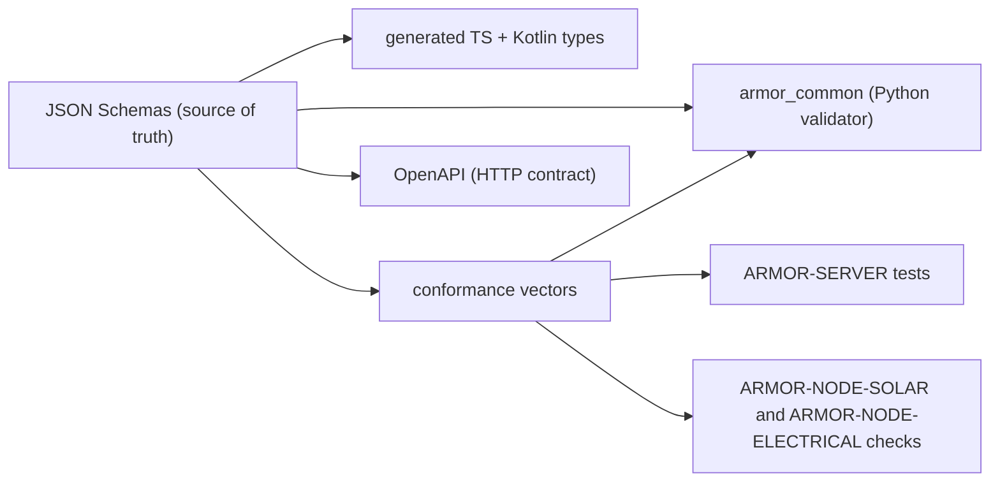

<p align="center">
  
</p>

# 🧾 ARMOR-COMMON

<p align="center">
  <a href="README.md">🇺🇸 English</a> |
  <a href="README_spa.md">🇪🇸 Español</a> |
  <a href="README_fra.md">🇫🇷 Français</a> |
  <a href="README_ita.md">🇮🇹 Italiano</a> |
  <a href="README_deu.md">🇩🇪 Deutsch</a> |
  <a href="README_zho.md">🇨🇳 简体中文</a> |
  <a href="README_jpn.md">🇯🇵 日本語</a> |
  🇵🇹 <b>Português</b>
</p>

### Contratos de mensagens, validação, a base de firmware que os nós partilham e o lançador de projetos partilhado

<p align="center">
  
  
  
  
  
  
</p>

---

**Verificação de honestidade - o que funciona hoje:** Os esquemas (telemetria, saúde, comando, informação do nó, inversor e bateria solares, elétrico, alarme com o seu comando e resultado, e rede), o validador Python, os 1225 vetores de conformidade, os tipos TypeScript e Kotlin gerados, o ficheiro OpenAPI do servidor (190 caminhos), a base de firmware partilhada pelos cinco nós e o lançador de projetos partilhado são reais e testados (170 testes). O ficheiro Kotlin é gerado mas **ainda não é consumido** pelo ARMOR-ANDROID-CONTROL (que mantém a sua própria leitura), e o comando `set_thresholds` leva um único campo `sensitivity` porque os parâmetros reais do radar só ficam definidos quando existir firmware.

---

## 📋 Num relance

| | |
|---|---|
| Versão | `0.7.6` |
| Maturidade | Estabelecido |
| Testes | 170 (`python -m unittest discover -s tests`) e 1225 vetores de conformidade |
| Tecnologia | Python 3.11+ / JSON Schema / OpenAPI |
| Em hardware real | Só o nó radar funcionou numa placa: as suas mensagens são as que o servidor do CM5, o Studio e a aplicação Android falam todos os dias; as mensagens dos outros nós são verificadas contra substitutos |

## 🚦 Estado do projeto

Cada linha é uma parte deste repositório e a luz diz até onde chega hoje. É escrita com o que o repositório consegue demonstrar (testes, compilações, execuções), não com o que está previsto.

🟢 Feito e verificado · 🟡 Funciona, com limites conhecidos · 🟠 Feito a meio ou ainda por verificar · 🔴 Por fazer ou a não funcionar

| Área | Estado | O que significa aqui |
|---|---|---|
| Software | 🟢 | Os esquemas, o validador de Python, os tipos gerados de TypeScript e Kotlin, o ficheiro OpenAPI do servidor e a base de firmware partilhada pelos cinco nós estão feitos. |
| Testes | 🟢 | Passam 170 testes e 1225 vetores de conformidade; os analisadores de JSON, Bluetooth e Improv do firmware são também testados com libFuzzer. |
| Protocolos e dados | 🟡 | Só as mensagens do nó radar são usadas todos os dias com uma placa real e o servidor; as dos outros nós são verificadas contra simulações. |
| Integração | 🟡 | Verifica-se que a base de firmware é idêntica em cada nó; os tipos de Kotlin estão gerados, mas a app Android ainda não os usa, porque mantém a sua própria análise. |
| Hardware | 🟠 | Só o nó radar executou este firmware partilhado numa placa; os outros quatro nós não. |
| Segurança | 🟡 | A verificação da assinatura do firmware e a derivação do PIN Bluetooth estão testadas no anfitrião; não houve revisão independente. |
| Documentação | 🟢 | Oito idiomas, o ficheiro OpenAPI, o guia de conformidade e o registo de alterações estão atualizados. |

## 🎯 Visão geral

O **ARMOR-COMMON** é dono do que significa cada mensagem do A.R.M.O.R. Os nós de radar, os nós de ligação solares e o simulador produzem estas mensagens; o servidor, a IA visual e o serviço de voz consomem-nas. Se dois projetos discordarem sobre um campo, este repositório decide.

* **Uma única fonte de verdade:** esquemas JSON em `src/armor_common/schemas/` para telemetria, saúde, comando, informação do nó, as duas mensagens solares (inversor, bateria com células e capacidades), as mensagens elétricas (leituras, comando, resultado), as mensagens de alarme (estado, comando, resultado) e a mensagem de rede. Campos desconhecidos e combinações impossíveis são recusados.
* **Um validador que não pode saltar uma regra:** interpreta o esquema diretamente e recusa um esquema que use uma palavra-chave que não implementa.
* **Vetores de conformidade:** 1225 cargas aceites e recusadas executadas por cada implementação (Python aqui, TypeScript no ARMOR-SERVER, as verificações dos repositórios de firmware), de modo que um desvio faz falhar uma compilação.
* **Clientes gerados:** os tipos TypeScript e Kotlin saem dos esquemas (`tools/generate_types.py --check` mantém-nos atuais).
* **Contrato HTTP:** `openapi/armor-server.yaml` descreve cada rota do servidor (190 caminhos, 245 operações), a sua regra de acesso e um esquema com nome para cada corpo de pedido, resposta e erro, e um teste verifica que as rotas que o servidor regista são exatamente as que descreve (método e caminho).
* **Base de firmware:** `firmware_base/` guarda uma só vez cada ficheiro que os cinco nós partilham (rede, definições e utilizadores, servidor do painel web e login, certificado HTTPS, registo, Bluetooth com emparelhamento por PIN, verificação de atualizações assinadas; relés e Zigbee nos nós que os têm); `tools/sync_firmware_base.py` escreve-o em cada nó e verifica que nenhuma cópia se desviou ([o guia](docs/FIRMWARE_BASE.md), [firmware assinado](docs/SIGNED_FIRMWARE.md)).
* **Lançador partilhado:** `tools/armor_project_tool.py` dá a cada repositório da família o mesmo fluxo `build`, `build-test` e `run`, e `tools/armor_ci_validate.py` as mesmas verificações de CI.
* **Ligação TLS opcional ao broker na base partilhada dos nós:** `firmware_base` traz o interruptor `mqtt.tls` e o texto `mqtt.ca_pem` (um certificado PEM, no máximo 2 KB, validado), a ligação que confia só nessa autoridade e verifica o nome do broker, e os testes no computador partilhados pelos cinco nós; desativada por predefinição.
* **Saúde dos nós e perfis de armar:** a mensagem `node_health` (o mesmo relatório de um nó de radar, solar, elétrico, de alarme ou de painel de parede) e o `arm_profile` (uma forma com nome de armar: que zonas vigiam, os atrasos, a sirene e com que insistência o servidor avisa, dentro do comando de armar) têm os seus esquemas, vetores de conformidade, tipos TypeScript e Kotlin gerados, rotas OpenAPI e o código de firmware partilhado que constrói o relatório.
* **Eventos de ligação e de sistema do histórico:** os esquemas `connection_event`, `system_event` e `connection_client` (o que o histórico do servidor diz dos clientes que se ligam e do próprio sistema, com um vocabulário fixo e nenhum campo onde possa ir um segredo), os seus vetores de conformidade, os tipos TypeScript e Kotlin gerados e a rota OpenAPI que lista os clientes.
* **Diagnóstico e qualidade das leituras no contrato:** o relatório de arranque sujo, o core dump, a verificação de segurança das definições, o pacote de diagnóstico, os eventos do radar e as mensagens do token de diagnóstico só de leitura têm os seus esquemas, vetores de conformidade e tipos gerados; um canal de contador pode levar a idade da sua leitura e a sua contagem de erros, e uma mensagem de inversor pode nomear os valores que o nó manteve num limite.

## 🧩 Papel no A.R.M.O.R.

O ARMOR-COMMON é o que mantém a família a falar a mesma língua. Cada mensagem entre um nó e o [ARMOR-SERVER](https://github.com/JuanenRac/ARMOR-SERVER) é definida aqui uma vez, com os vetores que toda a implementação tem de passar; aqui vive também o contrato HTTP do servidor; e o firmware que os cinco nós partilham ([ARMOR-NODE-RADAR](https://github.com/JuanenRac/ARMOR-NODE-RADAR), [ARMOR-NODE-SOLAR](https://github.com/JuanenRac/ARMOR-NODE-SOLAR), [ARMOR-NODE-ELECTRICAL](https://github.com/JuanenRac/ARMOR-NODE-ELECTRICAL), [ARMOR-NODE-ALARM](https://github.com/JuanenRac/ARMOR-NODE-ALARM), [ARMOR-NODE-HMI](https://github.com/JuanenRac/ARMOR-NODE-HMI)) é guardado uma vez e copiado para eles por uma ferramenta. Não guarda nenhum segredo e não executa nada em produção.

## 🔄 Arquitetura



## 📂 Estrutura do repositório

```text
ARMOR-COMMON/
├── src/armor_common/   contracts, schema (validator), envelope, schemas/*.json (the node messages, the alarm, electrical and network ones, the relay, zone-feed, alert and orders ones)
├── conformance/        accepted and rejected payloads shared by every implementation
├── firmware_base/      the firmware that the five nodes share, once (synced into each by tools/sync_firmware_base.py)
├── generated/          TypeScript and Kotlin types (generated, do not edit)
├── openapi/            armor-server.yaml
├── registry/           repositories.json: the one list of the repositories of the family (kind, group, technologies, place on the map, who feeds whom) that the documentation, deployment and update tools read
├── tools/              armor_project_tool.py, generate_types.py, generate_rest_types.py, make_conformance.py, sync_firmware_base.py, release_firmware.py, firmware_sign.mjs
├── tests/              unit tests and conformance runner
└── docs/               contracts guide, the shared firmware base
```

## 🛠️ Ambiente de desenvolvimento

**Requisitos:** Python 3.11+

```powershell
python -m pip install -e .
python -m unittest discover -s tests      # 170 tests, 1225 conformance vectors
python tools/generate_types.py --check    # generated types are current
python tools/generate_rest_types.py --check    # the types of the HTTP contract are current
python tools/make_conformance.py          # regenerate the vectors after editing the case list (--check: they are current)
python tools/sync_firmware_base.py check  # the firmware the node projects share has not drifted (see docs/FIRMWARE_BASE.md)
```

Tópicos do broker: `armor/node/{node_id}/telemetry | health | command | info`, `armor/solar/{node_id}/{device}/state`, `armor/electrical/{node_id}/state | command | result`, `armor/alarm/{node_id}/state | command | result` e `armor/network/{node_id}/state`. Veja o [guia de contratos](docs/CONTRACTS.md). O lançador partilhado cria um `.env` ignorado na primeira execução do ARMOR-SERVER com segredos aleatórios e uma palavra-passe de administrador aleatória; nada é impresso nem enviado.

## 🔗 Projetos relacionados

O **A.R.M.O.R.** (Autonomous Radar & Multimodal Observation Range) é um sistema de segurança perimetral feito de repositórios independentes. Cada um tem a sua própria versão, os seus próprios testes e o seu próprio README; esta é a família:

* **ARMOR-COMMON** (este repositório) - Contratos de mensagens, validadores, vetores de conformidade e tipos gerados
* **[ARMOR-NODE-RADAR](https://github.com/JuanenRac/ARMOR-NODE-RADAR)** - Firmware de nó de campo para ESP32-S3 com três radares e o seu próprio painel web
* **[ARMOR-NODE-SOLAR](https://github.com/JuanenRac/ARMOR-NODE-SOLAR)** - Protocolos de inversores e baterias solares e as mensagens de um nó de ligação
* **[ARMOR-NODE-ELECTRICAL](https://github.com/JuanenRac/ARMOR-NODE-ELECTRICAL)** - Nó elétrico: contadores, a mensagem das leituras da rede e as regras de comutação
* **[ARMOR-NODE-ALARM](https://github.com/JuanenRac/ARMOR-NODE-ALARM)** - Nó e central de alarme: zonas, armar, atrasos, sirene e PIN, com o servidor ou sem ele
* **[ARMOR-NODE-HMI](https://github.com/JuanenRac/ARMOR-NODE-HMI)** - Painel tátil: o estado do sistema num ecrã de parede, armar e reconhecer, e a casa do assistente de voz
* **[ARMOR-NETWORK](https://github.com/JuanenRac/ARMOR-NETWORK)** - A rede local: os seus dispositivos, a internet e o que muda
* **[ARMOR-SERVER](https://github.com/JuanenRac/ARMOR-SERVER)** - Coordenador central: telemetria, alarmes, dispositivos, leituras solares e câmaras
* **[ARMOR-STUDIO](https://github.com/JuanenRac/ARMOR-STUDIO)** - Consola web: câmaras, radar, alarmes, energia solar e o desenhador de local 2D/3D
* **[ARMOR-ANDROID-CONTROL](https://github.com/JuanenRac/ARMOR-ANDROID-CONTROL)** - Cliente Android de operador com um radar 2D/3D em direto
* **[ARMOR-IOS-CONTROL](https://github.com/JuanenRac/ARMOR-IOS-CONTROL)** - Cliente de operador para iPhone
* **[ARMOR-SERVER-AI](https://github.com/JuanenRac/ARMOR-SERVER-AI)** - Política de inferência visual que explica as suas decisões e nunca atua
* **[ARMOR-VISION](https://github.com/JuanenRac/ARMOR-VISION)** - Zonas de câmara, máscaras e regras de deteção para o Jetson Orin NX
* **[ARMOR-VOICE-AI](https://github.com/JuanenRac/ARMOR-VOICE-AI)** - Intenções de voz offline com uma confirmação que não se pode falsificar
* **[ARMOR-HARDWARE](https://github.com/JuanenRac/ARMOR-HARDWARE)** - Caixas, eletrónica e a matriz de aceitação de bancada
* **[ARMOR-DEVOPS](https://github.com/JuanenRac/ARMOR-DEVOPS)** - Implementação, a bancada de testes CM5, cópias de segurança e TLS
* **[ARMOR-SIMULATOR](https://github.com/JuanenRac/ARMOR-SIMULATOR)** - Simulador de telemetria offline com falhas repetíveis
* **[ARMOR-UPDATER](https://github.com/JuanenRac/ARMOR-UPDATER)** - Deteta, instala e atualiza os próprios repositórios do ecossistema
* **[ARMOR-DOCS](https://github.com/JuanenRac/ARMOR-DOCS)** - Arquitetura, linha de base de segurança e a matriz de capacidades

## 📚 Documentação e comunidade

Onde ler mais:

* [Matriz de capacidades: o que está provado e o que não](https://github.com/JuanenRac/ARMOR-DOCS/blob/main/docs/CAPABILITY_MATRIX.md)
* [Catálogo de projetos: versões e como os repositórios dependem uns dos outros](https://github.com/JuanenRac/ARMOR-DOCS/blob/main/docs/PROJECT_CATALOG.md)
* [Registo de alterações deste repositório](CHANGELOG.md)
* [Licença (GPL-3.0-or-later)](LICENSE)
* Perguntas, ideias e relatórios: electrohobby3d@gmail.com

## 👤 AUTOR

**JuanenRac (Electro Hobby 3D)** · electrohobby3d@gmail.com

## 📜 LICENÇA

GPL-3.0-or-later - veja [LICENSE](LICENSE).
