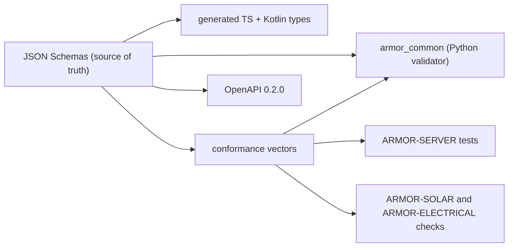

<p align="center">
  
</p>

# 🧾 ARMOR-COMMON

<p align="center">
  <a href="README.md">🇺🇸 English</a> |
  <a href="README_spa.md">🇪🇸 Español</a> |
  <a href="README_fra.md">🇫🇷 Français</a> |
  <a href="README_ita.md">🇮🇹 Italiano</a> |
  <a href="README_deu.md">🇩🇪 Deutsch</a> |
  <a href="README_zho.md">🇨🇳 简体中文</a> |
  <a href="README_jpn.md">🇯🇵 日本語</a> |
  <a href="README_por.md">🇵🇹 Português</a>
</p>


### Contratos de mensagens, validação e o lançador de projeto partilhado

<p align="center">
  
  
  
  
  
</p>

---

**Verificação de honestidade - o que funciona hoje:** Os esquemas, o validador Python, os 330 vetores de conformidade partilhados, os tipos TypeScript e Kotlin gerados e o lançador de projeto partilhado são reais e testados (36 testes). O ficheiro Kotlin é gerado mas **ainda não é consumido** pelo ARMOR-ANDROID-CONTROL, e o comando `set_thresholds` leva um único campo `sensitivity` porque os parâmetros reais do radar não estão definidos até existir firmware.

---

## 🎯 Visão geral

O **ARMOR-COMMON** é dono do que significa cada mensagem do A.R.M.O.R. Os nós de radar, os nós de ligação solares e o simulador produzem estas mensagens; o servidor, a IA visual e o serviço de voz consomem-nas. Se dois projetos discordarem sobre um campo, este repositório decide.

* **Uma só fonte de verdade:** esquemas JSON em `src/armor_common/schemas/` para telemetria, saúde, comando, informação do nó e as duas mensagens solares (inversor, bateria com células e capacidades). Os campos desconhecidos rejeitam-se em todo o lado.
* **Um validador que não pode saltar uma regra:** interpreta o esquema diretamente e recusa um esquema que use uma palavra-chave que não implementa.
* **Vetores de conformidade:** 330 cargas aceites e rejeitadas executadas por cada implementação (Python aqui, TypeScript no ARMOR-SERVER, as verificações do ARMOR-SOLAR), para que a deriva faça falhar uma construção.
* **Clientes gerados:** os tipos TypeScript e Kotlin vêm dos esquemas (`tools/generate_types.py --check` mantém-nos atuais).
* **Contrato HTTP:** `openapi/armor-server-0.2.0.yaml` descreve cada rota do servidor, a sua regra de acesso e o seu esquema.
* **Lançador partilhado:** `tools/armor_project_tool.py` dá a cada repositório da família o mesmo fluxo `build`, `build-test` e `run`.

## 🔄 Arquitetura



## 📂 Estrutura do repositório

```text
ARMOR-COMMON/
├── src/armor_common/   contracts, schema (validator), envelope, schemas/*.json (telemetry, health, command, info, solar_inverter, solar_battery, electrical)
├── conformance/        accepted and rejected payloads shared by every implementation
├── firmware_base/      the firmware that ARMOR-RADAR, ARMOR-SOLAR and ARMOR-ELECTRICAL share, once (synced into each by tools/sync_firmware_base.py)
├── generated/          TypeScript and Kotlin types (generated, do not edit)
├── openapi/            armor-server-0.2.0.yaml
├── tools/              armor_project_tool.py, generate_types.py, make_conformance.py, sync_firmware_base.py
├── tests/              unit tests and conformance runner
└── docs/               contracts guide, the shared firmware base
```

## 🛠️ Ambiente de desenvolvimento

```powershell
python -m pip install -e .
python -m unittest discover -s tests      # 39 tests, 330 conformance vectors
python tools/generate_types.py --check    # generated types are current
python tools/make_conformance.py          # regenerate the vectors after editing the case list
python tools/sync_firmware_base.py check  # the firmware the node projects share has not drifted (see docs/FIRMWARE_BASE.md)
```

Tópicos do broker: `armor/node/{node_id}/telemetry | health | command | info`, `armor/solar/{node_id}/{device}/state` e `armor/electrical/{node_id}/state | command | result`. Veja o [guia de contratos](docs/CONTRACTS.md). O lançador partilhado cria um `.env` ignorado na primeira execução do ARMOR-SERVER com segredos aleatórios e uma palavra-passe de administrador aleatória; nada se imprime nem se confirma.

## 🔗 Projetos relacionados

O **A.R.M.O.R.** (Autonomous Radar & Multimodal Observation Range) é um sistema de segurança perimetral feito de repositórios independentes. Cada um tem a sua própria versão, os seus próprios testes e o seu próprio README; esta é a família:

* **ARMOR-COMMON** (este repositório) - Contratos de mensagens, validadores, vetores de conformidade e tipos gerados
* **[ARMOR-RADAR](https://github.com/JuanenRac/ARMOR-RADAR)** - Firmware de nó de campo para ESP32-S3 com três radares e o seu próprio painel web
* **[ARMOR-SOLAR](https://github.com/JuanenRac/ARMOR-SOLAR)** - Protocolos de inversores e baterias solares e as mensagens de um nó de ligação
* **[ARMOR-ELECTRICAL](https://github.com/JuanenRac/ARMOR-ELECTRICAL)** - Nó elétrico: contadores, a mensagem das leituras da rede e as regras de comutação
* **[ARMOR-HMI](https://github.com/JuanenRac/ARMOR-HMI)** - Painel tátil: o estado do sistema num ecrã de parede, armar e reconhecer, e a casa do assistente de voz
* **[ARMOR-NETWORK](https://github.com/JuanenRac/ARMOR-NETWORK)** - A rede local: os seus dispositivos, a internet e o que muda
* **[ARMOR-SERVER](https://github.com/JuanenRac/ARMOR-SERVER)** - Coordenador central: telemetria, alarmes, dispositivos, leituras solares e câmaras
* **[ARMOR-STUDIO](https://github.com/JuanenRac/ARMOR-STUDIO)** - Consola web: câmaras, radar, alarmes, energia solar e o desenhador de local 2D/3D
* **[ARMOR-ANDROID-CONTROL](https://github.com/JuanenRac/ARMOR-ANDROID-CONTROL)** - Cliente Android de operador com um radar 2D/3D em direto
* **[ARMOR-SERVER-AI](https://github.com/JuanenRac/ARMOR-SERVER-AI)** - Política de inferência visual que explica as suas decisões e nunca atua
* **[ARMOR-VOICE-AI](https://github.com/JuanenRac/ARMOR-VOICE-AI)** - Intenções de voz offline com uma confirmação que não se pode falsificar
* **[ARMOR-HARDWARE](https://github.com/JuanenRac/ARMOR-HARDWARE)** - Caixas, eletrónica e a matriz de aceitação de bancada
* **[ARMOR-DEVOPS](https://github.com/JuanenRac/ARMOR-DEVOPS)** - Implementação, a bancada de testes CM5, cópias de segurança e TLS
* **[ARMOR-SIMULATOR](https://github.com/JuanenRac/ARMOR-SIMULATOR)** - Simulador de telemetria offline com falhas repetíveis
* **[ARMOR-UPDATER](https://github.com/JuanenRac/ARMOR-UPDATER)** - Deteta, instala e atualiza os próprios repositórios do ecossistema
* **[ARMOR-DOCS](https://github.com/JuanenRac/ARMOR-DOCS)** - Arquitetura, linha de base de segurança e a matriz de capacidades

## 📚 Documentação e comunidade

Onde ler mais:

* [Matriz de capacidades: o que está provado e o que não](https://github.com/JuanenRac/ARMOR-DOCS/blob/main/docs/CAPABILITY_MATRIX.md)
* [Catálogo de projetos: versões e como os repositórios dependem uns dos outros](https://github.com/JuanenRac/ARMOR-DOCS/blob/main/docs/PROJECT_CATALOG.md)
* [Registo de alterações deste repositório](CHANGELOG.md)
* [Licença (GPL-3.0-or-later)](LICENSE)
* Perguntas, ideias e relatórios: electrohobby3d@gmail.com

## 👤 AUTOR

**JuanenRac (Electro Hobby 3D)** · electrohobby3d@gmail.com

## 📜 LICENÇA

GPL-3.0-or-later - veja [LICENSE](LICENSE).
