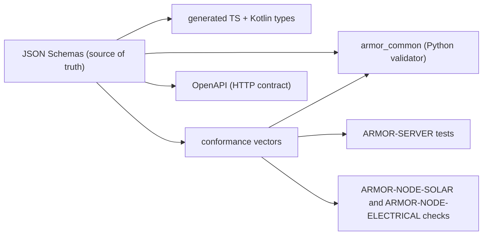

<p align="center">
  
</p>

# 🧾 ARMOR-COMMON

<p align="center">
  <a href="README.md">🇺🇸 English</a> |
  🇪🇸 <b>Español</b> |
  <a href="README_fra.md">🇫🇷 Français</a> |
  <a href="README_ita.md">🇮🇹 Italiano</a> |
  <a href="README_deu.md">🇩🇪 Deutsch</a> |
  <a href="README_zho.md">🇨🇳 简体中文</a> |
  <a href="README_jpn.md">🇯🇵 日本語</a> |
  <a href="README_por.md">🇵🇹 Português</a>
</p>

### Contratos de mensajes, validación, la base de firmware que comparten los nodos y el lanzador de proyectos compartido

<p align="center">
  
  
  
  
  
  
</p>

---

**Comprobación de honestidad - qué funciona hoy:** Los esquemas (telemetría, salud, comando, información del nodo, inversor y batería solares, eléctrico, alarma con su comando y resultado, y red), el validador de Python, los 1225 vectores de conformidad, los tipos generados de TypeScript y Kotlin, el fichero OpenAPI del servidor (136 rutas), la base de firmware compartida por los cinco nodos y el lanzador de proyectos compartido son reales y están probados (170 tests). El fichero de Kotlin está generado pero **todavía no lo consume** ARMOR-ANDROID-CONTROL (que conserva su propia lectura), y el comando `set_thresholds` lleva un único campo `sensitivity` porque los parámetros reales del radar no se definen hasta que exista el firmware.

---

## 📋 De un vistazo

| | |
|---|---|
| Versión | `0.7.6` |
| Madurez | Establecido |
| Tests | 170 (`python -m unittest discover -s tests`) y 1225 vectores de conformidad |
| Tecnología | Python 3.11+ / JSON Schema / OpenAPI |
| En hardware real | Solo el nodo radar ha funcionado en una placa: sus mensajes son los que hablan cada día el servidor de la CM5, Studio y la app Android; los mensajes de los demás nodos se comprueban contra sustitutos |

## 🎯 Descripción general

**ARMOR-COMMON** es dueño de lo que significa cada mensaje de A.R.M.O.R. Los nodos de radar, los nodos pasarela solares y el simulador producen estos mensajes; el servidor, la IA visual y el servicio de voz los consumen. Si dos proyectos discrepan sobre un campo, decide este repositorio.

* **Una única fuente de verdad:** esquemas JSON en `src/armor_common/schemas/` para telemetría, salud, comando, información del nodo, los dos mensajes solares (inversor, batería con celdas y capacidades), los mensajes eléctricos (lecturas, comando, resultado), los mensajes de alarma (estado, comando, resultado) y el mensaje de red. Se rechazan los campos desconocidos y las combinaciones imposibles.
* **Un validador que no puede saltarse una regla:** interpreta el esquema directamente y rechaza un esquema que use una palabra clave que no implementa.
* **Vectores de conformidad:** 1225 cargas aceptadas y rechazadas que ejecuta cada implementación (Python aquí, TypeScript en ARMOR-SERVER, las comprobaciones de los repositorios de firmware), de modo que una deriva rompe la compilación.
* **Clientes generados:** los tipos de TypeScript y Kotlin salen de los esquemas (`tools/generate_types.py --check` los mantiene al día).
* **Contrato HTTP:** `openapi/armor-server.yaml` describe cada ruta del servidor (163 rutas, 215 operaciones), su regla de acceso y un esquema con nombre para cada cuerpo de petición, respuesta y error, y un test comprueba que las rutas que registra el servidor son exactamente las que describe (método y ruta).
* **Base de firmware:** `firmware_base/` guarda una sola vez cada fichero que comparten los cinco nodos (red, ajustes y usuarios, servidor del panel web y acceso, certificado HTTPS, registro, Bluetooth con emparejamiento por PIN, comprobación de actualizaciones firmadas; relés y Zigbee en los nodos que los tienen); `tools/sync_firmware_base.py` lo escribe en cada nodo y comprueba que ninguna copia se desvíe ([la guía](docs/FIRMWARE_BASE.md), [firmware firmado](docs/SIGNED_FIRMWARE.md)).
* **Lanzador compartido:** `tools/armor_project_tool.py` da a cada repositorio de la familia el mismo flujo `build`, `build-test` y `run`, y `tools/armor_ci_validate.py` las mismas comprobaciones de CI.
* **Enlace TLS opcional con el broker en la base compartida de los nodos:** `firmware_base` lleva el interruptor `mqtt.tls` y el texto `mqtt.ca_pem` (un certificado PEM, 2 KB como máximo, validado), la conexión que confía solo en esa autoridad y comprueba el nombre del broker, y las pruebas en ordenador compartidas por los cinco nodos; desactivado por defecto.
* **Salud de los nodos y perfiles de armado:** el mensaje `node_health` (el mismo informe de un nodo de radar, solar, eléctrico, de alarma o de panel de pared) y el `arm_profile` (una forma con nombre de armar: qué zonas vigilan, los retardos, la sirena y con qué fuerza avisa el servidor, dentro del comando de armar) tienen sus esquemas, vectores de conformidad, tipos generados de TypeScript y Kotlin, rutas OpenAPI y el código de firmware compartido que construye el informe.
* **Eventos de conexión y de sistema del historial:** los esquemas `connection_event`, `system_event` y `connection_client` (lo que el historial del servidor dice de los clientes que se conectan y del propio sistema, con un vocabulario fijo y sin ningún campo donde pueda ir un secreto), sus vectores de conformidad, los tipos TypeScript y Kotlin generados y la ruta de OpenAPI que lista los clientes.
* **Diagnóstico y calidad de lectura en el contrato:** el informe de arranque sucio, el volcado de núcleo, la comprobación de seguridad de los ajustes, el paquete de diagnóstico, los eventos del radar y los mensajes del token de diagnóstico de solo lectura tienen sus esquemas, vectores de conformidad y tipos generados; un canal de medidor puede llevar la edad de su lectura y su contador de errores, y un mensaje de inversor puede nombrar los valores que el nodo mantuvo en un límite.

## 🧩 Papel en A.R.M.O.R.

ARMOR-COMMON es lo que mantiene a la familia hablando el mismo idioma. Cada mensaje entre un nodo y [ARMOR-SERVER](https://github.com/JuanenRac/ARMOR-SERVER) se define aquí una vez, con los vectores que toda implementación debe pasar; aquí vive también el contrato HTTP del servidor; y el firmware que comparten los cinco nodos ([ARMOR-NODE-RADAR](https://github.com/JuanenRac/ARMOR-NODE-RADAR), [ARMOR-NODE-SOLAR](https://github.com/JuanenRac/ARMOR-NODE-SOLAR), [ARMOR-NODE-ELECTRICAL](https://github.com/JuanenRac/ARMOR-NODE-ELECTRICAL), [ARMOR-NODE-ALARM](https://github.com/JuanenRac/ARMOR-NODE-ALARM), [ARMOR-NODE-HMI](https://github.com/JuanenRac/ARMOR-NODE-HMI)) se guarda una vez y una herramienta lo copia en ellos. No guarda ningún secreto ni ejecuta nada en producción.

## 🔄 Arquitectura



## 📂 Estructura del repositorio

```text
ARMOR-COMMON/
├── src/armor_common/   contracts, schema (validator), envelope, schemas/*.json (the node messages, the alarm, electrical and network ones, the relay, zone-feed, alert and orders ones)
├── conformance/        accepted and rejected payloads shared by every implementation
├── firmware_base/      the firmware that the five nodes share, once (synced into each by tools/sync_firmware_base.py)
├── generated/          TypeScript and Kotlin types (generated, do not edit)
├── openapi/            armor-server.yaml
├── registry/           repositories.json: the one list of the repositories of the family (kind, group, technologies, place on the map, who feeds whom) that the documentation, deployment and update tools read
├── tools/              armor_project_tool.py, generate_types.py, generate_rest_types.py, make_conformance.py, sync_firmware_base.py, release_firmware.py, firmware_sign.mjs
├── tests/              unit tests and conformance runner
└── docs/               contracts guide, the shared firmware base
```

## 🛠️ Entorno de desarrollo

**Requisitos:** Python 3.11+

```powershell
python -m pip install -e .
python -m unittest discover -s tests      # 170 tests, 1225 conformance vectors
python tools/generate_types.py --check    # generated types are current
python tools/generate_rest_types.py --check    # the types of the HTTP contract are current
python tools/make_conformance.py          # regenerate the vectors after editing the case list (--check: they are current)
python tools/sync_firmware_base.py check  # the firmware the node projects share has not drifted (see docs/FIRMWARE_BASE.md)
```

Temas del broker: `armor/node/{node_id}/telemetry | health | command | info`, `armor/solar/{node_id}/{device}/state`, `armor/electrical/{node_id}/state | command | result`, `armor/alarm/{node_id}/state | command | result` y `armor/network/{node_id}/state`. Véase la [guía de contratos](docs/CONTRACTS.md). El lanzador compartido crea un `.env` ignorado en la primera ejecución de ARMOR-SERVER con secretos aleatorios y una contraseña de administrador aleatoria; no se imprime ni se sube nada.

## 🔗 Proyectos relacionados

**A.R.M.O.R.** (Autonomous Radar & Multimodal Observation Range) es un sistema de seguridad perimetral hecho de repositorios independientes. Cada uno tiene su propia versión, sus propias pruebas y su propio README; esta es la familia:

* **ARMOR-COMMON** (este repositorio) - Contratos de mensajes, validadores, vectores de conformidad y tipos generados
* **[ARMOR-NODE-RADAR](https://github.com/JuanenRac/ARMOR-NODE-RADAR)** - Firmware del nodo de campo para ESP32-S3 con tres radares y su propio panel web
* **[ARMOR-NODE-SOLAR](https://github.com/JuanenRac/ARMOR-NODE-SOLAR)** - Protocolos de inversores y baterías solares y los mensajes de un nodo pasarela
* **[ARMOR-NODE-ELECTRICAL](https://github.com/JuanenRac/ARMOR-NODE-ELECTRICAL)** - Nodo eléctrico: contadores, el mensaje de las lecturas de la red y las reglas para maniobrar
* **[ARMOR-NODE-ALARM](https://github.com/JuanenRac/ARMOR-NODE-ALARM)** - Nodo y central de alarma: zonas, armado, retardos, sirena y PIN, con el servidor o sin él
* **[ARMOR-NODE-HMI](https://github.com/JuanenRac/ARMOR-NODE-HMI)** - Panel táctil: el estado del sistema en una pantalla de pared, armar y reconocer alarmas, y el hogar del asistente de voz
* **[ARMOR-NETWORK](https://github.com/JuanenRac/ARMOR-NETWORK)** - La red local: sus dispositivos, internet y lo que cambia
* **[ARMOR-SERVER](https://github.com/JuanenRac/ARMOR-SERVER)** - Coordinador central: telemetría, alarmas, dispositivos, lecturas solares y cámaras
* **[ARMOR-STUDIO](https://github.com/JuanenRac/ARMOR-STUDIO)** - Consola web: cámaras, radar, alarmas, energía solar y el diseñador de sitio 2D/3D
* **[ARMOR-ANDROID-CONTROL](https://github.com/JuanenRac/ARMOR-ANDROID-CONTROL)** - Cliente Android del operador con radar 2D/3D en vivo
* **[ARMOR-IOS-CONTROL](https://github.com/JuanenRac/ARMOR-IOS-CONTROL)** - Cliente de operador para iPhone
* **[ARMOR-SERVER-AI](https://github.com/JuanenRac/ARMOR-SERVER-AI)** - Política de inferencia visual que explica sus decisiones y nunca actúa
* **[ARMOR-VISION](https://github.com/JuanenRac/ARMOR-VISION)** - Zonas de cámara, máscaras y reglas de detección para la Jetson Orin NX
* **[ARMOR-VOICE-AI](https://github.com/JuanenRac/ARMOR-VOICE-AI)** - Intenciones de voz sin conexión con una confirmación imposible de falsificar
* **[ARMOR-HARDWARE](https://github.com/JuanenRac/ARMOR-HARDWARE)** - Cajas, electrónica y la matriz de aceptación en banco
* **[ARMOR-DEVOPS](https://github.com/JuanenRac/ARMOR-DEVOPS)** - Despliegue, el banco de pruebas de la CM5, copias de seguridad y TLS
* **[ARMOR-SIMULATOR](https://github.com/JuanenRac/ARMOR-SIMULATOR)** - Simulador de telemetría sin conexión con fallos repetibles
* **[ARMOR-UPDATER](https://github.com/JuanenRac/ARMOR-UPDATER)** - Detecta, instala y actualiza los propios repositorios del ecosistema
* **[ARMOR-DOCS](https://github.com/JuanenRac/ARMOR-DOCS)** - Arquitectura, base de seguridad y la matriz de capacidades

## 📚 Documentación y comunidad

Dónde leer más:

* [Matriz de capacidades: qué está probado y qué no](https://github.com/JuanenRac/ARMOR-DOCS/blob/main/docs/CAPABILITY_MATRIX.md)
* [Catálogo de proyectos: versiones y cómo dependen unos de otros](https://github.com/JuanenRac/ARMOR-DOCS/blob/main/docs/PROJECT_CATALOG.md)
* [Historial de cambios de este repositorio](CHANGELOG.md)
* [Licencia (GPL-3.0-or-later)](LICENSE)
* Preguntas, ideas e informes: electrohobby3d@gmail.com

## 👤 AUTOR

**JuanenRac (Electro Hobby 3D)** · electrohobby3d@gmail.com

## 📜 LICENCIA

GPL-3.0-or-later - véase [LICENSE](LICENSE).
