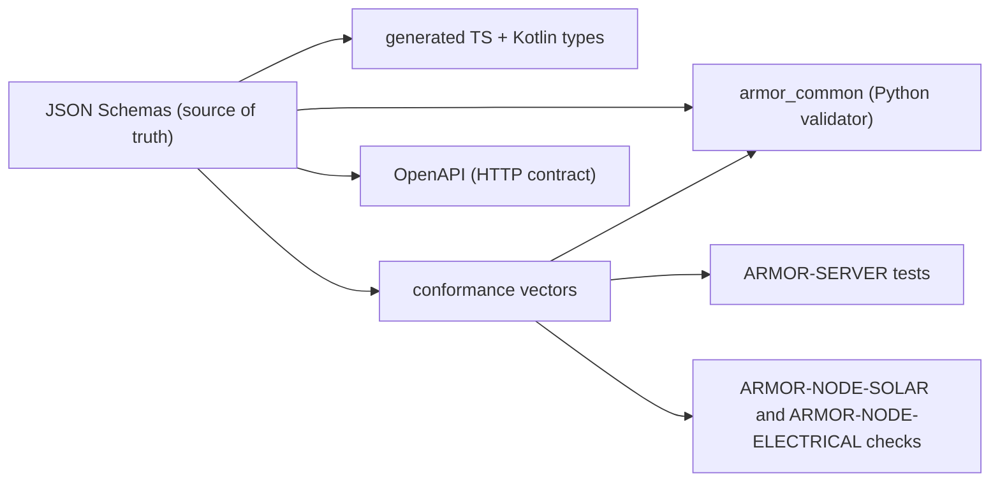

<p align="center">
  
</p>

# 🧾 ARMOR-COMMON

<p align="center">
  <a href="README.md">🇺🇸 English</a> |
  🇪🇸 <b>Español</b> |
  <a href="README_fra.md">🇫🇷 Français</a> |
  <a href="README_ita.md">🇮🇹 Italiano</a> |
  <a href="README_deu.md">🇩🇪 Deutsch</a> |
  <a href="README_zho.md">🇨🇳 简体中文</a> |
  <a href="README_jpn.md">🇯🇵 日本語</a> |
  <a href="README_por.md">🇵🇹 Português</a>
</p>

### Contratos de mensajes, validación, la base de firmware que comparten los nodos y el lanzador de proyectos compartido

<p align="center">
  
  
  
  
  
  
  
</p>

---

**Comprobación de honestidad - qué funciona hoy:** Los esquemas (telemetría, salud, comando, información del nodo, inversor y batería solares, eléctrico, alarma con su comando y resultado, y red), el validador de Python, los 1225 vectores de conformidad, los tipos generados de TypeScript y Kotlin, el fichero OpenAPI del servidor (191 rutas), la base de firmware compartida por los cinco nodos y el lanzador de proyectos compartido son reales y están probados (214 tests). El fichero de Kotlin está generado pero **todavía no lo consume** ARMOR-ANDROID-CONTROL (que conserva su propia lectura), y el comando `set_thresholds` lleva un único campo `sensitivity` porque los parámetros reales del radar no se definen hasta que exista el firmware.

---

## 📋 De un vistazo

| | |
|---|---|
| Versión | `0.7.8` |
| Madurez | Establecido |
| Función | Contratos compartidos, validador y base de firmware de la familia |
| Tecnología | Python 3.11+, JSON Schema, OpenAPI; base de firmware en C++ (ESP-IDF) |
| Pruebas | 214 (`python -m unittest discover -s tests`), 1225 vectores de conformidad |
| Contrato | 34 JSON Schema, 191 rutas HTTP (247 operaciones) |
| Funciona en | Cualquier ordenador (biblioteca y herramientas); la base de firmware funciona dentro de los cinco nodos |
| En hardware real | Solo el nodo radar ha ejecutado el firmware compartido en una placa; los otros cuatro no |
| Licencia | GPL-3.0-or-later |

**Ir a:** [Resumen](#-resumen) · [Arquitectura](#-arquitectura) · [Funciones](#-funciones) · [Seguridad](#-seguridad-y-protección) · [Interfaces](#-interfaces) · [Configuración](#-configuración) · [Inicio rápido](#-inicio-rápido) · [Pruebas](#-pruebas) · [Problemas](#-resolución-de-problemas) · [Estructura](#-estructura-del-repositorio) · [Relacionados](#-proyectos-relacionados)

## 🚦 Estado del proyecto

Cada línea es una parte de este repositorio y la luz dice hasta dónde llega hoy. Está escrito con lo que el repositorio puede demostrar (pruebas, compilaciones, ejecuciones), no con lo que está planeado.

🟢 Hecho y verificado · 🟡 Funciona, con límites conocidos · 🟠 Parcial o sin verificar todavía · 🔴 No hecho o no funciona

| Área | Estado | Qué significa aquí |
|---|---|---|
| Software | 🟢 | Los esquemas, el validador de Python, los tipos generados de TypeScript y Kotlin, el archivo OpenAPI del servidor y la base de firmware compartida por los cinco nodos están hechos. |
| Pruebas | 🟢 | Pasan 214 pruebas y 1225 vectores de conformidad; los analizadores de JSON, Bluetooth e Improv del firmware se prueban además con libFuzzer. |
| Protocolos y datos | 🟡 | Solo los mensajes del nodo radar se usan a diario con una placa real y el servidor; los de los demás nodos se comprueban contra simulaciones. |
| Integración | 🟡 | Se comprueba que la base de firmware sea idéntica en cada nodo; los tipos de Kotlin están generados pero la app de Android aún no los usa, porque conserva su propio análisis. |
| Hardware | 🟠 | Solo el nodo radar ha ejecutado este firmware compartido en una placa; los otros cuatro nodos no. |
| Seguridad | 🟡 | La comprobación de la firma del firmware y la derivación del PIN Bluetooth están probadas en el host; no ha habido una revisión independiente. |
| Documentación | 🟢 | Ocho idiomas, el archivo OpenAPI, la guía de conformidad y el historial de cambios están al día. |

## 🎯 Resumen

**ARMOR-COMMON** es dueño de lo que significa cada mensaje de A.R.M.O.R. Los nodos de radar, los nodos pasarela solares y el simulador producen estos mensajes; el servidor, la IA visual y el servicio de voz los consumen. Si dos proyectos discrepan sobre un campo, decide este repositorio.

* **Una única fuente de verdad:** esquemas JSON en `src/armor_common/schemas/` para telemetría, salud, comando, información del nodo, los dos mensajes solares (inversor, batería con celdas y capacidades), los mensajes eléctricos (lecturas, comando, resultado), los mensajes de alarma (estado, comando, resultado) y el mensaje de red. Se rechazan los campos desconocidos y las combinaciones imposibles.
* **Un validador que no puede saltarse una regla:** interpreta el esquema directamente y rechaza un esquema que use una palabra clave que no implementa.
* **Vectores de conformidad:** 1225 cargas aceptadas y rechazadas que ejecuta cada implementación (Python aquí, TypeScript en ARMOR-SERVER, las comprobaciones de los repositorios de firmware), de modo que una deriva rompe la compilación.
* **Clientes generados:** los tipos de TypeScript y Kotlin salen de los esquemas (`tools/generate_types.py --check` los mantiene al día).
* **Contrato HTTP:** `openapi/armor-server.yaml` describe cada ruta del servidor (191 rutas, 247 operaciones), su regla de acceso y un esquema con nombre para cada cuerpo de petición, respuesta y error, y un test comprueba que las rutas que registra el servidor son exactamente las que describe (método y ruta).
* **Base de firmware:** `firmware_base/` guarda una sola vez cada fichero que comparten los cinco nodos (red, ajustes y usuarios, servidor del panel web y acceso, certificado HTTPS, registro, Bluetooth con emparejamiento por PIN, comprobación de actualizaciones firmadas; relés y Zigbee en los nodos que los tienen); `tools/sync_firmware_base.py` lo escribe en cada nodo y comprueba que ninguna copia se desvíe ([la guía](docs/FIRMWARE_BASE.md), [firmware firmado](docs/SIGNED_FIRMWARE.md)).
* **Lanzador compartido:** `tools/armor_project_tool.py` da a cada repositorio de la familia el mismo flujo `build`, `build-test` y `run`, y `tools/armor_ci_validate.py` las mismas comprobaciones de CI.
* **Enlace TLS opcional con el broker en la base compartida de los nodos:** `firmware_base` lleva el interruptor `mqtt.tls` y el texto `mqtt.ca_pem` (un certificado PEM, 2 KB como máximo, validado), la conexión que confía solo en esa autoridad y comprueba el nombre del broker, y las pruebas en ordenador compartidas por los cinco nodos; desactivado por defecto.
* **Salud de los nodos y perfiles de armado:** el mensaje `node_health` (el mismo informe de un nodo de radar, solar, eléctrico, de alarma o de panel de pared) y el `arm_profile` (una forma con nombre de armar: qué zonas vigilan, los retardos, la sirena y con qué fuerza avisa el servidor, dentro del comando de armar) tienen sus esquemas, vectores de conformidad, tipos generados de TypeScript y Kotlin, rutas OpenAPI y el código de firmware compartido que construye el informe.
* **Eventos de conexión y de sistema del historial:** los esquemas `connection_event`, `system_event` y `connection_client` (lo que el historial del servidor dice de los clientes que se conectan y del propio sistema, con un vocabulario fijo y sin ningún campo donde pueda ir un secreto), sus vectores de conformidad, los tipos TypeScript y Kotlin generados y la ruta de OpenAPI que lista los clientes.
* **Diagnóstico y calidad de lectura en el contrato:** el informe de arranque sucio, el volcado de núcleo, la comprobación de seguridad de los ajustes, el paquete de diagnóstico, los eventos del radar y los mensajes del token de diagnóstico de solo lectura tienen sus esquemas, vectores de conformidad y tipos generados; un canal de medidor puede llevar la edad de su lectura y su contador de errores, y un mensaje de inversor puede nombrar los valores que el nodo mantuvo en un límite.

## 🧩 Papel en A.R.M.O.R.

ARMOR-COMMON es lo que mantiene a la familia hablando el mismo idioma. Cada mensaje entre un nodo y [ARMOR-SERVER](https://github.com/JuanenRac/ARMOR-SERVER) se define aquí una vez, con los vectores que toda implementación debe pasar; aquí vive también el contrato HTTP del servidor; y el firmware que comparten los cinco nodos ([ARMOR-NODE-RADAR](https://github.com/JuanenRac/ARMOR-NODE-RADAR), [ARMOR-NODE-SOLAR](https://github.com/JuanenRac/ARMOR-NODE-SOLAR), [ARMOR-NODE-ELECTRICAL](https://github.com/JuanenRac/ARMOR-NODE-ELECTRICAL), [ARMOR-NODE-ALARM](https://github.com/JuanenRac/ARMOR-NODE-ALARM), [ARMOR-NODE-HMI](https://github.com/JuanenRac/ARMOR-NODE-HMI)) se guarda una vez y una herramienta lo copia en ellos. No guarda ningún secreto ni ejecuta nada en producción.

| Habla con | Cómo | Para qué |
|---|---|---|
| ARMOR-SERVER | ejecuta los vectores; implementa cada ruta de OpenAPI | vectores, OpenAPI |
| ARMOR-STUDIO | guarda una copia de los tipos generados; una prueba falla si se desvía | TypeScript generado |
| ARMOR-ANDROID-CONTROL | tiene su propio análisis; los tipos Kotlin se generan pero no se usan | Kotlin generado |
| ARMOR-NODE-RADAR, SOLAR, ELECTRICAL, ALARM, HMI | reciben firmware_base con `tools/sync_firmware_base.py` | firmware copiado |
| ARMOR-DOCS, ARMOR-DEVOPS, ARMOR-UPDATER | leen `registry/repositories.json`, la lista única de repositorios | el registro |

## 🏛️ Arquitectura

<p align="center">
  
</p>

<details>
<summary>Versión en texto del diagrama (Mermaid)</summary>



</details>

## ✨ Funciones

### Añadir o cambiar un mensaje

1. Edita el esquema en `src/armor_common/schemas/` (y `docs/CONTRACTS.md` si cambia el significado).
2. Añade los casos a la lista y ejecuta `python tools/make_conformance.py`.
3. Ejecuta `python tools/generate_types.py` y `python tools/generate_rest_types.py` para renovar los tipos TypeScript y Kotlin.
4. Actualiza `openapi/armor-server.yaml` si interviene una ruta; `tests/test_openapi.py` lo compara con las rutas del servidor.
5. El servidor y los nodos ejecutan entonces los mismos vectores, así que un desacuerdo rompe la compilación.

### La base de firmware

`firmware_base/` guarda una sola vez cada fichero que comparten los cinco nodos: red, ajustes y usuarios, el servidor del panel web y su inicio de sesión, el certificado HTTPS, el registro, Bluetooth con emparejado por PIN, la comprobación de una actualización firmada, el informe de salud del nodo, el vigilante que reinicia un nodo en apuros, las órdenes tipadas del servidor y, en los nodos que los tienen, relés y Zigbee. `tools/sync_firmware_base.py` lo escribe en cada nodo y comprueba que ninguna copia se ha desviado (ver [docs/FIRMWARE_BASE.md](docs/FIRMWARE_BASE.md) y [docs/SIGNED_FIRMWARE.md](docs/SIGNED_FIRMWARE.md)). Sus decisiones que no necesitan hardware viven en `core/` y se prueban en un ordenador; `main/` lee los valores reales.

## 🔒 Seguridad y protección

| Amenaza | Defensa |
|---|---|
| Un campo desconocido o una combinación imposible | `additionalProperties: false`; el validador interpreta el esquema y se niega a cargar uno con una palabra clave que no implementa |
| Telemetría sin tope para agotar un nodo | Como máximo 15 pistas (5 por cada uno de 3 sensores) y lux de 0 a 200 000 |
| Una orden fuera de la lista | Lista cerrada: `calibrate`, `set_thresholds` (sensibilidad 1 a 10), `restart`; el suscriptor rechaza el resto antes del hardware |
| Un topic que no coincide con el id de nodo del cuerpo | El consumidor rechaza la discrepancia |
| Un firmware falso en GitHub | La imagen debe coincidir con su `.sha256` y llevar una firma Ed25519 de ese hash, comprobada con la clave pública de `firmware_base/core/fw_trust.hpp`; sin ella no cambia nada |
| La clave privada de publicación se filtra | Vive fuera de todo repositorio, CI y publicación (PKCS#8, modo 0600); `release_firmware.py` se niega a publicar si la clave no es la que el firmware reconoce |
| Contraseñas de nodo y PIN de Bluetooth | Contraseñas: PBKDF2-HMAC-SHA256, 10 000 rondas. PIN: derivado de la MAC y del secreto de flota (`CONFIG_ARMOR_FLEET_SECRET`, vacío en el firmware público) |
| Analizadores expuestos (JSON, tramas Bluetooth, Improv) | Fuzzing con libFuzzer, AddressSanitizer y UndefinedBehaviorSanitizer (`fuzz/run_fuzz.sh`, Linux con clang) |
| Una copia de un nodo se desvía de la compartida | `tools/sync_firmware_base.py check` falla si los cinco nodos no son idénticos |

**Lo que no cubre.** El firmware subido a mano por un administrador no se comprueba. Un nodo con un firmware anterior a esta comprobación instala la primera versión firmada solo por su hash. La clave protege las versiones, no las placas: con acceso físico cualquiera puede grabar lo que quiera. Si se pierde la clave, el actualizador de GitHub queda bloqueado hasta cambiar la clave pública con una subida manual o por cable. La comprobación de la firma y el PIN están probados en el equipo; no ha habido revisión independiente. Más en [docs/SIGNED_FIRMWARE.md](docs/SIGNED_FIRMWARE.md).

## 🔌 Interfaces

### Topics del broker

| Topic | Qué lleva |
|---|---|
| `armor/node/{node_id}/telemetry`  `health`  `command`  `info` | un nodo radar: pistas, salud, órdenes e información |
| `armor/solar/{node_id}/{device}/state` | un inversor o una batería de un nodo solar |
| `armor/electrical/{node_id}/state`  `command`  `result` | el nodo eléctrico: lecturas, orden, resultado |
| `armor/alarm/{node_id}/state`  `command`  `result` | el nodo de alarma (también `zigbee` y `policy` desde el servidor) |
| `armor/network/{node_id}/state` | lo que un nodo ve en la red |
| `armor/health/{node_id}` | el informe de salud de cualquier nodo y su último testamento |
| `armor/control/{node_id}/command`  `result`  `maintenance`  and `armor/control/all/command` | órdenes tipadas a un nodo o a todos, su resultado y la señal de mantenimiento previsto |
| `armor/device/{node_id}/{relay}/set`  `state`  `availability` | un relé de un nodo |
| `armor/radar/{node_id}/events`  and  `armor/server/alert` | eventos del radar; alertas que el servidor envía a los paneles |

### Esquemas, vectores y OpenAPI

* **34 JSON Schema** en `src/armor_common/schemas/`: telemetría, salud, orden, información del nodo, salud del nodo, control del nodo (orden y resultado), mantenimiento del nodo, inversor y batería solares (con sus órdenes y resultados), eléctrico (con orden y resultado), alarma (estado, orden, resultado, política y zonas), red (con sus órdenes), eventos de conexión y del sistema, eventos de radar, alerta del servidor, perfil de armado, estado de dispositivo, tokens de diagnóstico y el turno de voz.
* **1225 vectores de conformidad** en `conformance/` (34 ficheros, uno por mensaje), ejecutados por este repositorio, por ARMOR-SERVER y por las comprobaciones de los repositorios de firmware.
* **OpenAPI** `openapi/armor-server.yaml`: 191 rutas y 247 operaciones, cada una con su regla de acceso y un esquema con nombre para cada cuerpo, respuesta y error. Una prueba comprueba que las rutas que registra el servidor son exactamente las descritas. El turno de voz viaja como bytes (ver [docs/CONTRACTS.md](docs/CONTRACTS.md)).

### Herramientas de línea de órdenes

| Herramienta | Qué hace |
|---|---|
| `tools/armor_project_tool.py` | el flujo compartido `build`, `build-test` y `run` |
| `tools/generate_types.py [--check]`  `generate_rest_types.py [--check]` | tipos TypeScript y Kotlin, y los del contrato HTTP |
| `tools/make_conformance.py [--check]` | escribe los vectores de conformidad desde la lista de casos |
| `tools/sync_firmware_base.py` (`check`, `sync`, `import`) | escribe `firmware_base` en los cinco nodos, o comprueba que no se han desviado |
| `tools/release_firmware.py`  `tools/firmware_sign.mjs` | firma y publica una versión de firmware |
| `tools/voice_cases.py` | los casos de voz compartidos con ARMOR-VOICE-AI |
| `tools/make_architecture.py`  `tools/make_structure.py`  `tools/universal_readme_check.py` | las imágenes y la comprobación del formato de los README |

## ⚙️ Configuración

### Opciones de compilación del firmware (Kconfig)

| Ajuste | Por defecto | Qué hace |
|---|---|---|
| `CONFIG_ARMOR_NODE_ID` | "" | el nombre del nodo en el broker |
| `CONFIG_ARMOR_SETUP_CODE` | "" | el código que abre la configuración |
| `CONFIG_ARMOR_FLEET_SECRET` | "" | secreto de flota para el PIN Bluetooth; vacío en el firmware público |
| `CONFIG_ARMOR_BLE_SETUP_MINUTES` | 10 (1 to 120) | cuánto tiempo queda abierta la configuración Bluetooth |
| `CONFIG_ARMOR_ETH_SPI_HOST` | 1 (1 to 2) | host SPI del chip Ethernet |
| `CONFIG_ARMOR_ETH_MOSI` `MISO` `SCLK` `CS` `INT` `RST` | 11, 12, 13, 14, 10, 9 | pines de la placa Ethernet (perfil `s3-eth`) |
| `CONFIG_ARMOR_ETH_SPI_MHZ` | 20 (1 to 40) | reloj SPI del chip Ethernet |
| `CONFIG_ARMOR_MQTT_URI` `USERNAME` `PASSWORD` | "" | dirección y credenciales iniciales del broker |
| `CONFIG_ARMOR_BOOT_FACTORY_RESET` | y | permite el restablecimiento de fábrica al arrancar |
| `CONFIG_ARMOR_NTP_SERVER` | pool.ntp.org | servidor de hora |
| `CONFIG_ARMOR_HEARTBEAT_S` | 10 (2 to 300) | segundos entre latidos |
| `CONFIG_ARMOR_BOARD_S3_WIFI`  `CONFIG_ARMOR_BOARD_S3_ETH` | S3_WIFI | el perfil de placa de la imagen (`tools/build_node.sh NODE BOARD`) |

El enlace TLS del nodo con el broker es un ajuste del nodo (no de la compilación): `mqtt.tls` (apagado por defecto) y `mqtt.ca_pem` (un certificado PEM, 2 KB como máximo, validado); la conexión solo confía en esa autoridad y comprueba el nombre del broker. La biblioteca Python no tiene variables de entorno propias; el lanzador compartido crea un `.env` ignorado en la primera ejecución de ARMOR-SERVER con secretos aleatorios y una contraseña de administrador aleatoria, y no imprime ni sube nada.

## 🚀 Inicio rápido

**Requisitos:** Python 3.11+ (ningún otro paquete). Para comprobar la base de firmware, los repositorios de los cinco nodos deben estar junto a este.

```powershell
python -m pip install -e .                   # instala la biblioteca
python -m unittest discover -s tests         # 214 pruebas, 1225 vectores
python tools/generate_types.py --check       # los tipos generados están al día
python tools/generate_rest_types.py --check  # los tipos del contrato HTTP están al día
python tools/make_conformance.py             # regenera los vectores tras editar la lista de casos (--check: están al día)
python tools/sync_firmware_base.py check     # el firmware compartido no se ha desviado
```

## 🧪 Pruebas

```powershell
python -m unittest discover -s tests  # 214 pruebas
python -I tools/armor_ci_validate.py
```

| Fichero de pruebas | Pruebas | Qué cubre |
|---|---|---|
| `test_contracts.py` | 68 | cada mensaje, topic y separador, con los vectores de conformidad |
| `test_task_safety_check.py` | 23 | el escaneo que encuentra las tareas que un nodo no puede perder |
| `test_universal_readme_check.py`, `test_readme_tools.py` | 36 | la comprobación del formato y las imágenes de los README |
| `test_firmware_base.py` | 13 | la base de firmware compartida y su sincronía |
| `test_openapi.py` | 13 | el fichero OpenAPI frente a las rutas del servidor |
| `test_release_firmware.py` | 12 | la firma y publicación del firmware |
| `test_pretty_run.py`, `test_build_scripts.py` | 11 | el panel en vivo de los scripts |
| `test_generated_types.py`, `test_repository_registry.py`, `test_voice_turn.py` | 21 | los tipos generados, la lista de repositorios y el turno de voz |
| `test_alarm_codes.py`, `test_collect_errors.py`, `test_project_manifest_doc.py`, `test_firmware_fuzz.py`, `test_fuzz_validator.py` | 17 | palabras de los códigos de alarma, recogida de errores, guía del manifiesto y banco de fuzzing |

Las pruebas de equipo del firmware compartido están en `firmware_base/tests/` (C++, sin ESP-IDF) y las ejecutan las comprobaciones de los propios repositorios de los nodos. `python tools/sync_firmware_base.py check` necesita los repositorios de los cinco nodos junto a este. GitHub Actions ejecuta la base de A.R.M.O.R. en cada push y pull request: la validación del manifiesto, la versión, el registro de cambios y la paridad de los README, y luego la compilación y las pruebas del propio proyecto.

## 🏗️ Compilación y publicación

Es Python puro y un conjunto de herramientas: no hay nada que compilar. La versión vive en `pyproject.toml`, en `armor.project.json` y en la insignia del README (leída del manifiesto); cada versión tiene su entrada en [CHANGELOG.md](CHANGELOG.md). Las versiones se publican en GitHub. La herramienta de publicación de firmware (`tools/release_firmware.py`) firma y publica las imágenes de los nodos; la clave que necesita nunca está en un repositorio.

## 🩺 Resolución de problemas

| Ves | Porque | Haz |
|---|---|---|
| `FIRMWARE_BASE=FAIL ... copies drifted` | un nodo cambió a mano un fichero compartido | haz el cambio en `firmware_base/` y ejecuta `sync`; o `import` para tomar los ficheros de los nodos tal cual |
| `ARMOR-NODE-HMI: main/secret_vault.cpp is missing` | los repositorios de los nodos no están junto a ARMOR-COMMON | clónalos uno junto al otro |
| `generated types are out of date` | cambió un esquema o el fichero OpenAPI | ejecuta `generate_types.py` y `generate_rest_types.py` sin `--check` |
| `TASK_SAFETY=FAIL no task found: the scan is broken` | el escaneo de los fuentes de los nodos no encontró nada | comprueba que los repositorios de los nodos están junto a este |
| `no_signature`, `bad_signature`, `checksum_mismatch`, `wrong_firmware` | el nodo rechazó una versión: firma, hash o placa ausentes o erróneos | publica con `tools/release_firmware.py` y la clave que el firmware reconoce |

## 📂 Estructura del repositorio

<p align="center">
  
</p>

<details>
<summary>Versión en texto del árbol</summary>

```text
ARMOR-COMMON/
├── src/armor_common/
│   ├── contracts.py               topics y validadores
│   ├── schema.py                  el intérprete de esquemas
│   ├── envelope.py                el sobre común
│   ├── voice.py                   el contrato de voz
│   ├── schemas/                   34 JSON Schema
│   ├── alarm_codes.json           palabras de cada alarma
│   └── battery_ops.json           operaciones de batería
├── firmware_base/                 el firmware que comparten los cinco nodos, una sola vez
├── conformance/                   1225 mensajes válidos e inválidos
├── generated/                     tipos TypeScript y Kotlin (generados, no editar)
├── openapi/                       armor-server.yaml, contrato HTTP
├── registry/                      repositories.json, lista de la familia
├── fuzz/                          objetivos libFuzzer
├── scripts/                       lanzador armor-project
├── tools/                         generadores, sincronía y publicación del firmware, lanzador, comprobaciones de CI
├── tests/                         214 pruebas
├── docs/                          contratos, firmware, fuzzing
├── images/                        banner, icono y las imágenes del README
├── .github/                       flujo de CI, aviso al panel, plantillas de incidencias y pull requests
├── armor.project.json             manifiesto: versión, función, madurez
├── pyproject.toml                 metadatos del paquete, entradas
├── CHANGELOG.md                   qué cambió en cada versión
├── run.sh run.bat                 arrancar, flujo compartido
├── build.sh build.bat             construir y probar, flujo compartido
├── build-test.sh build-test.bat   construir, probar y empaquetar
├── test.sh test.bat               solo las pruebas, nunca la versión
└── SECURITY.md SUPPORT.md CONTRIBUTING.md CODE_OF_CONDUCT.md LICENSE
```

</details>

## 🗺️ Hoja de ruta y límites conocidos

**Límites conocidos hoy**

* Los tipos Kotlin se generan pero **aún no se usan** en ARMOR-ANDROID-CONTROL, que mantiene su propio análisis.
* La orden `set_thresholds` lleva un único campo `sensitivity`: los parámetros reales del radar no se definen hasta que exista el firmware.
* Solo el nodo radar ha ejecutado el firmware compartido en una placa; los otros cuatro no.
* Sin revisión de seguridad independiente.

**Lo siguiente**

* Que la aplicación Android use los tipos Kotlin generados.
* Definir los parámetros reales del radar de `set_thresholds`.
* Ejecutar el firmware compartido en las placas de los otros cuatro nodos.

## 🌍 Idiomas

El README y los textos existen en inglés, español, francés, italiano, alemán, chino, japonés y portugués de Portugal.

## 🔗 Proyectos relacionados

**A.R.M.O.R.** (Autonomous Radar & Multimodal Observation Range) es un sistema de seguridad perimetral hecho de repositorios independientes. Cada uno tiene su propia versión, sus propias pruebas y su propio README; esta es la familia:

* **ARMOR-COMMON** (este repositorio) - Contratos de mensajes, validadores, vectores de conformidad y tipos generados
* **[ARMOR-NODE-RADAR](https://github.com/JuanenRac/ARMOR-NODE-RADAR)** - Firmware de nodo de campo para ESP32-S3 con tres radares y su propio panel web
* **[ARMOR-NODE-SOLAR](https://github.com/JuanenRac/ARMOR-NODE-SOLAR)** - Protocolos de inversores y baterías solares y los mensajes de un nodo pasarela
* **[ARMOR-NODE-ELECTRICAL](https://github.com/JuanenRac/ARMOR-NODE-ELECTRICAL)** - Nodo eléctrico: medidores, el mensaje de las lecturas de la red y las reglas de maniobra
* **[ARMOR-NODE-ALARM](https://github.com/JuanenRac/ARMOR-NODE-ALARM)** - Nodo y panel de alarma: zonas, armado, retardos, sirena y PIN, con el servidor o sin él
* **[ARMOR-NODE-HMI](https://github.com/JuanenRac/ARMOR-NODE-HMI)** - Panel táctil: el estado del sistema en una pantalla de pared, armar y reconocer, y el hogar del asistente de voz
* **[ARMOR-NETWORK](https://github.com/JuanenRac/ARMOR-NETWORK)** - La red local: sus dispositivos, internet y lo que cambia
* **[ARMOR-SERVER](https://github.com/JuanenRac/ARMOR-SERVER)** - Coordinador central: telemetría, alarmas, dispositivos, lecturas solares y cámaras
* **[ARMOR-STUDIO](https://github.com/JuanenRac/ARMOR-STUDIO)** - Consola web: cámaras, radar, alarmas, energía solar y el diseñador 2D/3D del emplazamiento
* **[ARMOR-ANDROID-CONTROL](https://github.com/JuanenRac/ARMOR-ANDROID-CONTROL)** - Cliente de operador Android con radar 2D/3D en vivo
* **[ARMOR-IOS-CONTROL](https://github.com/JuanenRac/ARMOR-IOS-CONTROL)** - Cliente de operador para iPhone
* **[ARMOR-SERVER-AI](https://github.com/JuanenRac/ARMOR-SERVER-AI)** - Política de inferencia visual que explica sus decisiones y nunca actúa
* **[ARMOR-VISION](https://github.com/JuanenRac/ARMOR-VISION)** - Zonas de cámara, máscaras y reglas de detección para la Jetson Orin NX
* **[ARMOR-VOICE-AI](https://github.com/JuanenRac/ARMOR-VOICE-AI)** - Intenciones de voz sin conexión con una confirmación que no se puede falsificar
* **[ARMOR-HARDWARE](https://github.com/JuanenRac/ARMOR-HARDWARE)** - Cajas, electrónica y la matriz de aceptación en banco
* **[ARMOR-DEVOPS](https://github.com/JuanenRac/ARMOR-DEVOPS)** - Despliegue, el banco de pruebas de la CM5, copias de seguridad y TLS
* **[ARMOR-SIMULATOR](https://github.com/JuanenRac/ARMOR-SIMULATOR)** - Simulador de telemetría sin conexión con fallos repetibles
* **[ARMOR-UPDATER](https://github.com/JuanenRac/ARMOR-UPDATER)** - Detecta, instala y actualiza los repositorios del propio ecosistema
* **[ARMOR-DOCS](https://github.com/JuanenRac/ARMOR-DOCS)** - Arquitectura, base de seguridad y la matriz de capacidades

## 📚 Documentación

* [Contratos](docs/CONTRACTS.md): cada mensaje, topic y cómo cambiar un contrato
* [Base de firmware](docs/FIRMWARE_BASE.md): lo que comparten los cinco nodos y cómo se sincroniza
* [Firmware firmado](docs/SIGNED_FIRMWARE.md): la firma de las versiones y lo que no cubre
* [Fuzzing](docs/FUZZING.md): los tres objetivos de análisis y cómo ejecutarlos
* [Manifiesto del proyecto](docs/PROJECT_MANIFEST.md): el `armor.project.json` de cada repositorio
* [Las imágenes de los README](docs/README_PICTURES.md): cómo se dibujan Architecture y Repository Structure
* [Matriz de capacidades: qué está demostrado y qué no](https://github.com/JuanenRac/ARMOR-DOCS/blob/main/docs/CAPABILITY_MATRIX.md)
* [Catálogo de proyectos: versiones y cómo dependen unos repositorios de otros](https://github.com/JuanenRac/ARMOR-DOCS/blob/main/docs/PROJECT_CATALOG.md)
* [Registro de cambios de este repositorio](CHANGELOG.md)

## 🤝 Contribuir y comunidad

* Antes de un pull request ejecuta `python -I tools/armor_ci_validate.py` y las pruebas: ambos deben pasar. Mira [CONTRIBUTING.md](CONTRIBUTING.md) y el [código de conducta](CODE_OF_CONDUCT.md).
* El README existe en ocho idiomas y se genera desde las fuentes de ARMOR-DOCS: un cambio de texto se hace allí.
* Un cambio en un mensaje entre componentes empieza en ARMOR-COMMON.
* No describas como funcionando en una placa lo que solo se ha compilado.
* Informa de una vulnerabilidad en privado: [SECURITY.md](SECURITY.md). Preguntas, ideas e informes: electrohobby3d@gmail.com ([SUPPORT.md](SUPPORT.md)).

## 👤 AUTOR

**JuanenRac (Electro Hobby 3D)** · electrohobby3d@gmail.com

## 📜 LICENCIA

GPL-3.0-or-later - véase [LICENSE](LICENSE).
