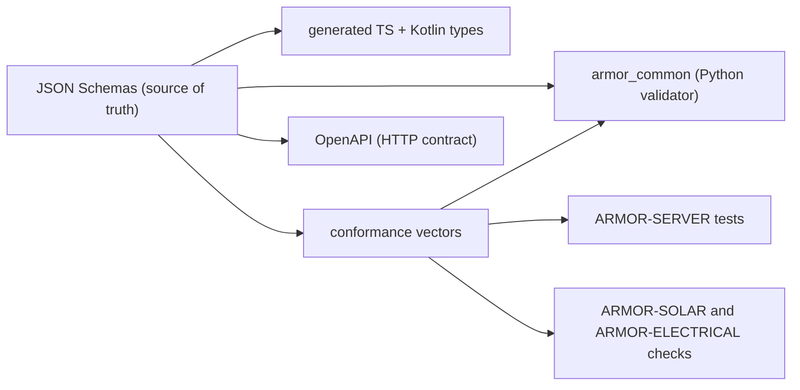

<p align="center">
  
</p>

# 🧾 ARMOR-COMMON

<p align="center">
  <a href="README.md">🇺🇸 English</a> |
  <a href="README_spa.md">🇪🇸 Español</a> |
  <a href="README_fra.md">🇫🇷 Français</a> |
  <a href="README_ita.md">🇮🇹 Italiano</a> |
  <a href="README_deu.md">🇩🇪 Deutsch</a> |
  🇨🇳 <b>简体中文</b> |
  <a href="README_jpn.md">🇯🇵 日本語</a> |
  <a href="README_por.md">🇵🇹 Português</a>
</p>

### 消息契约、验证、各节点共用的固件基础和共享的项目启动器

<p align="center">
  
  
  
  
  
  
</p>

---

**诚实性检查 - 今天真正能运行的部分:** 各模式（遥测、健康、命令、节点信息、太阳能逆变器和电池、电气、带命令和结果的报警、网络）、Python 验证器、527 个一致性向量、生成的 TypeScript 和 Kotlin 类型、服务器的 OpenAPI 文件（136 个路径）、五个节点共用的固件基础以及共享的项目启动器都是真实的并经过测试（79 个测试）。Kotlin 文件已生成，但 ARMOR-ANDROID-CONTROL **尚未使用**（它保留自己的解析），`set_thresholds` 命令只带一个 `sensitivity` 字段，因为真实的雷达参数要等固件存在才能确定。

---

## 📋 速览

| | |
|---|---|
| 版本 | `0.5.9` |
| 成熟度 | 成熟 |
| 测试 | 79 (`python -m unittest discover -s tests`) and 527 conformance vectors |
| 技术栈 | Python 3.11+ / JSON Schema / OpenAPI |
| 真实硬件 | 只有雷达节点在电路板上运行过：它的消息就是 CM5 服务器、Studio 和 Android 应用每天使用的消息；其他节点的消息对照替身检查 |

## 🎯 概述

**ARMOR-COMMON** 掌管每条 A.R.M.O.R. 消息的含义。雷达节点、太阳能网关节点和模拟器产生这些消息；服务器、视觉 AI 和语音服务消费它们。如果两个项目对某个字段有分歧，由本仓库裁决。

* **唯一的事实来源：**`src/armor_common/schemas/` 中的 JSON Schema，涵盖遥测、健康、命令、节点信息、两种太阳能消息（逆变器、含电芯和容量的电池）、电气消息（读数、命令、结果）、报警消息（状态、命令、结果）和网络消息。未知字段和不可能的组合会被拒绝。
* **无法跳过规则的验证器：**它直接解释模式，并拒绝使用了它未实现的关键字的模式。
* **一致性向量：**527 个被接受和被拒绝的负载，由每个实现运行（这里是 Python，ARMOR-SERVER 中是 TypeScript，以及固件仓库的检查），因此偏差会让构建失败。
* **生成的客户端：**TypeScript 和 Kotlin 类型来自模式（`tools/generate_types.py --check` 保持其最新）。
* **HTTP 契约：**`openapi/armor-server.yaml` 描述服务器的每条路由（136 个路径）、其访问规则和模式，ARMOR-SERVER 有测试确保没有遗漏。
* **固件基础：**`firmware_base/` 把五个节点共用的每个文件只保存一次（网络、设置和用户、网页面板服务器和登录、HTTPS 证书、日志、带 PIN 配对的蓝牙、签名更新检查；继电器和 Zigbee 仅限具备它们的节点）；`tools/sync_firmware_base.py` 把它写入每个节点并检查没有副本偏离（[指南](docs/FIRMWARE_BASE.md)，[签名固件](docs/SIGNED_FIRMWARE.md)）。
* **共享启动器：**`tools/armor_project_tool.py` 为家族的每个仓库提供相同的 `build`、`build-test` 和 `run` 流程，`tools/armor_ci_validate.py` 提供相同的 CI 检查。

## 🧩 在 A.R.M.O.R. 中的角色

ARMOR-COMMON 让整个家族说同一种语言。节点与 [ARMOR-SERVER](https://github.com/JuanenRac/ARMOR-SERVER) 之间的每条消息都在这里只定义一次，并带有每个实现都必须通过的向量；服务器的 HTTP 契约也在这里；五个节点共用的固件（[ARMOR-RADAR](https://github.com/JuanenRac/ARMOR-RADAR)、[ARMOR-SOLAR](https://github.com/JuanenRac/ARMOR-SOLAR)、[ARMOR-ELECTRICAL](https://github.com/JuanenRac/ARMOR-ELECTRICAL)、[ARMOR-ALARM](https://github.com/JuanenRac/ARMOR-ALARM)、[ARMOR-HMI](https://github.com/JuanenRac/ARMOR-HMI)）只保存一份，由工具复制进去。它不保存任何密钥，也不在生产中运行任何东西。

## 🔄 架构



## 📂 仓库结构

```text
ARMOR-COMMON/
├── src/armor_common/   contracts, schema (validator), envelope, schemas/*.json (the node messages, the alarm, electrical and network ones, the relay, zone-feed, alert and orders ones)
├── conformance/        accepted and rejected payloads shared by every implementation
├── firmware_base/      the firmware that the five nodes share, once (synced into each by tools/sync_firmware_base.py)
├── generated/          TypeScript and Kotlin types (generated, do not edit)
├── openapi/            armor-server.yaml
├── tools/              armor_project_tool.py, generate_types.py, make_conformance.py, sync_firmware_base.py, release_firmware.py, firmware_sign.mjs
├── tests/              unit tests and conformance runner
└── docs/               contracts guide, the shared firmware base
```

## 🛠️ 开发环境

**环境要求:** Python 3.11+

```powershell
python -m pip install -e .
python -m unittest discover -s tests      # 79 tests, 527 conformance vectors
python tools/generate_types.py --check    # generated types are current
python tools/make_conformance.py          # regenerate the vectors after editing the case list (--check: they are current)
python tools/sync_firmware_base.py check  # the firmware the node projects share has not drifted (see docs/FIRMWARE_BASE.md)
```

代理主题：`armor/node/{node_id}/telemetry | health | command | info`、`armor/solar/{node_id}/{device}/state`、`armor/electrical/{node_id}/state | command | result`、`armor/alarm/{node_id}/state | command | result` 和 `armor/network/{node_id}/state`。参见[契约指南](docs/CONTRACTS.md)。共享启动器在 ARMOR-SERVER 首次运行时创建被忽略的 `.env`，其中有随机密钥和随机管理员密码；不会打印或提交任何内容。

## 🔗 相关项目

**A.R.M.O.R.**（Autonomous Radar & Multimodal Observation Range）是由若干独立仓库组成的周界安防系统。每个仓库都有自己的版本、测试和 README；家族成员如下：

* **ARMOR-COMMON** (本仓库) - 消息契约、验证器、一致性向量和生成的类型
* **[ARMOR-RADAR](https://github.com/JuanenRac/ARMOR-RADAR)** - 适用于 ESP32-S3 的现场节点固件，带三个雷达和自带网页面板
* **[ARMOR-SOLAR](https://github.com/JuanenRac/ARMOR-SOLAR)** - 太阳能逆变器与电池的协议，以及网关节点的消息
* **[ARMOR-ELECTRICAL](https://github.com/JuanenRac/ARMOR-ELECTRICAL)** - 电气节点：电表、电网读数消息和开关规则
* **[ARMOR-ALARM](https://github.com/JuanenRac/ARMOR-ALARM)** - 报警节点与报警主机：防区、布防、延时、警笛和 PIN，有无服务器均可
* **[ARMOR-HMI](https://github.com/JuanenRac/ARMOR-HMI)** - 触摸面板：墙面屏幕上的系统状态、布防与确认，以及语音助手的所在
* **[ARMOR-NETWORK](https://github.com/JuanenRac/ARMOR-NETWORK)** - 本地网络：其设备、互联网以及变化
* **[ARMOR-SERVER](https://github.com/JuanenRac/ARMOR-SERVER)** - 中央协调器：遥测、报警、设备、太阳能读数和摄像头
* **[ARMOR-STUDIO](https://github.com/JuanenRac/ARMOR-STUDIO)** - 网页控制台：摄像头、雷达、报警、太阳能和 2D/3D 场地设计器
* **[ARMOR-ANDROID-CONTROL](https://github.com/JuanenRac/ARMOR-ANDROID-CONTROL)** - 带实时 2D/3D 雷达的 Android 操作员客户端
* **[ARMOR-SERVER-AI](https://github.com/JuanenRac/ARMOR-SERVER-AI)** - 会解释决策且从不执行动作的视觉推理策略
* **[ARMOR-VISION](https://github.com/JuanenRac/ARMOR-VISION)** - Jetson Orin NX 上的摄像头区域、遮罩与检测规则
* **[ARMOR-VOICE-AI](https://github.com/JuanenRac/ARMOR-VOICE-AI)** - 带无法伪造确认的离线语音意图
* **[ARMOR-HARDWARE](https://github.com/JuanenRac/ARMOR-HARDWARE)** - 外壳、电子器件和台架验收矩阵
* **[ARMOR-DEVOPS](https://github.com/JuanenRac/ARMOR-DEVOPS)** - 部署、CM5 测试台、备份与 TLS
* **[ARMOR-SIMULATOR](https://github.com/JuanenRac/ARMOR-SIMULATOR)** - 带可重复故障的离线遥测模拟器
* **[ARMOR-UPDATER](https://github.com/JuanenRac/ARMOR-UPDATER)** - 发现、安装并更新生态系统自身的仓库
* **[ARMOR-DOCS](https://github.com/JuanenRac/ARMOR-DOCS)** - 架构、安全基线和能力矩阵

## 📚 文档与社区

更多阅读：

* [能力矩阵：哪些已被证实，哪些没有](https://github.com/JuanenRac/ARMOR-DOCS/blob/main/docs/CAPABILITY_MATRIX.md)
* [项目目录：版本以及各仓库之间的依赖](https://github.com/JuanenRac/ARMOR-DOCS/blob/main/docs/PROJECT_CATALOG.md)
* [本仓库的变更记录](CHANGELOG.md)
* [许可证（GPL-3.0-or-later）](LICENSE)
* 问题、想法与反馈：electrohobby3d@gmail.com

## 👤 作者

**JuanenRac (Electro Hobby 3D)** · electrohobby3d@gmail.com

## 📜 许可证

GPL-3.0-or-later - 见 [LICENSE](LICENSE)。
